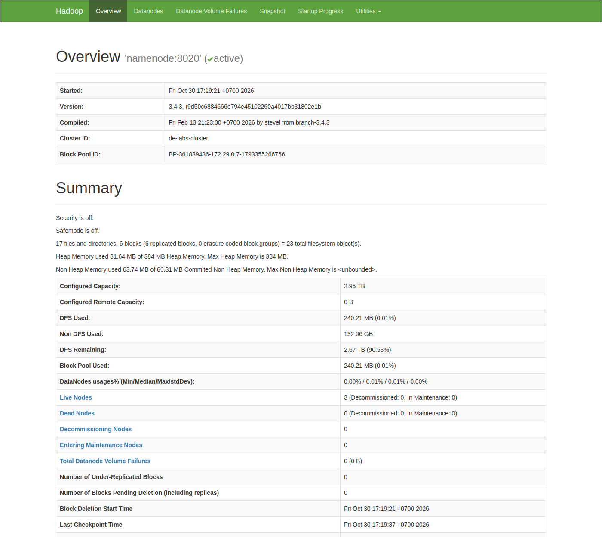
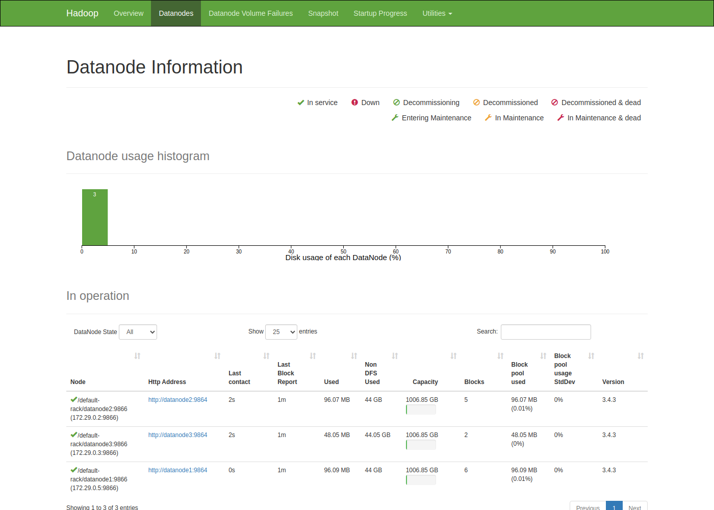
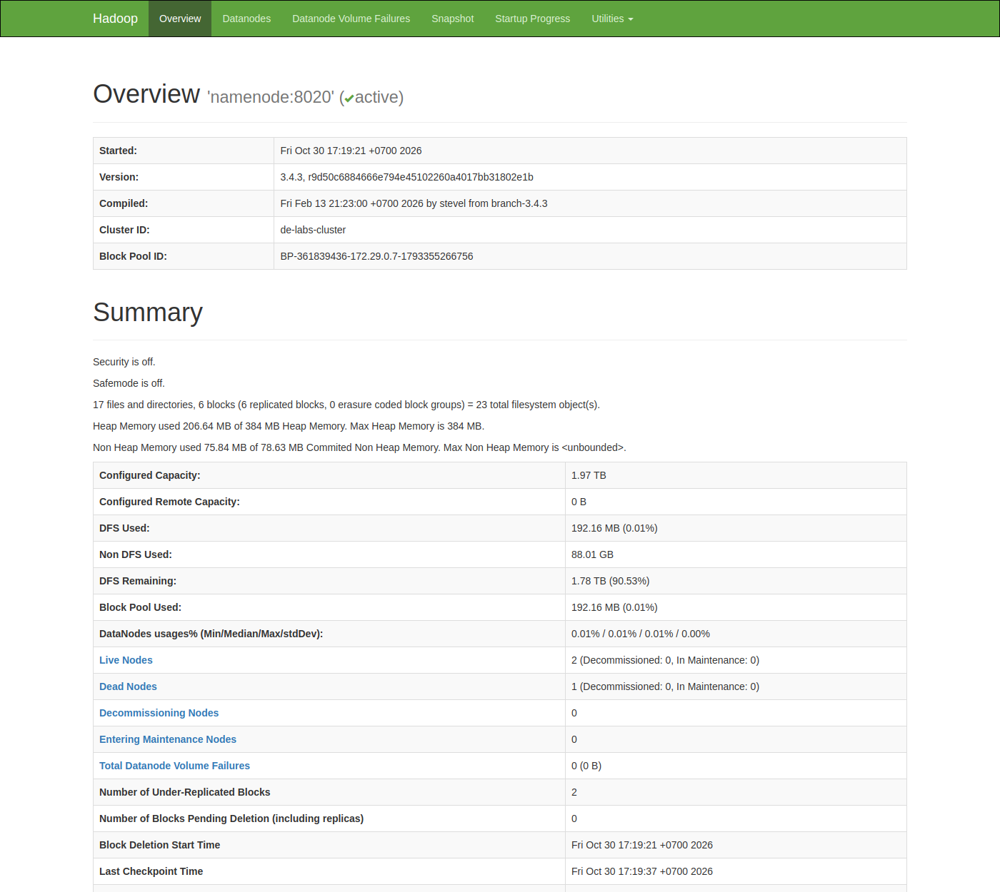
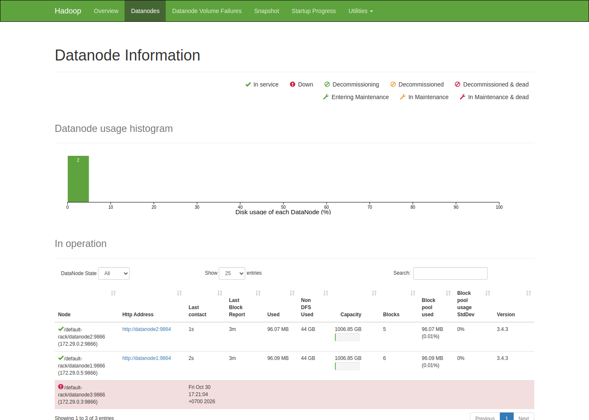
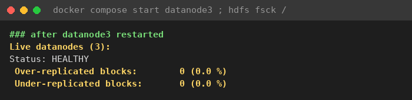
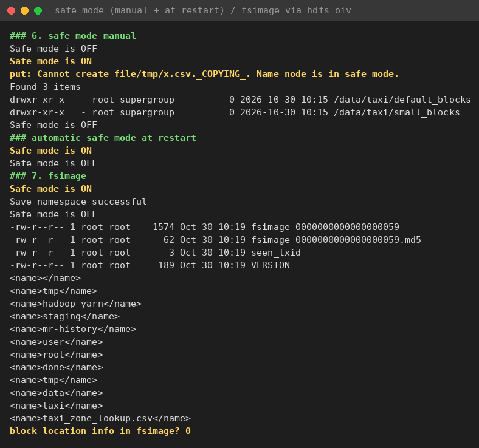

# HDFS: tổ chức block, nhân bản và khả năng chịu lỗi DataNode {#sec:l01}

## Tóm tắt {.unnumbered}

Bài thực hành khảo sát ba cơ chế của *Hadoop Distributed File System* (HDFS): chia tệp thành block, nhân bản block
lên nhiều DataNode và phản ứng của hệ thống khi một DataNode ngừng hoạt động. Cluster Hadoop 3.4.3 gồm 1 NameNode và
3 DataNode chạy bằng Docker Compose; dữ liệu là tệp NYC Yellow Taxi tháng 01/2024 (49,961,641 byte). Cùng một tệp được
lưu thành 1 block với block mặc định 128 MB và thành 3 block với block 16 MB, block cuối không bị đệm. Hạ hệ số nhân
bản từ 3 xuống 2 làm dung lượng thô giảm từ 142.9 M xuống 95.3 M. Khi dừng datanode3, NameNode tuyên bố node chết sau
**90 s**, đúng như công thức tính từ cấu hình. Tệp hệ số 2 được tái nhân bản sang datanode2, còn hai tệp hệ số 3 vẫn
under-replicated nhưng `Status: HEALTHY` và md5 trùng khớp. Ngoài ra, fsimage không lưu vị trí block, và đây là lý do
NameNode cần safe mode khi khởi động.

**Từ khóa:** HDFS, block, replication, DataNode, heartbeat, under-replication, safe mode, fsimage.

## Giới thiệu {#sec:l01-intro}

HDFS được thiết kế để lưu tệp rất lớn trên nhiều máy thông thường, trong đó hỏng phần cứng được coi là chuyện
thường ngày [1], [2]. Hệ thống tách siêu dữ liệu (NameNode quản lý) khỏi dữ liệu (DataNode lưu dưới dạng block) và
nhân bản mỗi block lên nhiều node. Các bài sau dùng MapReduce chạy trên HDFS, nên cần nắm các cơ chế này trước.

Mục tiêu của L01:

1. Khởi động cluster HDFS nhiều node bằng Docker Compose, đọc trạng thái qua CLI và giao diện web NameNode.
2. Dùng bộ lệnh `hdfs dfs` (mkdir, put, ls, du, cat, get, mv, rm, stat).
3. Dùng `hdfs fsck -files -blocks -locations` để chỉ ra cách một tệp được chia thành block và replica.
4. Thay đổi hệ số nhân bản bằng `setrep` và kích thước block lúc ghi bằng `-D dfs.blocksize`.
5. Dừng một DataNode, quan sát NameNode phát hiện sự cố, báo block under-replicated và tự tái nhân bản.
6. Dùng safe mode và kiểm tra nội dung fsimage.

@sec:l01-theory tóm lược lý thuyết, @sec:l01-method mô tả môi trường và quy trình, @sec:l01-results trình bày kết
quả, @sec:l01-discussion trả lời tám câu hỏi checkpoint và @sec:l01-conclusion kết luận.

## Cơ sở lý thuyết {#sec:l01-theory}

### Kiến trúc NameNode và DataNode

HDFS theo kiến trúc chủ tớ kế thừa từ Google File System [1], [2]. NameNode giữ toàn bộ *namespace* (cây thư mục,
tên tệp, quyền, danh sách block ID của từng tệp) trong bộ nhớ và ghi bền vững vào *fsimage* (ảnh chụp namespace) cùng
*edit log* (nhật ký thay đổi). DataNode lưu dữ liệu thật dưới dạng tệp Linux thông thường. Khi ghi, client hỏi
NameNode danh sách DataNode đích rồi đẩy dữ liệu theo pipeline từ DataNode thứ nhất sang thứ hai, thứ ba. Dữ liệu tệp
không bao giờ đi qua NameNode [3].

### Block và replica

Mỗi tệp được cắt thành các block có kích thước tối đa `dfs.blocksize` (mặc định 128 MB). Khác với block của hệ thống
tệp cục bộ, đây chỉ là giới hạn trên: block cuối chỉ lớn bằng phần dữ liệu còn lại [3], [5]. Mỗi block có
`dfs.replication` replica, mặc định 3. Trên đĩa DataNode, một replica gồm tệp `blk_<id>` chứa dữ liệu và tệp
`blk_<id>_<genstamp>.meta` chứa checksum. Hệ số nhân bản và kích thước block do client quyết định cho từng tệp;
`hdfs-site.xml` chỉ cho giá trị mặc định [4].

### Heartbeat, node stale và node dead

DataNode gửi *heartbeat* tới NameNode mỗi `dfs.heartbeat.interval` (3 s) và định kỳ gửi *block report* (danh sách
block đang giữ). Node im lặng quá `dfs.namenode.stale.datanode.interval` bị coi là *stale*, client sẽ tránh node này.
Node bị coi là *dead* sau

$$T_{dead} = 2 \times \text{recheck-interval} + 10 \times \text{heartbeat-interval}.$$

Với recheck-interval mặc định 5 phút, $T_{dead} = 2 \times 300 + 10 \times 3 = 630$ s, tức 10.5 phút [7].

### Under-replication và tái nhân bản

Khi một node chết, NameNode gỡ các replica của node đó khỏi *block map* (bảng ánh xạ block sang DataNode). Block có
số replica sống nhỏ hơn hệ số đích trở thành under-replicated và được xếp hàng sao chép từ một replica còn sống sang
DataNode chưa có bản sao của block đó; HDFS không đặt hai replica của cùng block trên một DataNode [3]. Tệp vẫn
`HEALTHY` khi mọi block còn ít nhất `dfs.namenode.replication.min` (= 1) replica sống. Mất dữ liệu chỉ ứng với trạng
thái MISSING hoặc CORRUPT.

### Safe mode và fsimage

Vị trí block không có trong fsimage hay edit log, nó chỉ nằm trong RAM của NameNode và được dựng lại từ block report
sau mỗi lần khởi động [2], [3]. Trong lúc đó NameNode ở safe mode (chỉ đọc) cho tới khi tỉ lệ block đã được báo cáo
đạt `dfs.namenode.safemode.threshold-pct` (99.9 %), cộng thêm khoảng chờ `dfs.namenode.safemode.extension`.
Kleppmann [6] bàn rộng hơn về đánh đổi giữa nhân bản, độ bền và chi phí phục hồi trong hệ phân tán.

## Môi trường và phương pháp thực nghiệm {#sec:l01-method}

### Môi trường

Cluster chạy trên một máy, các thành phần Hadoop là container dùng chung image `de-labs/hadoop:3.4.3`
(@tbl:l01-env). Chúng tôi rút `recheck-interval` xuống 30 s (mặc định 5 phút) để thấy được sự cố DataNode trong
khoảng 90 s thay vì phải chờ hơn 10 phút, và rút `safemode.extension` xuống 5 s.

| Thành phần | Giá trị |
|---|---|
| Máy chủ | WSL2, x86_64, 12 CPU, bộ nhớ Docker 31.9 GB |
| Phần mềm | Hadoop 3.4.3 (image `de-labs/hadoop:3.4.3`), Docker Compose |
| Dịch vụ | 1 NameNode, 3 DataNode, ResourceManager, NodeManager, JobHistory |
| Topology | 1 rack (`/default-rack`) |
| `dfs.replication` | 3 |
| `dfs.blocksize` | 134,217,728 byte (128 MB, mặc định) |
| `dfs.heartbeat.interval` | 3 s |
| `dfs.namenode.heartbeat.recheck-interval` | 30,000 ms (mặc định 300,000 ms) |
| `dfs.namenode.stale.datanode.interval` | 15,000 ms (mặc định 30,000 ms) |
| `dfs.namenode.redundancy.interval.seconds` | 3 s |
| `dfs.namenode.safemode.extension` | 5,000 ms (mặc định 30,000 ms) |
| `dfs.permissions.enabled` | false (chỉ dùng cho môi trường học tập) |

: Phần cứng, phần mềm và cấu hình HDFS dùng trong thực nghiệm. {#tbl:l01-env}

`fsck` in vị trí replica theo IP, nên chúng tôi ghi lại ánh xạ IP sang hostname từ `hdfs dfsadmin -report` ngay sau
khi khởi động (@tbl:l01-ip). Block Pool ID `BP-361839436-172.29.0.7-1793355266756` cho biết NameNode ở 172.29.0.7.

| Địa chỉ IP | Hostname |
|---|---|
| 172.29.0.5 | datanode1 |
| 172.29.0.2 | datanode2 |
| 172.29.0.3 | datanode3 |

: Ánh xạ địa chỉ IP sang hostname của các DataNode. {#tbl:l01-ip}

### Dữ liệu

Hai tệp NYC Taxi được đọc từ thư mục `/datasets` bind mount vào container: `taxi_zone_lookup.csv` (12,331 byte,
70 dòng chứa `Manhattan`) và `yellow_tripdata_2024-01.parquet` (49,961,641 byte, `hdfs dfs -du -h` hiển thị 47.6 M).

### Quy trình

Mọi lệnh chạy trong container `namenode`, đóng vai trò edge node, trừ lệnh `docker compose` chạy trên host:

1. Khởi động cluster, chờ đủ 3 DataNode đăng ký, mở giao diện web NameNode ở cổng 9870.
2. Thao tác `hdfs dfs`: tạo thư mục, tải `taxi_zone_lookup.csv` lên `/data/taxi`, đọc, sao chép, đổi tên, tải về,
   xóa, đo dung lượng; in thuộc tính tệp bằng `hdfs dfs -stat`.
3. Tải tệp Parquet hai lần: block mặc định vào `/data/taxi/default_blocks` và `-D dfs.blocksize=16m` vào
   `/data/taxi/small_blocks`; so sánh bằng `fsck` và liệt kê tệp block vật lý trên datanode1.
4. Hạ hệ số của tệp `small_blocks` bằng `hdfs dfs -setrep -w 2`; ghi thêm một tệp với hệ số 1 trong một lệnh.
5. Chạy `fsck` tệp `small_blocks`, dừng `datanode3` bằng `docker compose stop`, thăm dò `hdfs dfsadmin -report`
   khoảng 8 s một lần; chạy lại `fsck`, kiểm tra md5 của tệp hệ số 3; khởi động lại datanode3.
6. Bật, tắt safe mode thủ công, thử ghi và đọc; khởi động lại NameNode để xem safe mode tự động.
7. `saveNamespace`, chuyển fsimage sang XML bằng `hdfs oiv` và tìm thông tin vị trí block trong đó.

Đầu ra lưu trong các tệp `0*.txt` (Phụ lục A), ảnh chụp màn hình trong `img/`.

## Kết quả thực nghiệm {#sec:l01-results}

### Khởi động cluster và bộ lệnh `hdfs dfs`

`hdfs dfsadmin -report` ghi nhận `Live datanodes (3)`, safe mode OFF. Các lệnh `hdfs dfs` đều chạy được
(@fig:l01-shell). `taxi_zone_lookup.csv` có hệ số 3 (cột thứ hai của `ls`), `cat` kết hợp `grep -c` đếm được 70 dòng
Manhattan, bản tải về `/tmp/zones_copy.csv` đúng 12,331 byte. `du -h` in 12.0 K dung lượng logic và 36.1 K dung lượng
thô, gấp ba do nhân bản. `hdfs dfs -stat` trả về `blocksize=134217728 repl=3 size=12331`: tệp 12 KB vẫn được gán
block size 128 MB.

{#fig:l01-shell width=85%}

Trên giao diện web, trang Overview báo NameNode `active`, phiên bản 3.4.3, safe mode tắt, 3 node sống, 0 node chết,
0 block under-replicated (@fig:l01-ui-overview). Trang Datanodes liệt kê cả ba node ở trạng thái In service
(@fig:l01-ui-datanodes). Trang Browse Directory cho thấy `/data/taxi` gồm `default_blocks`, `small_blocks` và
`taxi_zone_lookup.csv` với Replication 3, Block Size 128 MB (@fig:l01-ui-browse).

{#fig:l01-ui-overview width=100%}

{#fig:l01-ui-datanodes width=100%}

{#fig:l01-ui-browse width=100%}

### Ảnh hưởng của kích thước block

Tệp Parquet được tải lên hai lần. `hdfs dfs -stat` cho bản thứ nhất `blocksize=134217728`, bản thứ hai
`blocksize=16777216`, cả hai `repl=3`. Kết quả `fsck` ở @tbl:l01-blocks và @fig:l01-blocks.

| Cách tải lên | Block size (byte) | Số block | Kích thước từng block (byte) |
|---|---|---|---|
| Mặc định | 134,217,728 | 1 | 49,961,641 |
| `-D dfs.blocksize=16m` | 16,777,216 | 3 | 16,777,216 + 16,777,216 + 16,407,209 |

: Số block của cùng một tệp khi dùng block 128 MB và 16 MB. {#tbl:l01-blocks}

{#fig:l01-blocks width=85%}

Ở lần chạy `fsck` đầu tiên trên `small_blocks` (10:15:21, ngay sau khi ghi), chúng tôi thấy hai block
`blk_1073741829` và `blk_1073741830` chỉ có `Live_repl=2`, kèm `Under-replicated blocks: 2 (66.666664 %)` và
`Missing replicas: 2 (22.222221 %)`, dù trạng thái vẫn `HEALTHY`. Lúc đầu chúng tôi nghĩ việc ghi bị lỗi, nhưng lần
`fsck` tiếp theo (đầu tệp `02_setrep.txt`) đã cho cả ba block `Live_repl=3` và `Under-replicated blocks: 0`. Lý do là
NameNode chỉ cập nhật vị trí replica khi DataNode báo về, nên sau khi ghi có một khoảng trễ ngắn.

Trên datanode1, mỗi block là một tệp `blk_<id>` kèm tệp `.meta` (@fig:l01-physical, @tbl:l01-physical). Tệp
`blk_1073741830` chỉ có 16,407,209 byte, không bị đệm lên 16 MB. Tệp `.meta` 131,079 byte của block 16,777,216 byte
khớp với 4 byte CRC cho mỗi 512 byte dữ liệu ($16{,}777{,}216 / 512 \times 4 = 131{,}072$) cộng 7 byte header, tức
chi phí checksum khoảng 0.78 %.

| Tệp block | Dữ liệu (byte) | `.meta` (byte) | Thuộc tệp |
|---|---|---|---|
| `blk_1073741825` | 12,331 | 107 | `taxi_zone_lookup.csv` |
| `blk_1073741827` | 49,961,641 | 390,335 | `default_blocks/...parquet` |
| `blk_1073741828` | 16,777,216 | 131,079 | `small_blocks/...parquet`, block 0 |
| `blk_1073741829` | 16,777,216 | 131,079 | `small_blocks/...parquet`, block 1 |
| `blk_1073741830` | 16,407,209 | 128,191 | `small_blocks/...parquet`, block 2 |

: Các tệp block vật lý trên datanode1 và tệp checksum đi kèm. {#tbl:l01-physical}

{#fig:l01-physical width=85%}

### Thay đổi hệ số nhân bản

`hdfs dfs -setrep -w 2` trên tệp `small_blocks` in cảnh báo rằng việc giảm hệ số có thể phải chờ lâu, nhưng thực tế
kết thúc gần như ngay (`. done`). Sau đó `ls` hiển thị hệ số 2 và `fsck` cho `Live_repl=2` ở cả ba block. Dung lượng
thô của `small_blocks` giảm đúng một phần ba so với bản `default_blocks` còn hệ số 3 (@tbl:l01-du).

| Đường dẫn | Hệ số | Dung lượng logic | Dung lượng thô |
|---|---|---|---|
| `/data/taxi/default_blocks` | 3 | 47.6 M | 142.9 M |
| `/data/taxi/small_blocks` | 2 | 47.6 M | 95.3 M |
| `/data/taxi/taxi_zone_lookup.csv` | 3 | 12.0 K | 36.1 K |

: Dung lượng logic và dung lượng thô theo `hdfs dfs -du -h` sau khi `setrep 2`. {#tbl:l01-du}

Để ghi tệp với một replica mà không cần `setrep`, chỉ cần ghi đè `-D dfs.replication=1` ngay trong lệnh `put`. Kết
quả là `one_replica.csv repl=1`, block duy nhất `blk_1073741831` (12,331 byte, `Live_repl=1`) nằm trên 172.29.0.5,
tức datanode1 (@fig:l01-setrep).

{#fig:l01-setrep width=85%}

### Sự cố DataNode và tái nhân bản

Ngay trước khi dừng node (10:15:58), cả ba block của `small_blocks` đều có replica trên datanode1 và datanode3,
không block nào nằm trên datanode2 (@fig:l01-before, cột "Trước sự cố" của @tbl:l01-locations). Vì vậy chúng tôi chọn
dừng datanode3: node này giữ replica của mọi block thuộc tệp hệ số 2.

{#fig:l01-before width=85%}

Datanode3 bị dừng lúc 10:16:06 UTC. Diễn biến theo kết quả thăm dò ở @tbl:l01-timeline và @fig:l01-timeline.

| Thời điểm | Sự kiện |
|---|---|
| t+0 s (10:16:06) | `docker compose stop datanode3` |
| t+1 s đến t+82 s | `Live datanodes (3)`, `Under replicated blocks: 0` (11 lần thăm dò) |
| t+90 s | `Live datanodes (2)`, `Dead datanodes (1)`: node bị tuyên bố chết |
| t+94 s (10:17:40,079) | Log NameNode: `removeDeadDatanode: lost heartbeat from 172.29.0.3:9866` |
| t+98 s đến t+137 s | `Under replicated blocks: 2` ổn định qua 6 lần thăm dò |

: Diễn biến sau khi dừng datanode3 theo `dfsadmin -report` và log NameNode. {#tbl:l01-timeline}

{#fig:l01-timeline width=85%}

Con số 90 s khớp với công thức ở @sec:l01-theory: $2 \times 30 + 10 \times 3 = 90$ s. Replica bị gỡ khỏi block map
muộn hơn 4 s vì bộ giám sát heartbeat chỉ chạy theo chu kỳ recheck-interval, và phải sau mốc này chỉ số
under-replicated mới tăng. Có một điểm lúc đầu chúng tôi thấy lạ: ba block của tệp hệ số 2 cũng mất một replica,
nhưng không lần thăm dò nào ghi nhận quá 2 block under-replicated. Cách giải thích hợp lý là ba block đó đã được tái
nhân bản trong khoảng giữa t+94 s và t+98 s, nhanh hơn chu kỳ thăm dò. Giá trị 2 còn lại là hai block của các tệp
hệ số 3 (@tbl:l01-underrep).

Trên giao diện web, trang Overview hiện một Dead Node (@fig:l01-ui-dead-overview) và trang Datanodes đánh dấu datanode3
màu đỏ kèm thời điểm liên lạc cuối (@fig:l01-ui-dead-datanodes). Lần đo chính chúng tôi không kịp chụp giao diện,
nên hai ảnh này được chụp ở một lần dừng datanode3 khác. Mốc "Last contact" 17:21:04 +0700 (10:21:04 UTC) muộn hơn
dòng thời gian trong log, và hai ảnh không thuộc lần đo ở @tbl:l01-timeline.

{#fig:l01-ui-dead-overview width=100%}

{#fig:l01-ui-dead-datanodes width=100%}

`fsck` lúc 10:18:38 cho thấy `small_blocks` đã trở lại `OK`: `Number of data-nodes: 2`, cả ba block `Live_repl=2`,
`Under-replicated blocks: 0` (@fig:l01-after). Replica trên datanode3 đã được chép sang datanode2, node còn sống duy
nhất chưa giữ bản sao (@tbl:l01-locations).

| Block | Kích thước (byte) | Trước sự cố | Sau sự cố |
|---|---|---|---|
| `blk_1073741828` | 16,777,216 | datanode1, datanode3 | datanode1, datanode2 |
| `blk_1073741829` | 16,777,216 | datanode3, datanode1 | datanode1, datanode2 |
| `blk_1073741830` | 16,407,209 | datanode3, datanode1 | datanode1, datanode2 |

: Vị trí replica của tệp `small_blocks` (hệ số 2) trước và sau khi dừng datanode3. {#tbl:l01-locations}

{#fig:l01-after width=85%}

Với toàn bộ `/data`, `fsck` báo **`Under-replicated blocks: 2 (40.0 %)`** (2 trên 5 block) và `Status: HEALTHY`
(@fig:l01-underrep). Hai block này thuộc hai tệp hệ số 3, mỗi block còn 2 replica trên datanode2 và datanode1
(@tbl:l01-underrep). Tệp Parquet hệ số 3 tải về có md5 `10dff36f5a2fc325274438bf361c70f0`, trùng với bản gốc. Tệp
`/tmp/one_replica.csv` không bị MISSING vì replica duy nhất của nó nằm trên datanode1.

| Tệp | Hệ số đích | Block | `Live_repl` | Trạng thái |
|---|---|---|---|---|
| `default_blocks/...parquet` | 3 | `blk_1073741827` | 2 | Under replicated |
| `small_blocks/...parquet` | 2 | 3 block | 2 | OK |
| `taxi_zone_lookup.csv` | 3 | `blk_1073741825` | 2 | Under replicated |

: Trạng thái các tệp trong `/data` khi chỉ còn 2 DataNode sống. {#tbl:l01-underrep}

{#fig:l01-underrep width=85%}

Khởi động lại datanode3, `dfsadmin -report` trở về `Live datanodes (3)` và `fsck` báo `Under-replicated blocks: 0`,
`Over-replicated blocks: 0`, `Status: HEALTHY` (@fig:l01-back). Các block hệ số 3 đã có lại replica thứ ba. Tệp hệ số
2 lúc này có replica trên cả ba node, và NameNode đã xóa bớt bản thừa.

{#fig:l01-back width=70%}

### Safe mode và fsimage

Khi bật safe mode thủ công, lệnh ghi bị từ chối với thông báo
`put: Cannot create file/tmp/x.csv._COPYING_. Name node is in safe mode.`, còn `hdfs dfs -ls /data/taxi` vẫn trả về
3 mục (@fig:l01-safemode). Sau `docker compose restart namenode`, `-safemode get` báo `Safe mode is ON` trong vài
giây đầu rồi chuyển sang OFF khi đã nhận đủ block report.

`saveNamespace` tạo `fsimage_0000000000000000059` dung lượng 1,574 byte (kèm `.md5` 62 byte, `seen_txid` 3 byte,
`VERSION` 189 byte). Bản XML do `hdfs oiv` sinh ra có tên thư mục và tệp (`tmp`, `hadoop-yarn`, `user`, `root`,
`data`, `taxi`, `taxi_zone_lookup.csv`, ...) cùng block ID, nhưng tìm thông tin DataNode (cổng 9866) thì được 0 dòng.
fsimage không chứa vị trí block.

{#fig:l01-safemode width=85%}

## Thảo luận {#sec:l01-discussion}

### Tệp 300 MB với cấu hình mặc định chiếm bao nhiêu block, replica và dung lượng? {#sec:l01-q1}

Số block là $\lceil 300/128 \rceil = 3$: hai block 128 MB và một block cuối 44 MB. Với hệ số 3 có $3 \times 3 = 9$
replica và khoảng $3 \times 300 = 900$ MB dung lượng thô, cộng thêm tệp `.meta` khoảng 0.78 % (@tbl:l01-physical).
Block cuối không chiếm trọn 128 MB, giống block 16,407,209 byte ở @tbl:l01-blocks, và phép nhân ba dung lượng khớp
với số đo ở @tbl:l01-du. NameNode chỉ giữ 3 đối tượng block trong RAM, không phụ thuộc hệ số nhân bản.

### Vì sao block cuối của tệp taxi nhỏ hơn 16 MB, và có tốn 16 MB đĩa không? {#sec:l01-q2}

Vì tệp kết thúc ở đó: $49{,}961{,}641 - 2 \times 16{,}777{,}216 = 16{,}407{,}209$ byte. Tệp `blk_1073741830` trên
datanode1 đúng bằng kích thước này (@fig:l01-physical), nên không có phần đĩa nào bị bỏ phí. Block của hệ thống tệp
cục bộ (ví dụ 4 KB) thì khác, nó được cấp phát trọn và phần thừa bị bỏ trống. Tệp 12,331 byte được gán block size
128 MB cũng chỉ chiếm 12,331 byte trên mỗi DataNode.

### Vị trí block được lưu ở đâu, và khi NameNode khởi động lại thì sao? {#sec:l01-q3}

Ánh xạ block sang DataNode chỉ nằm trong RAM của NameNode. Thực nghiệm ở @fig:l01-safemode cho thấy fsimage có tên tệp
và block ID nhưng không có thông tin DataNode nào. Khi khởi động lại, NameNode nạp namespace từ fsimage và edit log
rồi dựng lại block map từ block report, nên phải ở safe mode cho tới khi nhận đủ báo cáo. Thiết kế này hợp lý vì
DataNode mới biết chắc block nào đang nằm trên đĩa của nó. Trong lúc NameNode tắt, đĩa có thể hỏng hoặc node bị thay,
nên danh sách vị trí lưu sẵn sẽ nhanh chóng sai [1], [2]. Hiện tượng thiếu replica tạm thời ngay sau khi ghi
(@sec:l01-results) cũng cho thấy NameNode chỉ biết vị trí replica qua báo cáo của DataNode.

### Vì sao tệp hệ số 2 được phục hồi còn tệp hệ số 3 thì không? {#sec:l01-q4}

Muốn tái nhân bản phải có một DataNode còn sống chưa giữ replica của block, vì hai replica trên cùng node không tăng
khả năng chịu lỗi nên HDFS không cho phép. Sau khi datanode3 chết chỉ còn datanode1 và datanode2. Mỗi block của tệp
hệ số 2 ban đầu nằm trên datanode1 và datanode3 (@tbl:l01-locations), nên datanode2 nhận bản sao mới và tệp trở lại
`OK` (@fig:l01-after). Block của hai tệp hệ số 3 thì đã có mặt trên cả hai node còn lại (@tbl:l01-underrep), không
còn chỗ cho bản thứ ba, nên phải chờ datanode3 quay lại (@fig:l01-back). Số replica tối đa đạt được là
$\min(\text{hệ số đích}, \text{số DataNode sống})$.

### `fsck` báo gì khi có block under-replicated, và vì sao đó chưa phải lỗi? {#sec:l01-q5}

`fsck /data` vẫn báo `Status: HEALTHY` khi có 2 block under-replicated (@fig:l01-underrep). HEALTHY nghĩa là mọi block
còn ít nhất `dfs.namenode.replication.min` (= 1) replica sống, nên dữ liệu vẫn đọc được, và md5 trùng khớp ở
@sec:l01-results xác nhận điều này. Under-replication chỉ làm giảm độ dư thừa: hỏng thêm một node thì các block này còn
một bản. Lỗi thật là MISSING hoặc CORRUPT, khi block không còn replica hợp lệ nào. Nếu replica duy nhất của
`/tmp/one_replica.csv` nằm trên datanode3 thì tệp này đã bị báo MISSING; trong thực nghiệm nó may mắn nằm trên
datanode1.

### Nếu giữ `recheck-interval` mặc định 5 phút thì sao, và vì sao timeout dài lại tốt? {#sec:l01-q6}

Node sẽ bị tuyên bố chết sau $2 \times 5$ phút $+ 10 \times 3$ s $= 10.5$ phút thay vì 90 s như @tbl:l01-timeline.
Trong môi trường thật, timeout dài tránh được *replication storm* (bão tái nhân bản). Một node khởi động lại để vá lỗi
hoặc mất mạng một phút cũng có thể kéo theo việc sao chép hàng terabyte block, và khi node quay lại thì các bản sao đó
thành thừa. Băng thông và I/O đĩa bị tiêu tốn đúng lúc cluster đang không ổn định. Hai ngưỡng phục vụ hai việc khác
nhau. Ngưỡng stale ngắn (mặc định 30 s, trong lab 15 s) giúp client tránh node có dấu hiệu bất thường gần như ngay.
Ngưỡng dead dài chỉ quyết định lúc bắt đầu tái nhân bản, việc tốn kém nhất. Ngoài ra còn độ trễ tối đa một chu kỳ
recheck-interval trước khi replica bị gỡ khỏi block map, như 4 s đo được ở @tbl:l01-timeline.

### Vì sao NameNode khởi động trong safe mode và phải chặn ghi? {#sec:l01-q7}

Lúc khởi động, NameNode biết namespace nhưng chưa biết block nằm ở đâu (@sec:l01-q3). Khi chưa đủ 99.9 % block được
báo cáo, nó không phân biệt được block thật sự mất với block chỉ chưa kịp báo. Nếu cho ghi, xóa hay tái nhân bản lúc
này, NameNode có thể lên lịch sao chép hàng loạt block chưa được báo cáo hoặc xóa nhầm replica tưởng là thừa. Safe
mode giữ hệ thống ở chế độ chỉ đọc cho tới khi block map đáng tin, đúng như @fig:l01-safemode: ghi bị từ chối, đọc
vẫn chạy, trạng thái tự chuyển từ ON sang OFF sau khi khởi động lại.

### Vì sao 1 triệu tệp 1 KB là vấn đề, còn 1 tệp 1 KB thì không? {#sec:l01-q8}

Mỗi tệp, thư mục và block là một đối tượng trong heap NameNode, khoảng 150 byte mỗi đối tượng [5]. Một triệu tệp nhỏ
tạo ít nhất 2 triệu đối tượng (một inode và một block mỗi tệp), xấp xỉ 300 MB heap cho khoảng 1 GB dữ liệu. Khi ghi
còn có 1 triệu lời gọi RPC tới NameNode, và khi xử lý bằng MapReduce thì có 1 triệu map task vì mỗi tệp tạo ít nhất
một split. Đây là *small files problem*. Trong thực nghiệm, tệp 12,331 byte vẫn chiếm riêng một block ID và một
replica trên mỗi DataNode (@tbl:l01-physical). Cách xử lý thường dùng là gộp tệp nhỏ thành tệp lớn hoặc dùng định
dạng chứa như Parquet/ORC, SequenceFile, HAR.

### Hạn chế của thực nghiệm

Cluster chạy trên một máy với một rack, nên chính sách đặt replica theo rack chưa được kiểm chứng. Các tham số
`recheck-interval`, `stale.datanode.interval` và `safemode.extension` đã bị rút ngắn, nên thời gian đo không phản ánh
môi trường sản xuất. Vòng thăm dò `sleep 5` cộng thời gian chạy `dfsadmin -report` cho chu kỳ khoảng 8 s, vì vậy thời
điểm tái nhân bản xong chỉ xác định được trong khoảng t+94 s đến t+98 s. Dữ liệu chỉ khoảng 48 MB, chưa đủ để đánh
giá chi phí mạng của tái nhân bản ở quy mô lớn.

## Kết luận {#sec:l01-conclusion}

Block size là giới hạn trên: tệp 49,961,641 byte thành 1 hoặc 3 block tùy tham số phía client, block cuối không bị
đệm. Dung lượng thô tỉ lệ với hệ số nhân bản (@tbl:l01-du). Thời gian phát hiện node chết đúng bằng
$2 \times \text{recheck} + 10 \times \text{heartbeat}$, và NameNode tự tái nhân bản khi còn node hợp lệ. Block không
phục hồi được vẫn HEALTHY và đọc được. Vị trí block chỉ nằm trong bộ nhớ NameNode, nên cần safe mode khi khởi động.

Từ kết quả này, chúng tôi rút ra rằng dữ liệu quan trọng nên giữ hệ số ít nhất 3 trên cluster có nhiều DataNode hơn
hệ số đó thì mới tự phục hồi được khi một node hỏng. Hệ số 1 chỉ nên dùng cho dữ liệu tạm có thể tạo lại. Nên giữ
timeout phát hiện node chết dài như mặc định và tránh lưu nhiều tệp nhỏ. Hướng làm tiếp có thể là thử *erasure
coding* (ví dụ chính sách `XOR-2-1-1024k`) để so chi phí lưu trữ với nhân bản ba lần, so sánh decommission có kiểm
soát với sự cố đột ngột, chạy balancer sau khi thêm DataNode thứ tư, hoặc cố ý làm hỏng một tệp block để xem cơ chế
phát hiện lỗi checksum.

## Tài liệu tham khảo {.unnumbered}

[1] S. Ghemawat, H. Gobioff, and S.-T. Leung, "The Google File System," in *Proc. 19th ACM Symposium on Operating
Systems Principles (SOSP)*, 2003, pp. 29–43.

[2] K. Shvachko, H. Kuang, S. Radia, and R. Chansler, "The Hadoop Distributed File System," in *Proc. IEEE 26th
Symposium on Mass Storage Systems and Technologies (MSST)*, 2010, pp. 1–10.

[3] Apache Software Foundation, "HDFS Architecture," Apache Hadoop 3.4 Documentation.
https://hadoop.apache.org/docs/stable/hadoop-project-dist/hadoop-hdfs/HdfsDesign.html

[4] Apache Software Foundation, "HDFS Commands Guide," Apache Hadoop 3.4 Documentation.
https://hadoop.apache.org/docs/stable/hadoop-project-dist/hadoop-hdfs/HDFSCommands.html

[5] T. White, *Hadoop: The Definitive Guide*, 4th ed. Sebastopol, CA, USA: O'Reilly Media, 2015.

[6] M. Kleppmann, *Designing Data-Intensive Applications*. Sebastopol, CA, USA: O'Reilly Media, 2017.

[7] Apache Software Foundation, "hdfs-default.xml," Apache Hadoop 3.4 Documentation.
https://hadoop.apache.org/docs/stable/hadoop-project-dist/hadoop-hdfs/hdfs-default.xml

## Phụ lục A: Danh mục tệp nộp kèm {.unnumbered}

Các tệp log và ảnh nộp kèm được liệt kê ở @tbl:l01-files.

| Tệp | Nội dung |
|---|---|
| `01_shell_blocks.txt` | `dfsadmin -report`, lệnh `hdfs dfs`, `hdfs dfs -stat`, `fsck` block 128 MB/16 MB, tệp block trên datanode1 |
| `02_setrep.txt` | `fsck` tệp 16 MB khi đã ổn định, `setrep -w 2`, `du -h`, ghi tệp hệ số 1 |
| `03_fsck_small_blocks_BEFORE_kill.txt` | `fsck` tệp 16 MB (hệ số 2) trước khi dừng datanode3 |
| `04_kill_datanode_timeline.txt` | Dòng thời gian thăm dò sau khi dừng datanode3, log `removeDeadDatanode` |
| `05_fsck_small_blocks_AFTER_kill.txt` | `fsck` tệp 16 MB sau khi tái nhân bản |
| `06_after_kill_misc.txt` | `fsck /data` khi under-replicated, md5 của tệp tải về và bản gốc |
| `07_datanode_back.txt` | Trạng thái sau khi datanode3 khởi động lại |
| `08_safemode_fsimage.txt` | Safe mode thủ công và tự động, `saveNamespace`, phân tích fsimage |
| `img/01`–`img/10` | Ảnh chụp terminal của các bước 1 đến 7 |
| `img/11`–`img/15` | Ảnh chụp giao diện web NameNode (khỏe mạnh, duyệt thư mục, datanode3 chết) |

: Danh mục tệp log và ảnh nộp kèm báo cáo. {#tbl:l01-files}

## Phụ lục B: Trích đoạn mã nguồn {.unnumbered}

In tên, block size, hệ số nhân bản và kích thước của `taxi_zone_lookup.csv` (phần 2 của bài, ghi trong
`01_shell_blocks.txt`):

```bash
hdfs dfs -stat "name=%n blocksize=%o repl=%r size=%b" /data/taxi/taxi_zone_lookup.csv
# name=taxi_zone_lookup.csv blocksize=134217728 repl=3 size=12331
```

Ghi tệp với hệ số 1 trong một lệnh, không dùng `setrep` (phần 4, ghi trong `02_setrep.txt`). `dfs.replication` là
tham số phía client nên ghi đè được bằng `-D`:

```bash
hdfs dfs -D dfs.replication=1 -put /datasets/data/taxi/taxi_zone_lookup.csv /tmp/one_replica.csv
# one_replica.csv repl=1   (replica duy nhất trên 172.29.0.5 = datanode1)
```

Các lệnh chính của thí nghiệm block và sự cố DataNode:

```bash
hdfs dfs -D dfs.blocksize=16m -put /datasets/data/taxi/yellow_tripdata_2024-01.parquet \
    /data/taxi/small_blocks/
hdfs fsck /data/taxi/small_blocks -files -blocks -locations
hdfs dfs -setrep -w 2 /data/taxi/small_blocks/yellow_tripdata_2024-01.parquet
docker compose stop datanode3          # chạy trên máy host
while true; do hdfs dfsadmin -report | grep -E "Live|Dead|Under"; sleep 5; done
hdfs dfs -get /data/taxi/default_blocks/yellow_tripdata_2024-01.parquet /tmp/check.parquet
md5sum /tmp/check.parquet /datasets/data/taxi/yellow_tripdata_2024-01.parquet
```
