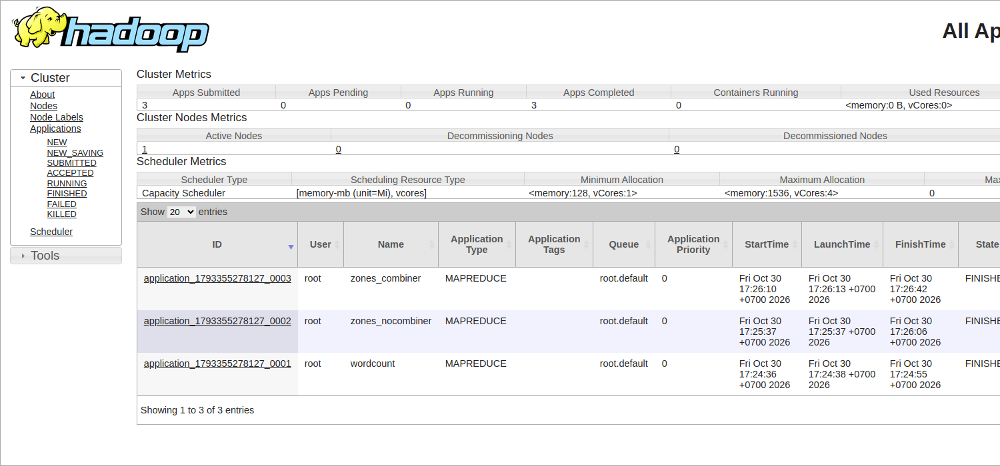
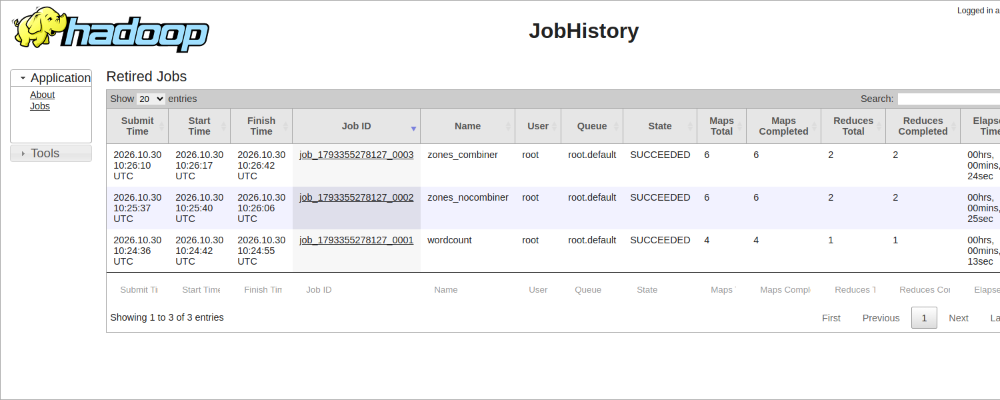
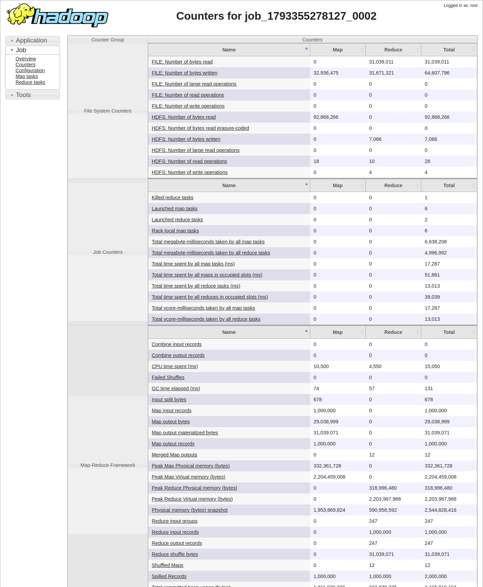
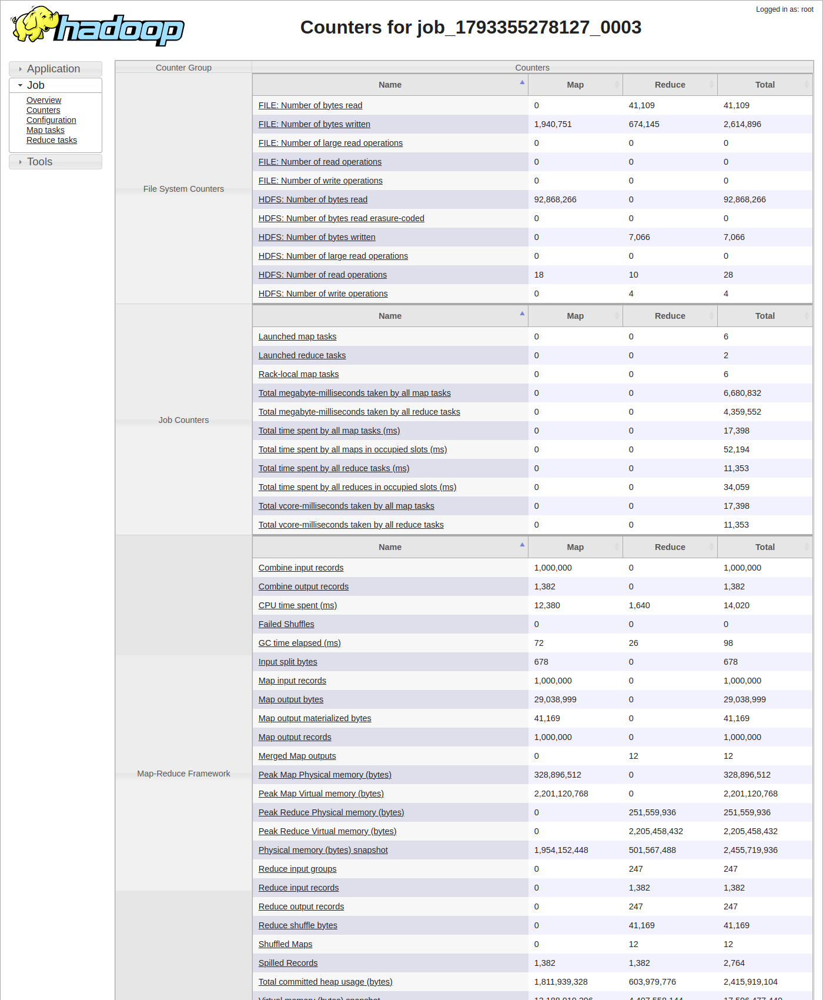

# MapReduce với Hadoop Streaming, map-side join và combiner {#sec:l02}

## Tóm tắt {.unnumbered}

Bài thực hành viết mapper và reducer bằng Python rồi chạy qua Hadoop Streaming trên cluster Hadoop dựng từ L01 (một
NameNode, ba DataNode, ResourceManager, NodeManager, JobHistory Server). Có hai bài toán. Bài thứ nhất đếm từ trên bốn
cuốn sách Project Gutenberg (khoảng 2.6 MB). Bài thứ hai đếm số chuyến taxi theo khu vực đón khách trên 1,000,000 dòng
NYC Yellow Taxi tháng 01/2024 (92.8 MB), trong đó mã khu vực được đổi sang tên bằng map-side join với bảng tra cứu 265
dòng. Mọi chương trình đều được thử bằng đường ống Unix trước khi đưa lên YARN. Thí nghiệm chính chạy cùng một job
hai lần, có và không có combiner. Combiner giảm `Reduce shuffle bytes` khoảng 754 lần, số bản ghi vào reducer từ
1,000,000 xuống 1,382, và kết quả hai lần chạy giống hệt nhau. Tuy vậy job có combiner lại chậm hơn khoảng 3 s, vì
trên một máy shuffle gần như không tốn gì. Ở phần mở rộng, chúng tôi tính giá cước trung bình theo khu vực bằng một
combiner dạng `(sum, count)`. Kết quả khớp với lần chạy không có combiner.

**Từ khóa:** MapReduce, Hadoop Streaming, YARN, shuffle, combiner, map-side join, counter, JobHistory.

## Giới thiệu {#sec:l02-intro}

MapReduce [1] tách việc xử lý dữ liệu lớn thành hai hàm do người lập trình viết, `map` và `reduce`. Phần còn lại do
framework lo: chia dữ liệu, lập lịch, chuyển dữ liệu trung gian giữa các nút và chạy lại task lỗi. Ngày nay pipeline
mới phần lớn viết bằng Spark, nhưng chuỗi map, shuffle/sort, reduce và ý tưởng gộp cục bộ vẫn còn nguyên, ví dụ bước
`HashAggregate (partial)` trong kế hoạch thực thi Spark SQL [6]. Đọc counter của một job MapReduce là cách dễ nhất để
thấy shuffle thực sự tốn bao nhiêu.

Bài thực hành có các mục tiêu sau:

1. Viết mapper và reducer bằng Python, kiểm thử cục bộ bằng đường ống `cat | mapper | sort | reducer`.
2. Chạy chương trình trên YARN bằng Hadoop Streaming và đọc job counter.
3. Đếm số chuyến theo khu vực đón khách, kèm map-side join qua distributed cache (tùy chọn `-files`).
4. Đo tác động của combiner lên `Map output materialized bytes` và `Reduce shuffle bytes`.
5. Xem lại các job trên YARN ResourceManager UI (cổng 8088) và JobHistory UI (cổng 19888).

## Cơ sở lý thuyết {#sec:l02-theory}

### Mô hình MapReduce

Theo Dean và Ghemawat [1], hàm `map` biến mỗi bản ghi đầu vào thành không, một hoặc nhiều cặp khóa–giá trị trung gian.
Framework nhóm các giá trị cùng khóa và gọi `reduce` một lần cho mỗi khóa. Đầu vào được chia thành các *input split*.
Với tệp trên HDFS, mặc định mỗi block là một split, và mỗi split do một map task xử lý. Số reduce task thì người dùng
tự đặt qua `mapreduce.job.reduces`, mặc định là 1 [4], [7].

### Shuffle và sort

Đầu ra của mỗi map task được phân vùng theo khóa (mặc định dùng `HashPartitioner`), sắp xếp và ghi ra đĩa cục bộ. Sau
đó các reducer kéo dữ liệu về qua HTTP rồi merge-sort. Giai đoạn này là shuffle. Nó bảo đảm mỗi reducer nhận khóa theo
thứ tự, nên các bản ghi cùng khóa luôn nằm liền nhau [4]. Shuffle dùng cả đĩa, mạng và sắp xếp, nên thường là phần đắt
nhất của job.

### Hadoop Streaming

Hadoop Streaming [2] cho phép bất kỳ chương trình thực thi nào làm mapper hoặc reducer. Bản ghi đi vào qua stdin dưới
dạng dòng văn bản, còn chương trình in `key<TAB>value` ra stdout. Reducer trong API Java nhận sẵn
`(key, Iterable<values>)`, nhưng reducer Streaming chỉ thấy một luồng dòng đã sắp xếp và phải tự nhận ra chỗ đổi khóa.
Muốn tăng counter tùy biến thì ghi dòng `reporter:counter:<group>,<counter>,<amount>` ra stderr.

### Combiner

Combiner là một reducer thu nhỏ, chạy trên đầu ra của từng map task trước khi shuffle. Hadoop có thể gọi combiner 0,
1 hay nhiều lần. Vì vậy hàm gộp phải có tính kết hợp và giao hoán, và đầu ra phải cùng định dạng với đầu vào [1], [4].
Phép cộng thỏa điều kiện này nên reducer đếm dùng lại được làm combiner. Phép lấy trung bình thì không.

### Map-side join và distributed cache

Nếu một bên của phép nối đủ nhỏ, có thể gửi nó tới mọi task qua distributed cache, nạp vào bộ nhớ rồi tra cứu ngay
trong mapper. Phép nối xong ở pha map và bên lớn không phải shuffle theo khóa nối. Khi cả hai bên đều lớn thì phải dùng
*reduce-side join*, tức shuffle cả hai tập theo khóa [4], [5]. Spark gọi kỹ thuật thứ nhất là broadcast join [6].

### YARN và JobHistory

YARN [3] tách quản lý tài nguyên (ResourceManager, NodeManager) khỏi logic của từng ứng dụng (ApplicationMaster). Mỗi
map hoặc reduce task chạy trong một container. Khi job kết thúc, JobHistory Server lưu lại counter, cấu hình và log
của các task.

## Môi trường và phương pháp thực nghiệm {#sec:l02-method}

### Môi trường

Bài này dùng lại cluster Docker của L01. Thư mục bài được gắn vào `/lab/L02` trong các container Hadoop, và mọi lệnh
chạy trong container `namenode` vì container này có sẵn `python3`. Streaming cần trình thông dịch có mặt trên nút chạy
task. Cấu hình xem ở @tbl:l02-env.

| Thành phần | Cấu hình |
|---|---|
| HDFS | 1 NameNode, 3 DataNode, replication factor = 3 |
| YARN | 1 ResourceManager (Capacity Scheduler), 1 NodeManager (1 Active Node trên UI) |
| Tài nguyên YARN | NodeManager cấp 1.5 GB: AM 512 MB + 2 task 384 MB chạy đồng thời |
| Phân bổ container | tối thiểu `<memory:128, vCores:1>`, tối đa `<memory:1536, vCores:4>` |
| Lịch sử job | JobHistory Server, cổng 19888; ResourceManager UI cổng 8088 |
| Ngôn ngữ mapper/reducer | Python 3, chạy qua `hadoop-streaming-*.jar` |

: Môi trường thực nghiệm. {#tbl:l02-env}

### Dữ liệu

@tbl:l02-data liệt kê dữ liệu đã dùng. Bộ sách gồm bốn cuốn Project Gutenberg có mã 1342, 11, 84 và 2701. Dữ liệu taxi
là 1,000,000 dòng đầu của tệp Parquet `yellow_tripdata_2024-01`. Streaming chỉ đọc văn bản nên chúng tôi dùng
`parquet_to_csv.py` để chuyển sang CSV không có dòng tiêu đề. Bảng `taxi_zone_lookup.csv` ánh xạ `LocationID` sang
`Borough/Zone`.

| Bộ dữ liệu | Kích thước | Số bản ghi | Lưu trữ HDFS |
|---|---|---|---|
| Sách Gutenberg (4 tệp) | pg11 171K, pg1342 755K, pg2701 1.3M, pg84 439K (tổng 2.6M) | 48,749 dòng | `/user/root/books`, 4 tệp |
| Taxi CSV 2024-01 | 92,847,108 byte (92.8 MB) | 1,000,000 dòng | `/user/root/taxi_csv`, block 16 MB, 6 block |
| `taxi_zone_lookup.csv` | nhỏ | 265 dòng | gửi qua `-files` |

: Dữ liệu sử dụng trong thực nghiệm. {#tbl:l02-data}

Tệp CSV được đưa lên với block 16 MB để job có nhiều split hơn. Theo tính toán, số block là
$\lceil 92{,}847{,}108 / 16{,}777{,}216 \rceil = \lceil 5.53 \rceil = 6$, đúng với kết quả `hdfs fsck`.

### Quy trình

1. Viết mapper và reducer đếm từ, thử bằng đường ống Unix có và không có `sort`.
2. Đưa sách lên HDFS, chạy job `wordcount` bằng Streaming với `-files mapper.py,reducer.py`.
3. Chuyển 1,000,000 dòng taxi sang CSV, đưa lên HDFS với `-D dfs.blocksize=16m`, kiểm tra số block bằng `hdfs fsck`.
4. Viết `zones/mapper.py`. Mapper nạp bảng tra cứu, đếm dòng hỏng và phát cặp `zone\t1`. Thử cục bộ trên 1,000 dòng.
5. Chạy job đếm theo khu vực hai lần, đều với `-D mapreduce.job.reduces=2` và chỉ khác nhau ở `-combiner`. Sau đó so
   counter và `diff` hai đầu ra.
6. Xem các job trên YARN UI, JobHistory UI và bằng CLI (`yarn application -list`, `mapred job -list all`).
7. Mở rộng: tính giá cước trung bình theo khu vực với combiner `(sum, count)`.

Lệnh chạy bản có combiner như dưới đây. Bản không combiner chỉ bỏ dòng `-combiner`.

```bash
hadoop jar $STREAM -D mapreduce.job.name=zones_combiner -D mapreduce.job.reduces=2 \
  -files mapper.py,reducer.py,/datasets/data/taxi/taxi_zone_lookup.csv \
  -mapper "python3 mapper.py" -combiner "python3 reducer.py" -reducer "python3 reducer.py" \
  -input /user/root/taxi_csv -output /user/root/zones_out_combiner
```

Thời gian wall-clock của job taxi được tính bằng hiệu thời điểm giữa dòng log `Running job` và dòng
`completed successfully` của job đó, không dùng lệnh `time`. Cách này bỏ qua phần khởi động client.

## Kết quả thực nghiệm {#sec:l02-results}

### Đếm từ, kiểm thử cục bộ

Mapper đổi văn bản sang chữ thường rồi lấy từ theo biểu thức `[a-z][a-z']*`. Với đầu vào `Hadoop's HDFS, hadoop!`,
mapper in ra ba cặp `hadoop's 1`, `hdfs 1`, `hadoop 1`. Chạy cả đường ống trên bốn cuốn sách, năm từ nhiều nhất là
`the 25806`, `and 14340`, `of 14113`, `to 12103` và `a 9045`. Khi bỏ `sort` khỏi đường ống, reducer in ra 25,805 dòng
bắt đầu bằng `the` thay vì một dòng tổng (@fig:l02-local-pipe). Con số này gần bằng tổng số lần xuất hiện, tức gần như
lần nào cũng thành một nhóm riêng. Chỉ những chỗ `the` tình cờ đứng liền nhau mới được gộp.

{#fig:l02-local-pipe width=85%}

### Đếm từ trên YARN

Job `wordcount` (`job_1793355278127_0001`) chạy thành công với `number of splits:4`. Counter xem ở @tbl:l02-wc và
@fig:l02-wc-yarn. Mỗi cuốn sách nhỏ hơn một block nên được một split. Vì vậy job có 4 map task và 1 reduce task theo
mặc định. Số khóa vào reducer bằng số dòng đầu ra, và top 5 đọc từ HDFS giống bản chạy cục bộ.

| Counter | Giá trị |
|---|---|
| Launched map tasks / reduce tasks | 4 / 1 |
| Map input records | 48,749 |
| Map output records | 462,618 |
| Map output bytes | 3,408,811 |
| Map output materialized bytes = Reduce shuffle bytes | 4,334,071 |
| Reduce input groups = Reduce output records | 20,967 |
| HDFS bytes written (`part-00000`) | 226,341 |
| CPU time spent | 7,010 ms |
| Thời gian lệnh (`real`) | 23.572 s |

: Counter của job đếm từ trên YARN. {#tbl:l02-wc}

{#fig:l02-wc-yarn width=85%}

### Dữ liệu taxi và map-side join cục bộ

`hdfs fsck` báo `92847108 bytes, replicated: replication=3, 6 block(s): OK`. Lúc thử mapper khu vực ở máy cục bộ,
mapper chưa đọc được bảng tra cứu vì `-files` chỉ có tác dụng trên cluster. Chúng tôi chép `taxi_zone_lookup.csv` vào
thư mục hiện hành để giả lập distributed cache. Trên 1,000 dòng đầu, ba khu vực nhiều chuyến nhất là
`Manhattan/East Village 59`, `Manhattan/Lincoln Square East 55` và `Manhattan/Upper West Side South 45`. Tiếp theo
chúng tôi đưa vào hai dòng hỏng, một dòng `garbage` và một dòng có `PULocationID` không phải số. Mapper không dừng
lỗi mà ghi đúng hai dòng `reporter:counter:TaxiLab,BAD_RECORDS,1` ra stderr (@fig:l02-taxi-local). Dữ liệu thật không
có dòng hỏng nào. Vì thế nhóm counter `TaxiLab` không xuất hiện trong các job trên cluster, và `Map input records`
bằng `Map output records`.

{#fig:l02-taxi-local width=85%}

### Có và không có combiner

Hai job `zones_nocombiner` (`job_1793355278127_0002`) và `zones_combiner` (`job_1793355278127_0003`) chạy liền nhau,
cùng đầu vào và cùng 2 reducer. @tbl:l02-combiner gồm các counter đề bài yêu cầu. @tbl:l02-combiner-extra gồm thêm
vài counter lấy từ log đầy đủ.

| Counter | Không combiner | Có combiner |
|---|---|---|
| Launched map tasks | 6 | 6 |
| Map output records | 1,000,000 | 1,000,000 |
| Combine input records | 0 | 1,000,000 |
| Combine output records | 0 | 1,382 |
| Map output materialized bytes | 31,039,071 | 41,169 |
| Reduce shuffle bytes | 31,039,071 | 41,169 |
| Reduce input records | 1,000,000 | 1,382 |
| Wall-clock time | 30.3 s | 33.3 s |

: So sánh counter giữa hai lần chạy không và có combiner. {#tbl:l02-combiner}

| Counter | Không combiner | Có combiner |
|---|---|---|
| Map output bytes | 29,038,999 | 29,038,999 |
| Reduce input groups = Reduce output records | 247 | 247 |
| Spilled Records | 2,000,000 | 2,764 |
| FILE: Number of bytes written | 64,607,796 | 2,614,896 |
| FILE: Number of bytes read | 31,039,011 | 41,109 |
| Total time spent by all map tasks | 17,287 ms | 17,398 ms |
| Total time spent by all reduce tasks | 13,013 ms | 11,353 ms |
| CPU time spent | 15,050 ms | 14,020 ms |
| Shuffled Maps / Merged Map outputs | 12 / 12 | 12 / 12 |
| Killed reduce tasks | 1 | không xuất hiện |

: Counter bổ sung của hai lần chạy khu vực (trích từ `nocombiner.log` và `combiner.log`). {#tbl:l02-combiner-extra}

{#fig:l02-combiner-cli width=85%}

Mapper sinh ra cùng một lượng dữ liệu ở cả hai lần, vì `Map output bytes` không đổi. Combiner thu gọn dữ liệu đó trước
khi ghi đĩa và shuffle. Lượng shuffle giảm $31{,}039{,}071 / 41{,}169 \approx 754$ lần, tức khoảng 99.9 %. Số bản ghi
tràn đĩa và số byte ghi đĩa cục bộ cũng giảm theo cùng cỡ. Cả hai lần chạy đều có 247 khu vực vào reducer, và `diff`
hai đầu ra rỗng (@fig:l02-combiner-cli). Ba khu vực đứng đầu là `Queens/JFK Airport 59777`,
`Manhattan/Midtown Center 48750` và `Manhattan/Upper East Side South 47260`.

Riêng thời gian thì ngược với dự đoán: bản có combiner chậm hơn 3.0 s. Tổng thời gian map task gần như không đổi, chỉ
có thời gian reduce giảm. Lần chạy không combiner có `Killed reduce tasks=1`. Đây là một attempt reduce bị hủy, còn cả
hai reduce task vẫn chạy xong, nên kết quả không bị ảnh hưởng.

### Giao diện YARN, JobHistory và CLI

ResourceManager UI liệt kê 3 ứng dụng đã xong (`wordcount`, `zones_nocombiner`, `zones_combiner`), 1 Active Node,
Capacity Scheduler và giới hạn container như ở @tbl:l02-env (@fig:l02-ui-yarn). Danh sách job trên JobHistory ở
@fig:l02-ui-history.

{#fig:l02-ui-yarn width=100%}

{#fig:l02-ui-history width=100%}

Trang tổng quan của `job_1793355278127_0003` (@fig:l02-ui-overview) ghi các thông tin sau: SUCCEEDED, không chạy chế
độ uber, Elapsed 24 s, map trung bình 2 s, shuffle trung bình 5 s. Cả 6 map và 2 reduce đều thành công, không có
attempt nào lỗi hay bị hủy. Elapsed tính từ lúc job bắt đầu chạy nên ngắn hơn con số wall-clock ở @tbl:l02-combiner.
Con số wall-clock còn gồm thời gian chờ ApplicationMaster khởi động.

{#fig:l02-ui-overview width=100%}

Trang Counters của hai job (@fig:l02-ui-counters-nc, @fig:l02-ui-counters-c) cho đúng các giá trị in trên console.
Trên hai trang này có thể so trực tiếp `Combine output records`, `Map output materialized bytes` và
`Reduce shuffle bytes`.

{#fig:l02-ui-counters-nc width=100%}

{#fig:l02-ui-counters-c width=100%}

Trên dòng lệnh, `yarn application -list -appStates FINISHED` cho 3 ứng dụng có Final-State SUCCEEDED, với Tracking-URL
trỏ tới `historyserver:19888`. `mapred job -list all` báo `Total jobs:3` (@fig:l02-yarn-cli).

{#fig:l02-yarn-cli width=85%}

### Mở rộng: giá cước trung bình theo khu vực

Mapper phát `zone\t<fare>,1`, trong đó `fare_amount` là cột thứ 10. Combiner cộng dồn cặp `(sum, count)` và xuất ra
đúng định dạng nó nhận vào. Reducer cộng tiếp và chỉ chia `sum/count` ở bước cuối. Job `job_1793355278127_0004` chạy
xong với `Combine input records=1000000`, `Combine output records=1382` và `Reduce shuffle bytes=56289`. Kết quả ở
@tbl:l02-avgfare và @fig:l02-avgfare.

| Khu vực | Giá cước trung bình | Số chuyến |
|---|---|---|
| Queens/JFK Airport | 59.71 | 59,777 |
| Manhattan/Midtown Center | 15.33 | 48,750 |
| Manhattan/Upper East Side South | 11.91 | 47,260 |
| Manhattan/Upper East Side North | 12.49 | 45,867 |
| Manhattan/Lincoln Square East | 13.30 | 37,424 |
| Manhattan/Penn Station/Madison Sq West | 15.72 | 37,342 |
| Manhattan/Midtown East | 14.71 | 36,421 |
| Manhattan/Times Sq/Theatre District | 18.20 | 36,291 |
| Queens/LaGuardia Airport | 40.87 | 33,240 |
| Manhattan/Upper West Side South | 13.36 | 30,849 |

: Giá cước trung bình (`fare_amount`) của 10 khu vực đón khách nhiều chuyến nhất. {#tbl:l02-avgfare}

{#fig:l02-avgfare width=85%}

Để kiểm tra, chúng tôi tính lại JFK bằng bản cục bộ không combiner và cũng được 59.71 trên 59,777 chuyến. Số chuyến
từng khu vực khớp với job đếm ở phần trước. Số bản ghi shuffle vẫn là 1,382, nhưng số byte nhiều hơn job đếm vì mỗi
giá trị mang thêm một tổng số thực. Về nội dung, hai sân bay có giá trung bình cao hơn hẳn các khu vực Manhattan, do
chuyến đi từ sân bay thường dài hơn.

## Thảo luận {#sec:l02-discussion}

### Trong đường ống cục bộ, lệnh nào làm việc của shuffle, và thiếu nó thì sao? {#sec:l02-q1}

Đó là lệnh `sort`. Nó đưa mọi dòng cùng khóa về cạnh nhau, giống bảo đảm mà shuffle cung cấp trên cluster (phân vùng
theo khóa rồi merge-sort ở reducer). Không có `sort`, reducer gặp cùng một từ ở nhiều đoạn rời nhau và in nó ra nhiều
lần với số đếm cục bộ. Đó là lý do `the` bị in 25,805 lần (@fig:l02-local-pipe).

### Vì sao reducer Streaming phải tự giữ `current_key`? {#sec:l02-q2}

Streaming chỉ đưa cho reducer các dòng văn bản đã sắp xếp. Khái niệm nhóm `(key, Iterable<values>)` chỉ có trong API
Java. Vì vậy reducer Python phải so khóa hiện tại với `current_key`, in tổng khi khóa đổi, và nhớ in khóa cuối cùng
sau vòng lặp (Phụ lục B). Quên bước cuối thì mất từ cuối cùng. Reducer của bài không mắc lỗi này: `Reduce output
records` bằng `Reduce input groups` ở @tbl:l02-wc.

### Job taxi có bao nhiêu map task, bao nhiêu reduce task, và vì sao? {#sec:l02-q3}

Job taxi có **6 map task**. Tệp CSV nằm trong 6 block 16 MB và mỗi block là một split (log ghi `number of splits:6`).
Job đếm từ chỉ có 4 map task vì mỗi cuốn sách nhỏ hơn một block. Số reduce task là 2 vì chúng tôi đặt
`-D mapreduce.job.reduces=2`. Con số này do người dùng chọn chứ không suy ra từ dữ liệu, và job đếm từ để mặc định là
1. Với 2 reducer, mỗi map task tạo hai phân vùng, nên `Shuffled Maps = 12` ($6 \times 2$) ở @tbl:l02-combiner-extra.
NodeManager chỉ chạy được hai task 384 MB cùng lúc, nên 6 map task chạy thành nhiều đợt. Log thể hiện điều này qua
tiến độ map tăng dần 17 %, 33 %, 50 %, 67 %, 83 % rồi 100 %.

### Combiner giảm `Reduce shuffle bytes` bao nhiêu lần, và vì sao đầu ra combiner xấp xỉ số khu vực nhân số map task? {#sec:l02-q4}

Shuffle giảm khoảng **754 lần** (@tbl:l02-combiner). Combiner chạy riêng trên đầu ra của từng map task, và mỗi task
chỉ xuất một bản ghi cho mỗi khu vực mà nó gặp. Toàn bộ dữ liệu có 247 khu vực. Chia đều thì mỗi task ra khoảng
$1{,}382 / 6 \approx 230$ bản ghi, tức mỗi split gặp gần hết các khu vực. Chỉ các tổng cục bộ này đi qua shuffle, nên
`Reduce input records` cũng chỉ còn 1,382.

### Vì sao combiner không làm job nhanh hơn ở đây, và khi nào nó có ích rõ? {#sec:l02-q5}

Trên một máy, shuffle chỉ là chép dữ liệu qua đĩa cục bộ hoặc loopback, gần như không tốn gì. Trong khi đó combiner
thêm một tiến trình Python phải đọc, phân tích và sắp xếp lại 1,000,000 bản ghi ở pha map. Theo
@tbl:l02-combiner-extra, tổng thời gian map không giảm. Phần tiết kiệm ở reduce, khoảng 1.7 s, không bù được thời gian
khởi động và độ dao động khi lập lịch container. Mỗi cấu hình mới chạy một lần, nên chênh lệch 3.0 s chưa đủ để kết
luận combiner làm chậm. Bản tham chiếu của đề bài cũng ghi khoảng 28 s và 37 s, nên dao động cỡ này là bình thường.
Trên cluster thật, shuffle đi qua mạng và mỗi reducer phải merge hàng GB từ hàng trăm mapper. Lúc đó việc bỏ được
99.9 % lượng shuffle và gần hết số bản ghi tràn đĩa sẽ lớn hơn nhiều so với chi phí CPU của combiner.

### Có dùng lại reducer "trung bình" làm combiner được không? {#sec:l02-q6}

Không được. Trung bình của các trung bình cho kết quả sai khi các phân vùng có số bản ghi khác nhau. Ví dụ, trung bình
của $\{10\}$ và $\{20, 30\}$ là $(10+20+30)/3 = 20$, còn trung bình của hai trung bình cục bộ là
$(10 + 25)/2 = 17.5$. Ngoài ra reducer trung bình xuất ra một số thực, khác định dạng đầu vào, nên không gộp tiếp được.
Hadoop có thể gọi combiner 0, 1 hay nhiều lần, nên cách đúng là để combiner phát `(sum, count)` và chỉ reducer mới chia.
Phần mở rộng làm theo cách này và kết quả JFK khớp với bản không combiner (@tbl:l02-avgfare).

### Map-side join trong bài hoạt động thế nào, và khi nào nó không còn hợp? {#sec:l02-q7}

Mỗi mapper nạp `taxi_zone_lookup.csv` (được phân phối qua `-files`) vào một `dict`, rồi đổi `PULocationID` thành
`Borough/Zone` ngay khi đọc từng chuyến. Bảng lớn vì thế không phải shuffle theo khóa nối. Cách này không còn hợp khi
bảng "nhỏ" không vừa thoải mái trong bộ nhớ task (ở đây mỗi task chỉ có 384 MB), hoặc khi gửi bảng tới mọi task tốn
hơn cả shuffle. Khi đó phải chuyển sang reduce-side join. Spark gọi cùng ý tưởng này là broadcast join, sẽ gặp lại ở L06.

### Counter `BAD_RECORDS` hiện ở đâu, và vì sao nên đếm dòng hỏng thay vì cho job dừng? {#sec:l02-q8}

Counter này nằm trong job counters, tức phần in ra console cuối job và mục Counters trên JobHistory UI, nhóm `TaxiLab`.
Counter chỉ hiện khi có ít nhất một dòng hỏng. Dữ liệu trong bài không có dòng hỏng nên nhóm này không xuất hiện. Phần
thử cục bộ ở @fig:l02-taxi-local cho thấy mapper vẫn phát đúng tín hiệu. Một job xử lý hàng tỷ dòng không nên chết vì
vài dòng lỗi, vì như vậy mọi công việc đã làm bị bỏ phí. Đếm số dòng hỏng thì vẫn thấy được vấn đề chất lượng dữ liệu,
và có thể đặt ngưỡng để cảnh báo hoặc dừng job khi số dòng hỏng quá nhiều.

### Hạn chế của thực nghiệm

Mọi thứ chạy trên một máy với một NodeManager. Các container dùng chung CPU và đĩa, còn shuffle không đi qua mạng thật,
nên con số thời gian không áp dụng thẳng cho cluster nhiều nút được. Mỗi cấu hình chỉ chạy một lần. Dữ liệu chỉ là mẫu
1,000,000 dòng của một tháng và không có dòng hỏng, nên `BAD_RECORDS` mới được kiểm chứng ở chế độ cục bộ.

## Kết luận {#sec:l02-conclusion}

Đường ống `cat | mapper | sort | reducer` tái hiện đúng mô hình MapReduce, và bỏ `sort` cũng giống như bỏ shuffle. Số
map task do số input split quyết định, còn số reduce task do người dùng đặt. Combiner giảm dữ liệu shuffle khoảng 754
lần mà không làm đổi kết quả. Tuy vậy trong môi trường một máy nó không làm job nhanh hơn, và chúng tôi cho rằng lý do
nằm ở môi trường chứ không phải ở combiner. Với phép tổng hợp không có tính kết hợp như trung bình, cần một dạng trung
gian như `(sum, count)` thì combiner mới dùng được.

Trong thực tế, nên dùng combiner hoặc tổng hợp cục bộ cho các phép tổng hợp có tính kết hợp khi lượng shuffle lớn và đi
qua mạng. Map-side join phù hợp khi một bên nằm gọn trong bộ nhớ task. Bản ghi hỏng nên được đếm thay vì bỏ qua âm
thầm. Nếu có thêm thời gian, chúng tôi muốn làm bài Top-N với một reducer dùng heap, xem `HashPartitioner` chia khóa
thế nào qua `part-00000` và `part-00001`, cố ý làm hỏng một task để quan sát cơ chế thử lại, và so với `groupBy().agg()`
của Spark ở L05/L06.

## Tài liệu tham khảo {.unnumbered}

[1] J. Dean and S. Ghemawat, "MapReduce: Simplified Data Processing on Large Clusters," in *Proc. 6th USENIX Symposium
on Operating Systems Design and Implementation (OSDI)*, 2004.

[2] Apache Software Foundation, "Hadoop Streaming," Apache Hadoop documentation.
https://hadoop.apache.org/docs/stable/hadoop-streaming/HadoopStreaming.html

[3] V. K. Vavilapalli et al., "Apache Hadoop YARN: Yet Another Resource Negotiator," in *Proc. 4th ACM Symposium on
Cloud Computing (SoCC)*, 2013.

[4] T. White, *Hadoop: The Definitive Guide*, 4th ed. Sebastopol, CA, USA: O'Reilly Media, 2015.

[5] M. Kleppmann, *Designing Data-Intensive Applications*. Sebastopol, CA, USA: O'Reilly Media, 2017.

[6] M. Armbrust et al., "Spark SQL: Relational Data Processing in Spark," in *Proc. ACM SIGMOD International Conference
on Management of Data*, 2015.

[7] Apache Software Foundation, "MapReduce Tutorial," Apache Hadoop documentation.
https://hadoop.apache.org/docs/stable/hadoop-mapreduce-client/hadoop-mapreduce-client-core/MapReduceTutorial.html

## Phụ lục A: Danh mục tệp nộp kèm {.unnumbered}

| Tệp | Nội dung |
|---|---|
| `wc_mapper.py`, `wc_reducer.py` | Mapper và reducer đếm từ |
| `zones_mapper.py` | Map-side join với `taxi_zone_lookup.csv`, counter `BAD_RECORDS` |
| `stretch_avg_fare/` (`mapper.py`, `combiner.py`, `reducer.py`) | Mở rộng: giá cước trung bình với combiner `(sum, count)` |
| `01_local_pipe.txt` | Kiểm thử cục bộ đếm từ, có và không có `sort` |
| `02_wordcount_yarn.txt` | Log và counter job `wordcount` trên YARN, top 5 từ HDFS |
| `03_taxi_csv_local_zones.txt` | Chuyển CSV, `hdfs fsck`, kiểm thử cục bộ mapper khu vực và `BAD_RECORDS` |
| `04_combiner_vs_nocombiner.txt` | Trích counter hai lần chạy, wall-clock, top 10 khu vực, kết quả `diff` |
| `nocombiner.log`, `combiner.log` | Log đầy đủ hai job khu vực |
| `05_yarn_cli.txt` | Kết quả `yarn application -list` và `mapred job -list all` |
| `06_stretch_avg_fare.txt` | Kết quả job giá cước trung bình |
| `img/` | Ảnh chụp terminal và giao diện web |

: Danh mục tệp nộp kèm trong `submission/L02/`. {#tbl:l02-files}

## Phụ lục B: Trích đoạn mã nguồn {.unnumbered}

Mapper đếm từ (`wc_mapper.py`) phát một cặp `word\t1` cho mỗi từ tìm được.

```python
WORD = re.compile(r"[a-z][a-z']*")
for line in sys.stdin:
    for word in WORD.findall(line.lower()):
        print(f"{word}\t1")
```

Reducer đếm từ (`wc_reducer.py`) tự nhận ra chỗ đổi khóa và in thêm khóa cuối cùng sau vòng lặp.

```python
current_word, current_count = None, 0
for line in sys.stdin:
    word, _, count = line.rstrip("\n").partition("\t")
    count = int(count)
    if word == current_word:
        current_count += count
    else:
        if current_word is not None:
            print(f"{current_word}\t{current_count}")
        current_word, current_count = word, count
if current_word is not None:  # the last word's total
    print(f"{current_word}\t{current_count}")
```

Mapper khu vực (`zones_mapper.py`) nạp bảng tra cứu, báo dòng hỏng qua stderr và phát `zone\t1`.

```python
zones = {}
if os.path.exists("taxi_zone_lookup.csv"):
    with open("taxi_zone_lookup.csv", newline="") as f:
        for row in csv.DictReader(f):
            zones[row["LocationID"]] = f"{row['Borough']}/{row['Zone']}"
for line in sys.stdin:
    fields = line.rstrip("\n").split(",")
    if len(fields) <= PU_COL or not fields[PU_COL].strip().isdigit():
        sys.stderr.write("reporter:counter:TaxiLab,BAD_RECORDS,1\n")
        continue
    pu = fields[PU_COL].strip()
    print(f"{zones.get(pu, pu)}\t1")
```

Combiner của phần mở rộng (`stretch_avg_fare/combiner.py`) cộng dồn `(sum, count)` và giữ định dạng `key\tsum,count`.
Reducer có cùng logic, chỉ khác ở chỗ cuối cùng in `total / count` với hai chữ số thập phân kèm số chuyến.

```python
for line in sys.stdin:
    key, _, value = line.rstrip("\n").partition("\t")
    s, _, c = value.partition(",")
    if key == current_key:
        total, count = total + float(s), count + int(c)
    else:
        if current_key is not None:
            print(f"{current_key}\t{total},{count}")
        current_key, total, count = key, float(s), int(c)
if current_key is not None:
    print(f"{current_key}\t{total},{count}")
```
