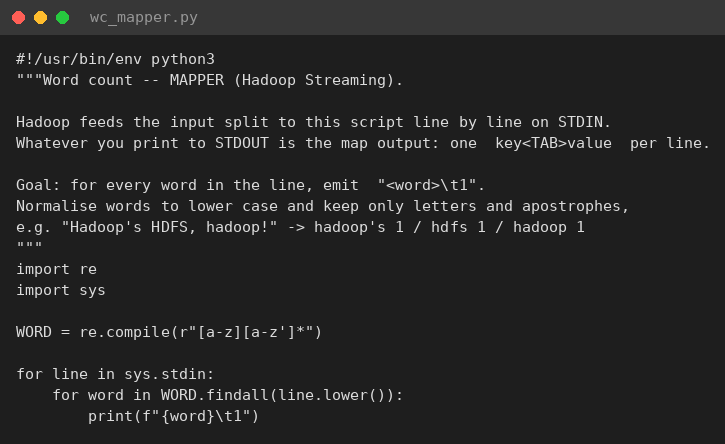
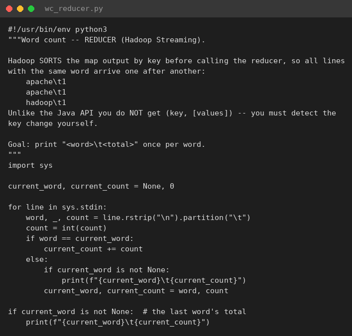
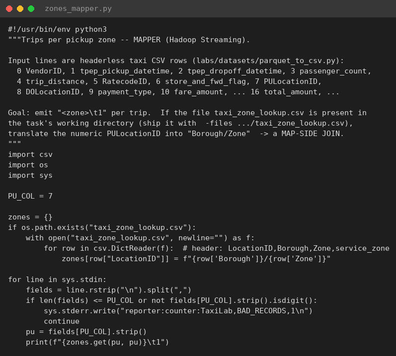
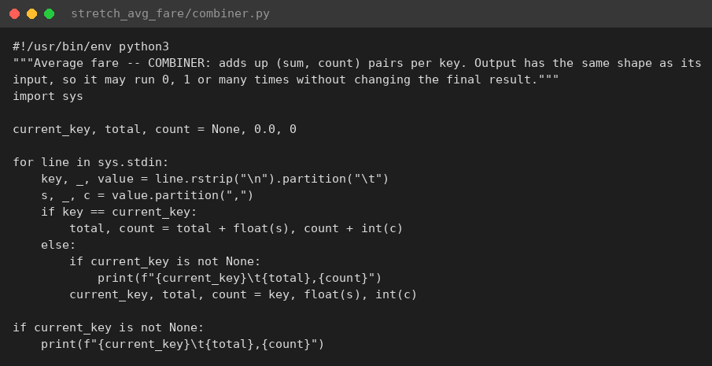

# L02 — MapReduce với Hadoop Streaming (Python)

Cluster: dùng lại cluster L01 (1 NN, 3 DN, RM, NM, JobHistory). Log gốc trong các file `0*.txt` và `*combiner.log`; ảnh ở `img/`.

## File nộp

| File | Nội dung |
|---|---|
| `wc_mapper.py`, `wc_reducer.py` | TODO 1–3 (word count) |
| `zones_mapper.py` | TODO 4–6 (map-side join với `taxi_zone_lookup.csv`, counter `BAD_RECORDS`) |
| `stretch_avg_fare/` | Stretch: giá cước trung bình theo zone với combiner đúng `(sum, count)` |

## 1–2. Word count: test local và chạy trên YARN

Test local (`cat | mapper | sort | reducer`) cho top 5 `the 25806, and 14340, of 14113, to 12103, a 9045`.
Khi **bỏ `sort`**, reducer in `the` ra **25,805 dòng** (mỗi lần xuất hiện gần như là một "nhóm" riêng) thay vì 1 dòng tổng.

Trên YARN: `Launched map tasks=4` (mỗi cuốn sách < 1 block là 1 split), `Reduce input groups=20967`; top 5 giống hệt bản local.

## 3–4. Dữ liệu taxi CSV và map-side join

1,000,000 dòng (92.8 MB) đưa lên HDFS với block 16 MB → **6 block → 6 map task**.
Test local trên 1,000 dòng: `Manhattan/East Village 59`, `Manhattan/Lincoln Square East 55`. Dòng hỏng được đếm
qua stderr `reporter:counter:TaxiLab,BAD_RECORDS,1` (dữ liệu thật có 0 dòng hỏng nên counter không xuất hiện trong job).

## 5. Combiner và không combiner

| Counter | Không combiner | Có combiner |
|---|---|---|
| Launched map tasks | 6 | 6 |
| Map output records | 1,000,000 | 1,000,000 |
| Combine output records | 0 | 1,382 |
| Map output materialized bytes | 31,039,071 | 41,169 |
| Reduce shuffle bytes | 31,039,071 | 41,169 |
| Reduce input records | 1,000,000 | 1,382 |
| Wall-clock time | 30.3 s | 33.3 s |

Kết quả hai lần chạy **giống hệt** (`diff` rỗng). Top zone: `Queens/JFK Airport 59777`, `Manhattan/Midtown Center 48750`.

## 6. YARN và JobHistory UI

## Stretch (bonus): giá cước trung bình theo zone với combiner đúng

Mapper emit `zone \t fare,1`; combiner cộng dồn `(sum, count)` và xuất **cùng định dạng** với input; reducer cộng
tiếp rồi mới chia `sum/count`. Kết quả JFK `59.71` trên `59,777` chuyến, trùng với bản chạy local không combiner,
nghĩa là combiner không làm sai kết quả. Shuffle chỉ còn 56,289 byte.

## Trả lời checkpoint

**Q1.** Lệnh `sort` đóng vai trò **shuffle & sort**: nó gom các key giống nhau nằm liền nhau. Thiếu nó, reducer
thấy cùng một từ ở nhiều đoạn không liền nhau nên in ra nhiều lần với số đếm cục bộ (thực nghiệm: `the` bị in 25,805 lần).

**Q2.** Streaming chỉ đưa cho reducer một **luồng dòng đã sort**; khái niệm "nhóm" `(key, Iterable<values>)` nằm
trong framework Java. Reducer Python phải tự phát hiện ranh giới key (`current_key`) và nhớ in key cuối cùng.

**Q3.** **6 map task** = 6 input split = 6 block HDFS 16 MB của file CSV 92.8 MB (mặc định mỗi block là một split).
Wordcount có 4 map vì mỗi cuốn sách nhỏ hơn 1 block nên là 1 split. **2 reduce task** vì đặt
`-D mapreduce.job.reduces=2` (mặc định là 1): số reducer do người dùng chọn, không suy ra từ dữ liệu.

**Q4.** Shuffle giảm **~754 lần** (31,039,071 → 41,169 byte). Mỗi map task chỉ xuất một bản ghi cho mỗi **zone khác nhau
mà nó gặp** (~230–260 zone) × 6 map ≈ 1,382. Chỉ các tổng cục bộ này đi qua mạng.

**Q5.** Combiner không nhanh hơn (33.3 s so với 30.3 s) vì trên một máy, shuffle chỉ là copy qua đĩa/loopback, gần như
miễn phí, trong khi combiner thêm một process Python phải đọc, parse và sort lại 1 triệu bản ghi ở mỗi map. Trên cluster
thật, shuffle đi qua mạng và reducer phải merge-sort hàng GB từ hàng trăm mapper; khi đó giảm 99.9 % lượng shuffle sẽ
áp đảo chi phí trên và combiner thắng rõ.

**Q6.** **Không.** Trung bình của các trung bình là sai vì mỗi partition có số bản ghi khác nhau. Combiner phải emit cặp
`(sum, count)` cục bộ và reducer mới tính `sum/count` (đã cài đặt ở phần stretch). Combiner phải có tính kết hợp và giao
hoán, output cùng định dạng với input, vì Hadoop có thể chạy nó 0, 1 hoặc nhiều lần.

**Q7.** Mỗi mapper nạp file nhỏ `taxi_zone_lookup.csv` (265 dòng, phân phối bằng distributed cache `-files`) vào một dict
và thay ID bằng tên zone, nên join không cần shuffle. Cách này hết hợp lý khi bảng "nhỏ" không còn vừa thoải mái trong bộ
nhớ của từng task; khi đó phải dùng reduce-side join (shuffle cả hai tập theo key). Spark gọi ý tưởng này là
**broadcast join** (L06).

**Q8.** `BAD_RECORDS` xuất hiện trong job counters (console cuối job và JobHistory UI → Counters → nhóm `TaxiLab`); chỉ
xuất hiện khi có ít nhất một dòng hỏng. Vài dòng lỗi không nên làm chết cả job xử lý hàng tỷ dòng; đếm chúng giúp lộ ra
vấn đề chất lượng dữ liệu và cho phép đặt ngưỡng cảnh báo.
