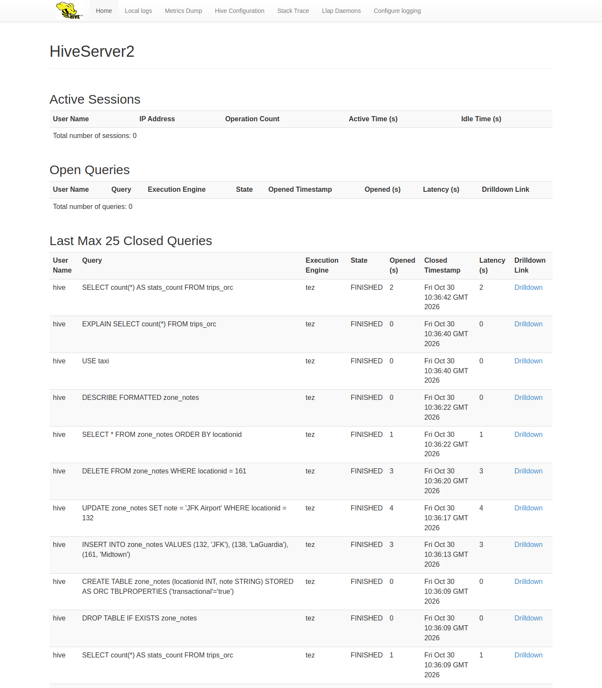
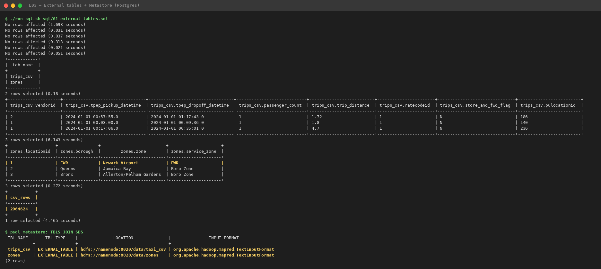
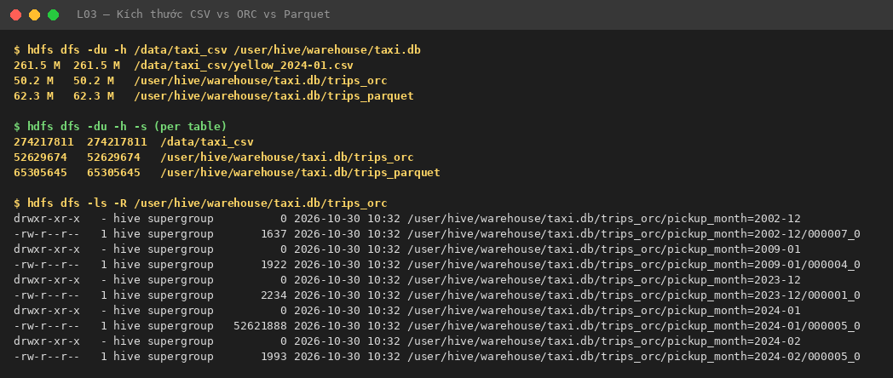
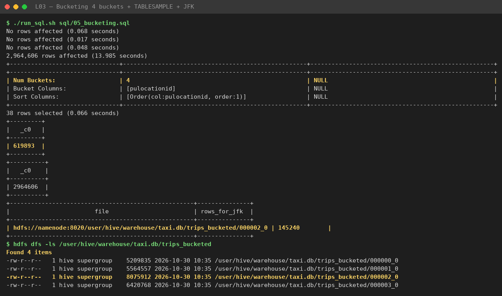
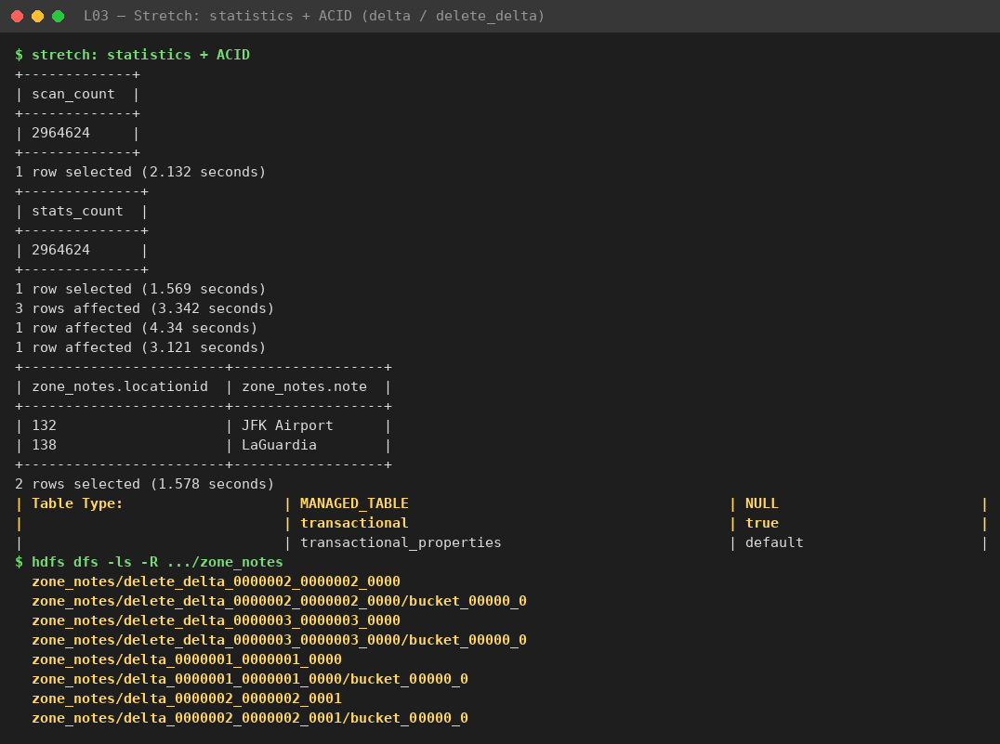

# Hive: truy vấn SQL trên HDFS, phân vùng, định dạng lưu trữ cột và bucketing {#sec:l03}

## Mục tiêu và môi trường {#sec:l03-intro}

Bài thực hành tạo bảng ngoài Hive trên CSV ở HDFS, chuyển sang bảng phân vùng ORC và Parquet, so sánh kích thước và
thời gian truy vấn, kiểm chứng cắt tỉa phân vùng bằng `EXPLAIN`, tạo bảng bucketing, và làm thêm hai phần mở rộng
(thống kê cột, bảng ACID). Cả cụm chạy bằng Docker Compose trên một máy (@tbl:l03-env).

| Thành phần | Phiên bản / cấu hình |
|---|---|
| Hive | 4.2.1 (`apache/hive:4.2.1`), HiveServer2 + Metastore độc lập |
| Bộ máy thực thi | Tez, chế độ cục bộ bên trong HiveServer2 |
| Cơ sở dữ liệu Metastore | PostgreSQL 18 (database `metastore`) |
| HDFS | 3.4.3, 1 NameNode + 1 DataNode (hệ số nhân bản 1) |
| Máy khách | Beeline qua `run_sql.sh` (in thời gian từng câu lệnh) |

: Môi trường thực nghiệm. {#tbl:l03-env}

Đề bài gợi ý dùng mẫu 1 triệu dòng, nhưng chúng tôi dùng nguyên tháng 01/2024 của dữ liệu taxi vàng New York
(@tbl:l03-data), nên các con số trong bài lớn hơn số tham khảo của đề.

## Thực hiện và kết quả {#sec:l03-results}

### Khởi động cụm và đưa CSV lên HDFS {#sec:l03-res-stack}

Năm container đều `Up`, NameNode và PostgreSQL ở trạng thái `healthy` (@fig:l03-stack). Tệp
`yellow_tripdata_2024-01.parquet` được chuyển sang CSV không có dòng tiêu đề rồi tải lên `/data/taxi_csv`, cùng bảng
tra cứu zone lên `/data/zones` (@tbl:l03-data). Giao diện web HiveServer2 ở cổng 10002 liệt kê các truy vấn đã chạy
xong, tất cả trên `tez` (@fig:l03-hs2ui).

| Tệp trên HDFS | Kích thước | Số dòng |
|---|---|---|
| `/data/taxi_csv/yellow_2024-01.csv` | 274,217,811 B (274.2 MB, 261.5 MiB) | 2,964,624 |
| `/data/zones/taxi_zone_lookup.csv` | 12.0 K | 265 zone + 1 dòng tiêu đề |

: Dữ liệu đầu vào. {#tbl:l03-data}

{#fig:l03-stack width=85%}

{#fig:l03-hs2ui width=85%}

### Bảng ngoài và nội dung Metastore {#sec:l03-res-external}

`01_external_tables.sql` tạo `trips_csv` với `ROW FORMAT DELIMITED` và `zones` với `OpenCSVSerde` cộng
`skip.header.line.count=1` (mã ở Phụ lục). Cả hai đọc được ngay. `SELECT * FROM zones LIMIT 3` trả về
`1 | EWR | Newark Airport | EWR`, `2 | Queens | Jamaica Bay | Boro Zone` và
`3 | Bronx | Allerton/Pelham Gardens | Boro Zone`, tức dòng tiêu đề và dấu ngoặc kép đã được bỏ. `count(*)` trên
`trips_csv` ra `csv_rows = 2,964,624` sau 4.465 s, khớp số dòng của tệp.

Truy vấn thẳng `TBLS JOIN SDS` trong PostgreSQL (@tbl:l03-metastore, @fig:l03-external) chỉ thấy tên bảng, loại bảng,
vị trí và lớp định dạng đầu vào; không có dòng dữ liệu nào trong Metastore.

| TBL_NAME | TBL_TYPE | LOCATION | INPUT_FORMAT |
|---|---|---|---|
| trips_csv | EXTERNAL_TABLE | `hdfs://namenode:8020/data/taxi_csv` | `org.apache.hadoop.mapred.TextInputFormat` |
| zones | EXTERNAL_TABLE | `hdfs://namenode:8020/data/zones` | `org.apache.hadoop.mapred.TextInputFormat` |

: Nội dung bảng `TBLS` và `SDS` trong Metastore sau bước tạo bảng ngoài. {#tbl:l03-metastore}

{#fig:l03-external width=85%}

### Bảng phân vùng ORC và Parquet {#sec:l03-res-partition}

`02_partitioned_tables.sql` bật `hive.exec.dynamic.partition.mode=nonstrict`, tính `pickup_month` bằng
`date_format(..., 'yyyy-MM')` ở cột cuối của `SELECT`, rồi nạp `trips_orc` (ZLIB) và `trips_parquet` (Snappy).
`INSERT OVERWRITE` ghi 2,964,624 dòng vào `trips_orc` trong 42.761 s và vào `trips_parquet` trong 45.134 s. Chúng tôi
chờ 4 phân vùng như kết quả mẫu của đề, nhưng `SHOW PARTITIONS` trả về 5 (@tbl:l03-partitions, @fig:l03-partitions):
dữ liệu cả tháng có thêm phân vùng `2024-02`.

| pickup_month | Số chuyến | Tệp ORC | Kích thước tệp |
|---|---|---|---|
| 2002-12 | 2 | `000007_0` | 1,637 B |
| 2009-01 | 3 | `000004_0` | 1,922 B |
| 2023-12 | 10 | `000001_0` | 2,234 B |
| 2024-01 | 2,964,606 | `000005_0` | 52,621,888 B |
| 2024-02 | 3 | `000005_0` | 1,993 B |

: Phân vùng của `trips_orc` sau khi nạp bằng phân vùng động. {#tbl:l03-partitions}

{#fig:l03-partitions width=70%}

Trên giao diện NameNode, thư mục `taxi.db` có bốn bảng `trips_bucketed`, `trips_orc`, `trips_parquet`, `zone_notes`
(@fig:l03-warehouse), và `trips_orc` có năm thư mục con `pickup_month=...` (@fig:l03-orcparts). Bốn phân vùng nhỏ chỉ
có một tệp khoảng 2 KB.

{#fig:l03-warehouse width=85%}

{#fig:l03-orcparts width=85%}

`DESCRIBE FORMATTED trips_orc` (@fig:l03-describe) ghi `Table Type: EXTERNAL_TABLE` cùng `TRANSLATED_TO_EXTERNAL=TRUE`
và `external.table.purge=TRUE`. Lý do là Hive 4 chỉ chấp nhận bảng quản lý dạng ACID, nên một câu
`CREATE TABLE ... STORED AS ORC` thường bị Metastore chuyển thành bảng ngoài nằm trong warehouse [1]. Thống kê trong
Metastore: `numFiles=5`, `numPartitions=5`, `numRows=2964624`, `rawDataSize=825609554`, `totalSize=52629674`. Hình này
cũng liệt kê 18 dòng có `pickup_month` khác `2024-01`, phân tích ở @sec:l03-q8.

{#fig:l03-describe width=85%}

Kích thước đo bằng `hdfs dfs -du -s` nằm ở @tbl:l03-sizes và @fig:l03-sizes. Tỉ lệ nén tính bằng
$r = S_{\text{CSV}} / S_{\text{định dạng}}$, ví dụ $274{,}217{,}811 / 52{,}629{,}674 \approx 5.2$.

| Định dạng | Kích thước (byte) | Kích thước (MiB) | Nhỏ hơn CSV |
|---|---|---|---|
| CSV (text) | 274,217,811 | 261.5 | 1× |
| ORC + ZLIB | 52,629,674 | 50.2 | **5.2×** |
| Parquet + Snappy | 65,305,645 | 62.3 | 4.2× |
| ORC bucketed (chỉ 5 cột) | 25,271,072 | 24.1 | 10.9× |

: Kích thước lưu trữ cùng dữ liệu tháng 01/2024 theo định dạng. {#tbl:l03-sizes}

{#fig:l03-sizes width=85%}

ORC + ZLIB nhỏ hơn Parquet + Snappy khoảng 19 %, hợp lý vì ZLIB thiên về tỉ lệ nén còn Snappy thiên về tốc độ. Bảng
bucketed chỉ giữ 5 trên 19 cột nên con số 10.9× không đem so với ba dòng trên được.

### So sánh thời gian truy vấn CSV, ORC và Parquet {#sec:l03-res-compare}

Q1 tìm năm zone đón khách nhiều nhất trong tháng 01/2024, chỉ dùng `pulocationid`, `fare_amount` và điều kiện thời
gian. Trên CSV, điều kiện là `tpep_pickup_datetime`; trên ORC và Parquet là `pickup_month = '2024-01'`. Q2 nối
`trips_orc` với `zones`. `03_compare_formats.sql` được chạy hai lần với `hive.compute.query.using.stats=false`,
`hive.query.results.cache.enabled=false` và `hive.fetch.task.conversion=none` để Hive phải quét thật; số dùng để so
sánh là lần thứ hai, khi JVM và Tez đã khởi động xong (@tbl:l03-timing, @fig:l03-compare).

| Truy vấn | Lần chạy | CSV | ORC | Parquet |
|---|---|---|---|---|
| Q1 top 5 zone đón khách | 1 | 9.222 s | 1.987 s | 1.767 s |
| Q1 top 5 zone đón khách | 2 | 8.528 s | 1.885 s | 1.618 s |
| Q2 nối `zones` theo borough | 1 | | 2.939 s | |
| Q2 nối `zones` theo borough | 2 | | 2.655 s | |

: Thời gian truy vấn theo định dạng (số liệu dùng để so sánh là lần chạy thứ hai). {#tbl:l03-timing}

{#fig:l03-compare width=85%}

Ở lần thứ hai, ORC nhanh hơn CSV khoảng $8.528/1.885 \approx 4.5$ lần, Parquet khoảng $8.528/1.618 \approx 5.3$ lần.
Mỗi truy vấn chỉ đo hai lần nên chưa nói được gì về phương sai, và với dữ liệu khoảng 274 MB thì chi phí khởi động
Tez chiếm phần đáng kể trong các thời gian 1.6–2.7 s. Ba nguồn cho cùng kết quả Q1 (@tbl:l03-q1), nên đổi định dạng
không làm sai dữ liệu. Zone `132` (sân bay JFK) đứng đầu, giá cước trung bình cao gấp mấy lần các zone nội đô.

| pulocationid | Số chuyến | Giá cước trung bình |
|---|---|---|
| 132 | 145,240 | 59.40 |
| 161 | 143,469 | 15.21 |
| 237 | 142,707 | 12.18 |
| 236 | 136,464 | 12.71 |
| 162 | 106,717 | 14.79 |

: Kết quả Q1 (giống nhau trên CSV, ORC và Parquet). {#tbl:l03-q1}

Theo Q2 (@tbl:l03-q2), Manhattan chiếm 89.3 % số chuyến. Cộng số chuyến các borough ra đúng 2,964,606, bằng số dòng
của phân vùng `2024-01`.

| Borough | Số chuyến | Doanh thu (`total_amount`) |
|---|---|---|
| Manhattan | 2,646,933 | 59,247,250 |
| Queens | 273,125 | 18,639,629 |
| Brooklyn | 25,258 | 828,808 |
| Unknown | 10,360 | 304,152 |
| Bronx | 6,905 | 246,496 |
| N/A | 1,658 | 154,901 |
| EWR | 295 | 30,738 |
| Staten Island | 72 | 3,966 |

: Kết quả Q2: số chuyến và doanh thu theo borough. {#tbl:l03-q2}

### Cắt tỉa phân vùng {#sec:l03-res-pruning}

Ngoài hai câu `EXPLAIN` của đề, chúng tôi thêm một `EXPLAIN DEPENDENCY` lọc theo `tpep_pickup_datetime` để đối chiếu
(@tbl:l03-pruning, @fig:l03-pruning).

| Thí nghiệm | Điều kiện lọc | Kết quả |
|---|---|---|
| (a) `EXPLAIN DEPENDENCY` | `pickup_month = '2024-01'` | `input_partitions` có **1** phân vùng (`pickup_month=2024-01`) |
| (b) `EXPLAIN DEPENDENCY` | `tpep_pickup_datetime` trong tháng 1 | `input_partitions` có cả 5 phân vùng |
| (c) `EXPLAIN EXTENDED` | `pickup_month = '2024-01'` | `filterExpr: (pickup_month = '2024-01')`; `Path -> Alias` chỉ có `.../trips_orc/pickup_month=2024-01` |

: Kết quả kiểm chứng cắt tỉa phân vùng. {#tbl:l03-pruning}

{#fig:l03-pruning width=85%}

Trong kế hoạch (c), `TableScan` ước lượng `Num rows: 2964606`, `Data size: 849321344`, `Basic stats: COMPLETE`, đúng
bằng số dòng của riêng phân vùng `2024-01`. Cả `Map 1` và `Reducer 2` đều chạy `Execution mode: vectorized`. Ở (b),
Hive không biết `tpep_pickup_datetime` và `pickup_month` có liên quan, vì trong lược đồ đó là hai cột độc lập, nên phải
liệt kê mọi phân vùng rồi lọc từng dòng.

### Bucketing {#sec:l03-res-bucket}

Bảng `trips_bucketed` (5 cột, `CLUSTERED BY (pulocationid) SORTED BY (pulocationid) INTO 4 BUCKETS`) nạp 2,964,606
dòng từ phân vùng `2024-01` trong 13.985 s. `DESCRIBE FORMATTED` ghi
`Num Buckets: 4`, `Bucket Columns: [pulocationid]` và `Sort Columns: [Order(col:pulocationid, order:1)]`. Thư mục bảng
có đúng bốn tệp (@tbl:l03-buckets, @fig:l03-bucketui).

| Tệp | Kích thước | Ghi chú |
|---|---|---|
| `000000_0` | 5,209,835 B | |
| `000001_0` | 5,564,557 B | |
| `000002_0` | 8,075,912 B | chứa toàn bộ 145,240 dòng JFK (zone 132) |
| `000003_0` | 6,420,768 B | |
| Tổng | 25,271,072 B | `numFiles=4`, `numRows=2964606` |

: Các tệp bucket của `trips_bucketed`. {#tbl:l03-buckets}

`TABLESAMPLE(BUCKET 1 OUT OF 4 ON pulocationid)` trả về 619,893 dòng sau 1.606 s, khoảng 20.9 % chứ không phải 25 %,
vì hàm băm chia theo giá trị khóa chứ không theo số dòng; bucket nào nhận các zone đông khách sẽ to hơn. Truy vấn
`INPUT__FILE__NAME` cho zone 132 chỉ trả về tệp `000002_0` (@fig:l03-bucketing), cũng là tệp lớn nhất.

{#fig:l03-bucketing width=85%}

{#fig:l03-bucketui width=85%}

### Phần mở rộng: thống kê và bảng ACID {#sec:l03-res-stretch}

Trước khi có thống kê, `SELECT count(*)` trên `trips_orc` mất 2.132 s; câu
`ANALYZE TABLE trips_orc PARTITION (pickup_month) COMPUTE STATISTICS FOR COLUMNS` mất 18.354 s. Chúng tôi chờ
`count(*)` sau đó được trả lời ngay từ Metastore khi bật `hive.compute.query.using.stats=true`, nhưng không: kết quả
vẫn là 2,964,624 qua DAG Tez, mất 1.569 s lần đầu và 2.592 s khi đo lại, dù `EXPLAIN` có
`TableScan [TS_0] (rows=2964624 width=290)` với `Tbl:COMPLETE, Col:COMPLETE`. Giải thích hợp lý nhất là `trips_orc`
thực chất là bảng EXTERNAL được chuyển đổi, và Hive không tin thống kê của bảng ngoài vì tệp có thể bị sửa từ bên
ngoài. Chúng tôi chưa kiểm chứng trên bảng ACID, nên đây vẫn là giả thuyết.

Bảng `zone_notes (locationid INT, note STRING) STORED AS ORC TBLPROPERTIES ('transactional'='true')` mới là
`MANAGED_TABLE` thật. Các giao dịch và thư mục sinh ra trên HDFS nằm ở @tbl:l03-acid, @fig:l03-stretch và
@fig:l03-acidui. Cuối cùng còn 2 dòng: `132 | JFK Airport` và `138 | LaGuardia`.

| Giao dịch | Câu lệnh | Thời gian | Thư mục sinh ra |
|---|---|---|---|
| 1 | `INSERT` (132 JFK), (138 LaGuardia), (161 Midtown) | 3.342 s (3 dòng) | `delta_0000001_0000001_0000` |
| 2 | `UPDATE ... SET note='JFK Airport' WHERE locationid=132` | 4.34 s (1 dòng) | `delete_delta_0000002_0000002_0000` + `delta_0000002_0000002_0001` |
| 3 | `DELETE ... WHERE locationid=161` | 3.121 s (1 dòng) | `delete_delta_0000003_0000003_0000` |

: Các giao dịch trên bảng ACID `zone_notes` và thư mục delta tương ứng. {#tbl:l03-acid}

{#fig:l03-stretch width=85%}

{#fig:l03-acidui width=85%}

Không tệp nào bị sửa tại chỗ: `UPDATE` là một `delete_delta` cộng một `delta` mới, mỗi thư mục có một tệp
`bucket_00000_0` khoảng 700–800 B và tệp `_orc_acid_version`. Bộ đọc hợp nhất các delta khi truy vấn, compaction sẽ
gộp chúng thành `base_*` về sau [4].

## Trả lời câu hỏi checkpoint {#sec:l03-discussion}

### Metastore giữ gì, HDFS giữ gì, và `DROP TABLE` xóa những gì? {#sec:l03-q1}

Metastore (`TBLS`, `SDS`, `PARTITIONS`... trong PostgreSQL) giữ siêu dữ liệu: tên và kiểu cột, SerDe, lớp định dạng,
loại bảng, `LOCATION` của bảng và từng phân vùng, thống kê (`numRows`, `totalSize`...) và trạng thái giao dịch ACID.
HDFS chỉ chứa tệp dữ liệu (@tbl:l03-metastore). `DROP TABLE trips_csv` chỉ xóa siêu dữ liệu, tệp
trong `/data/taxi_csv` vẫn còn. `DROP TABLE trips_orc` xóa cả siêu dữ liệu lẫn thư mục
`/user/hive/warehouse/taxi.db/trips_orc`, vì bảng có `external.table.purge=TRUE` (@fig:l03-describe).

### Vì sao `zones` cần `OpenCSVSerde` còn `trips_csv` chỉ cần `ROW FORMAT DELIMITED`? {#sec:l03-q2}

`ROW FORMAT DELIMITED` (`LazySimpleSerDe`) chỉ cắt trường theo dấu phân cách. Nó không bỏ dấu ngoặc kép và không hiểu
dấu phẩy nằm trong ngoặc kép. Tệp trips sinh ra từ Parquet, không tiêu đề, không ngoặc kép, nên vậy là đủ. Tệp zones
có dòng tiêu đề và giá trị như `"Allerton/Pelham Gardens"`, nên cần `OpenCSVSerde` cùng `skip.header.line.count=1`.
Đổi lại, `OpenCSVSerde` coi mọi cột là `STRING` (Q2 phải viết `CAST(z.locationid AS INT)`), phân tích chậm hơn và
không xử lý được giá trị NULL đặc biệt.

### Vì sao ORC và Parquet nhỏ hơn CSV 4–5 lần? {#sec:l03-q3}

Thứ nhất là lưu theo cột [2], [3]: giá trị cùng cột, cùng kiểu nằm cạnh nhau trong từng stripe/row group nên
dictionary, *run-length encoding*, delta và bit-packing nén rất tốt, nhất là với cột ít giá trị như `vendorid`,
`payment_type`. Thứ hai là kiểu nhị phân cộng nén khối: một timestamp chiếm 8 byte thay vì chuỗi 19 ký tự, rồi cả
khối được nén thêm bằng ZLIB hoặc Snappy (codec là lý do chính khiến ORC và Parquet chênh nhau ở @tbl:l03-sizes). Tỉ
lệ `rawDataSize`/`totalSize` của `trips_orc` (@sec:l03-res-partition) cho thấy dữ liệu giải nén lớn gấp khoảng 15.7
lần trên đĩa.

### Vì sao Q1 chạy nhanh hơn trên ORC và Parquet? {#sec:l03-q4}

Bốn cơ chế cùng góp phần vào mức giảm ở @tbl:l03-timing. Column pruning: Q1 chỉ cần 2–3 trong 19 cột, ORC và Parquet
chỉ đọc đúng các column chunk đó, còn CSV phải phân tích cả 274 MB từng dòng. Partition pruning: điều kiện trên
`pickup_month` khiến Hive chỉ mở thư mục `pickup_month=2024-01` (@tbl:l03-pruning), còn bảng CSV không phân vùng nên
phải quét hết. Predicate pushdown: min/max của từng stripe/row group cho phép bỏ qua khối không thỏa điều kiện. Cuối
cùng là thực thi vectorized theo lô 1,024 dòng (@sec:l03-res-pruning), không phải đổi văn bản thành số. Thí nghiệm
không tách riêng được đóng góp của từng cơ chế.

### Phân vùng tĩnh khác phân vùng động ra sao, và vì sao mặc định là `strict`? {#sec:l03-q5}

Phân vùng tĩnh ghi giá trị ngay trong câu lệnh, ví dụ `PARTITION (pickup_month='2024-01')`, và mọi dòng đều vào phân
vùng đó. Phân vùng động lấy giá trị từ cột cuối của `SELECT`. Chế độ `strict` bắt phải có ít nhất một giá trị tĩnh,
để một câu truy vấn viết sai không lỡ tay tạo ra hàng nghìn phân vùng, hàng nghìn tệp và đối tượng trong Metastore.
Bài này gặp đúng chuyện đó ở quy mô nhỏ: 18 dòng bất thường đã sinh ra bốn phân vùng lạ (@tbl:l03-partitions).

### Phân vùng theo `pulocationid` cộng ngày, hoặc theo `tpep_pickup_datetime`, thì sao? {#sec:l03-q6}

Theo `pulocationid` cộng ngày sẽ có khoảng $265 \times 31 \approx 8{,}000$ phân vùng mỗi tháng, mỗi phân vùng một tệp
từ vài KB đến vài trăm KB, tức vấn đề tệp nhỏ (*small files problem*) [5]. NameNode phải giữ hàng chục nghìn đối tượng
trong heap, Metastore phải lưu hàng nghìn dòng `PARTITIONS`/`SDS` nên lập kế hoạch chậm đi, và mỗi tệp nhỏ thành một
task riêng nên chi phí khởi tạo lấn át xử lý thật. Bốn phân vùng lẻ khoảng 2 KB của `trips_orc` (@tbl:l03-partitions)
là dấu hiệu sớm. Phân vùng theo timestamp gốc còn tệ hơn: gần như mỗi giây một phân vùng, hàng triệu thư mục chứa tệp
vài trăm byte. Nên chọn cột ít giá trị mà truy vấn hay lọc, sao cho mỗi phân vùng cỡ vài trăm MB đến khoảng 1 GB.

### Khi nào dùng partitioning, khi nào dùng bucketing, và vì sao số tệp bucket cố định? {#sec:l03-q7}

Partitioning tạo thư mục theo giá trị cột, hợp với cột ít giá trị mà truy vấn hay lọc (ngày, tháng, quốc gia), để bỏ
qua nguyên thư mục khi đọc. Bucketing chia theo $\text{hash}(c) \bmod N$ vào $N$ tệp, hợp với cột nhiều giá trị như mã
định danh hay `pulocationid`; nó cho phép lấy mẫu bằng `TABLESAMPLE`, và bucket map join hay sort-merge-bucket join
không cần shuffle khi hai bảng cùng bucket trên khóa join. Số tệp cố định vì $N$ đã chốt trong DDL (`INTO 4 BUCKETS`):
mỗi dòng luôn rơi vào bucket $\text{hash} \bmod 4$ dù dữ liệu nhiều hay ít, đúng như @tbl:l03-buckets. Hai kỹ thuật
dùng chung được, ví dụ phân vùng theo tháng rồi chia bucket theo zone.

### Những dòng nào rơi vào phân vùng lạ, và pipeline thật nên xử lý ra sao? {#sec:l03-q8}

18 dòng ngoài tháng 01/2024 (@fig:l03-describe) được tóm lại ở @tbl:l03-badrows.

| Phân vùng | Số dòng | Mô tả | Đánh giá |
|---|---|---|---|
| 2002-12 | 2 | 2002-12-31 22:59:39, zone 170, một cặp `total_amount` +10.5/−10.5 | Lỗi đồng hồ; một chuyến bị hoàn tiền |
| 2009-01 | 3 | Ngày 2009-01-01, cả ba trả khách tại zone 264 | Lỗi đồng hồ thiết bị |
| 2023-12 | 10 | 2023-12-31 23:39–23:58 | Chuyến thật bắt đầu trước giao thừa |
| 2024-02 | 3 | 2024-02-01 00:00:17–00:01:15 | Chuyến thật bắt đầu ngay sau nửa đêm |

: Các dòng có thời gian đón khách nằm ngoài tháng 01/2024. {#tbl:l03-badrows}

Dòng năm 2002 và 2009 là lỗi đồng hồ, còn dòng 2023-12 và 2024-02 là chuyến thật ở biên tháng. Trong pipeline thật,
chúng tôi sẽ so thời gian sự kiện với tháng của tệp nguồn, đẩy dòng ngoài khoảng hợp lệ vào một bảng quarantine kèm lý
do và cảnh báo khi số dòng này tăng; dòng biên tháng hợp lệ thì ghi vào đúng phân vùng của nó hoặc giữ theo tháng của
tệp nguồn, tùy quy ước. Không nên để phân vùng động lặng lẽ tạo phân vùng rác.

## Kết luận {#sec:l03-conclusion}

Bài đã hoàn thành đủ các task của đề cùng hai phần mở rộng (thống kê, ACID). Định dạng cột giảm kích thước 4–5 lần và
thời gian Q1 tương ứng so với CSV (@tbl:l03-sizes, @tbl:l03-timing); Hive chỉ cắt tỉa phân vùng khi điều kiện lọc nằm
đúng trên cột phân vùng (@tbl:l03-pruning). Hai điểm lệch so với kỳ vọng là phân vùng thứ năm `2024-02` và việc
`count(*)` không dùng thống kê. Mọi thứ chạy trên một máy với Tez cục bộ và một DataNode, nên các con số không phản
ánh tính song song hay chi phí mạng của cụm thật.

## Tài liệu tham khảo {.unnumbered}

[1] Apache Software Foundation, "Apache Hive Language Manual: DDL," Apache Hive Wiki.
https://cwiki.apache.org/confluence/display/Hive/LanguageManual+DDL

[2] Apache Software Foundation, "ORC Specification v1," Apache ORC. https://orc.apache.org/specification/

[3] Apache Software Foundation, "Apache Parquet Documentation," Apache Parquet. https://parquet.apache.org/docs/

[4] Y. Huai, A. Chauhan, A. Gates, G. Hagleitner, E. N. Hanson, O. O'Malley, J. Pandey, Y. Yuan, R. Lee, X. Zhang,
"Major Technical Advancements in Apache Hive," in *Proc. ACM SIGMOD*, 2014, pp. 1235–1246.

[5] T. White, *Hadoop: The Definitive Guide*, 4th ed. Sebastopol, CA: O'Reilly Media, 2015.

## Phụ lục: Trích đoạn mã nguồn {.unnumbered}

Các tệp nộp kèm trong `submission/L03/` được tóm ở @tbl:l03-files.

| Tệp | Nội dung |
|---|---|
| `01_external_tables.sql` … `05_bucketing.sql` | Các tệp SQL đã hoàn thành |
| `01_stack_and_upload.txt` … `10_bucketing.txt` | Log từng bước, theo thứ tự thực hiện |
| `11_stretch_stats_acid.txt`, `12_stretch_stats_answer.txt` | Phần mở rộng thống kê và ACID |
| `img/` | Ảnh chụp terminal và giao diện web |

: Danh mục tệp nộp kèm trong `submission/L03/`. {#tbl:l03-files}

Trong `01_external_tables.sql`, bảng `zones` dùng `OpenCSVSerde` và bỏ dòng tiêu đề:

```sql
CREATE EXTERNAL TABLE zones (
  locationid STRING, borough STRING, zone STRING, service_zone STRING
)
ROW FORMAT SERDE 'org.apache.hadoop.hive.serde2.OpenCSVSerde'
STORED AS TEXTFILE
LOCATION '/data/zones'
TBLPROPERTIES ('skip.header.line.count' = '1');
```

Trong `02_partitioned_tables.sql`, bật phân vùng động, tính `pickup_month` ở cột cuối của `SELECT` và khai báo bảng
Parquet nén Snappy (câu nạp `trips_parquet` giống hệt câu nạp `trips_orc`):

```sql
SET hive.exec.dynamic.partition.mode = nonstrict;

INSERT OVERWRITE TABLE trips_orc PARTITION (pickup_month)
SELECT t.*,
       date_format(t.tpep_pickup_datetime, 'yyyy-MM') AS pickup_month
FROM trips_csv t;

CREATE TABLE trips_parquet ( ... cùng 19 cột như trips_orc ... )
PARTITIONED BY (pickup_month STRING)
STORED AS PARQUET
TBLPROPERTIES ('parquet.compression' = 'SNAPPY');
```

Trong `05_bucketing.sql`, bảng bucketing chia theo `pulocationid` vào 4 bucket:

```sql
CREATE TABLE trips_bucketed (
  tpep_pickup_datetime TIMESTAMP, pulocationid INT, dolocationid INT,
  fare_amount DOUBLE, total_amount DOUBLE
)
CLUSTERED BY (pulocationid) SORTED BY (pulocationid) INTO 4 BUCKETS
STORED AS ORC;
```
