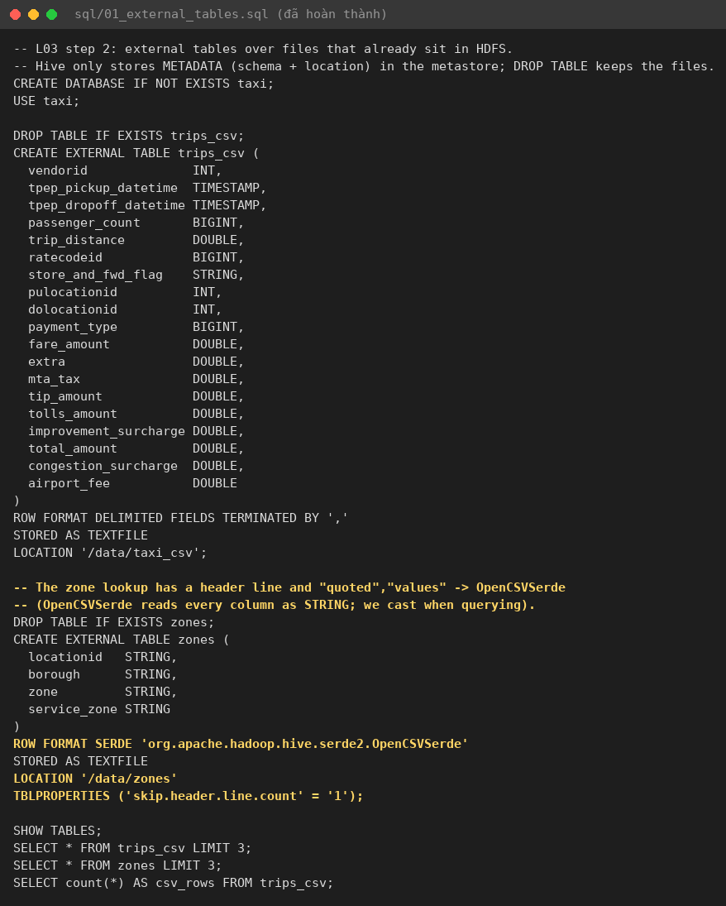
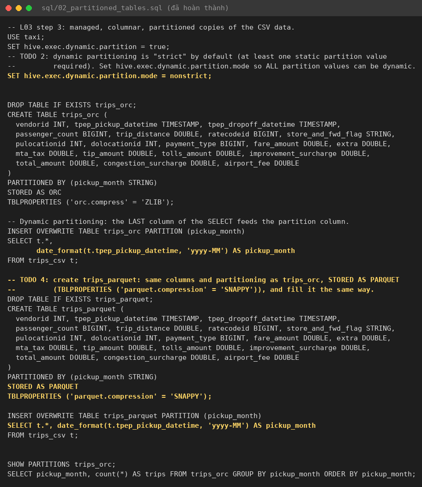
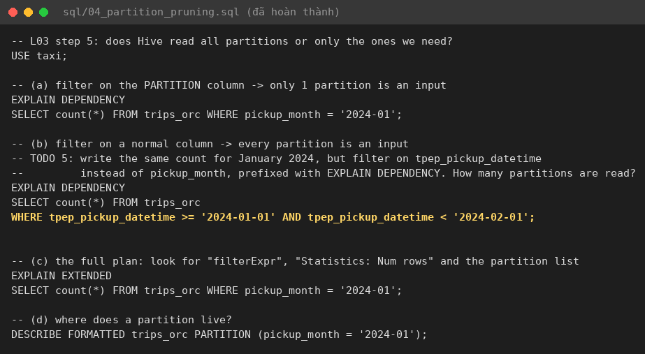
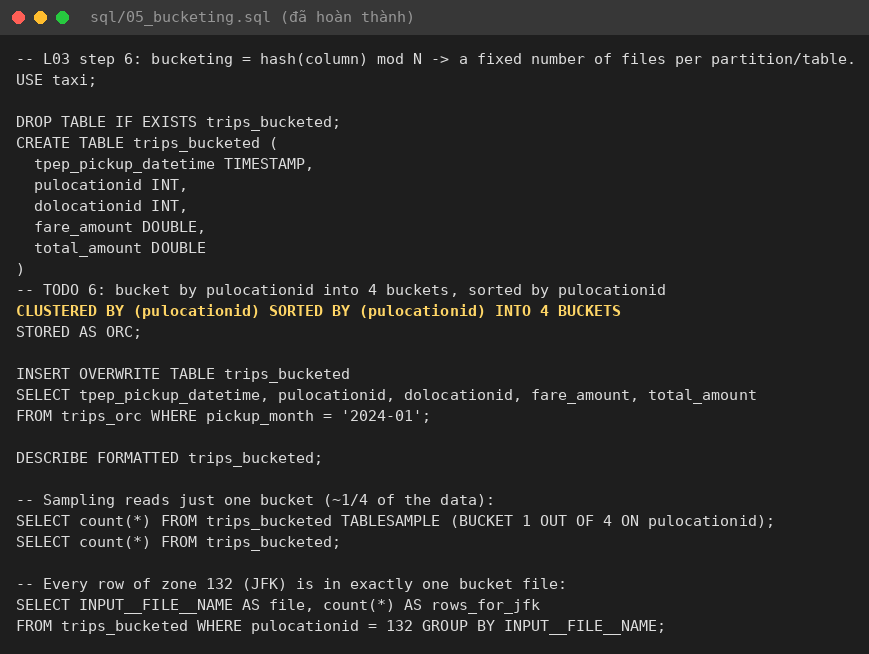

# L03 — Hive: SQL trên HDFS, partitioning, định dạng file, bucketing

Môi trường: Hive 4.2.1 (HiveServer2 + Metastore độc lập, Tez local mode), Metastore DB PostgreSQL 18, HDFS 3.4.3.
Dữ liệu: **cả tháng 01/2024** (2,964,624 dòng, CSV 274.2 MB), không dùng mẫu 1 triệu dòng.
Log gốc: các file `0*.txt`, `1*.txt` (đọc nhanh bằng `./clean.sh <file>`); file SQL đã hoàn thành nằm trong thư mục này; ảnh ở `img/`.

## File SQL đã hoàn thành

| File | TODO |
|---|---|
| `01_external_tables.sql` | TODO 1: `zones` dùng `OpenCSVSerde`, `LOCATION '/data/zones'`, `skip.header.line.count=1` |
| `02_partitioned_tables.sql` | TODO 2: `hive.exec.dynamic.partition.mode=nonstrict`; TODO 3: `date_format(tpep_pickup_datetime,'yyyy-MM')`; TODO 4: `trips_parquet` (Parquet + Snappy) |
| `04_partition_pruning.sql` | TODO 5: `EXPLAIN DEPENDENCY` với filter trên `tpep_pickup_datetime` |
| `05_bucketing.sql` | TODO 6: `CLUSTERED BY (pulocationid) SORTED BY (pulocationid) INTO 4 BUCKETS` |

## 1–2. Khởi động stack và đưa CSV lên HDFS

## 3. External tables

3 dòng mẫu, 3 zone (`1 | EWR | Newark Airport | EWR`…), `csv_rows = 2,964,624`. Metastore (Postgres) chỉ lưu tên
bảng, kiểu bảng, `LOCATION` và `INPUT_FORMAT`:

## 4. Bảng partition ORC và Parquet

INSERT OVERWRITE: ORC 42.8 s, Parquet 45.1 s (2,964,624 dòng mỗi bảng).
`SHOW PARTITIONS` cho **5 partition** (dữ liệu cả tháng có thêm 2024-02 so với mẫu 1 triệu dòng):

| pickup_month | trips |
|---|---|
| 2002-12 | 2 |
| 2009-01 | 3 |
| 2023-12 | 10 |
| 2024-01 | 2,964,606 |
| 2024-02 | 3 |

`DESCRIBE FORMATTED trips_orc` cho thấy `Table Type: EXTERNAL_TABLE`, `TRANSLATED_TO_EXTERNAL=TRUE`,
`external.table.purge=TRUE` (đúng hành vi Hive 4 với bảng "managed" không phải ACID).

### Bảng kích thước

| Định dạng | Kích thước (cả tháng, 2.96 triệu dòng) | So với CSV |
|---|---|---|
| CSV (text) | 274,217,811 B (261.5 MiB) | 1× |
| ORC + ZLIB | 52,629,674 B (50.2 MiB) | **5.2× nhỏ hơn** |
| Parquet + Snappy | 65,305,645 B (62.3 MiB) | **4.2× nhỏ hơn** |
| ORC bucketed (chỉ 5 cột) | 25,271,072 B (24.1 MiB) | 10.9× |

## 5. CSV, ORC và Parquet: bảng thời gian (lần chạy thứ 2)

| Query | CSV | ORC | Parquet |
|---|---|---|---|
| Q1 top pickup zones tháng 01/2024 | **8.53 s** | **1.89 s** | **1.62 s** |
| Q2 join `zones` theo borough (ORC) | | 2.66 s | |

(Lần chạy 1: 9.22 / 1.99 / 1.77 s.) Q1 dòng đầu: zone `132` (JFK) có **145,240 chuyến**, avg fare **59.40**; ba nguồn
cho kết quả giống hệt nhau. Q2: Manhattan 2,646,933 chuyến (**89.3 %**), Queens 273,125, Brooklyn 25,258…

## 6. Partition pruning

* (a) `WHERE pickup_month = '2024-01'` → `input_partitions` chỉ có **1** partition.
* (b) TODO 5, `WHERE tpep_pickup_datetime` trong tháng 1 → **cả 5** partition là input (Hive không suy được partition từ cột thường).
* (c) `EXPLAIN EXTENDED`: `filterExpr: (pickup_month = '2024-01')`, `Path -> Alias` chỉ có `.../trips_orc/pickup_month=2024-01`.

## 7. Bucketing

Đúng **4 file** `000000_0 … 000003_0`. `TABLESAMPLE(BUCKET 1 OUT OF 4)` = 619,893 dòng (~21 %, vì bucket theo hash
nên không đều). Cả **145,240 dòng JFK** đều nằm trong **một** file `000002_0` (vì vậy file này lớn nhất, 8.1 MB).

## Stretch

**ACID.** `zone_notes` với `transactional=true` là `MANAGED_TABLE` thật. Sau INSERT, UPDATE rồi DELETE, HDFS có
`delta_0000001` (insert), `delete_delta_0000002` + `delta_0000002` (UPDATE = xoá + ghi lại) và `delete_delta_0000003`
(DELETE). Không file nào bị sửa tại chỗ; reader merge các delta khi đọc, compaction gộp chúng về sau.

**Statistics.** `ANALYZE ... COMPUTE STATISTICS FOR COLUMNS` mất 18.4 s. Sau đó, với `hive.compute.query.using.stats=true`,
`count(*)` **vẫn chạy DAG Tez** (EXPLAIN vẫn có `TableScan`, ~1.6–2.6 s). Lý do: `trips_orc` thực chất là bảng
**EXTERNAL** (translated), và Hive không tin stats của bảng external để trả lời thay cho việc quét, vì file có thể
bị thay đổi ngoài Hive. Với bảng managed/ACID, câu trả lời sẽ lấy thẳng từ metastore (chỉ còn Fetch, không có job).

## Trả lời checkpoint

**Q1. Metastore lưu gì, HDFS lưu gì? DROP TABLE thì sao?**
**Metastore** (bảng `TBLS`, `SDS`, `PARTITIONS`… trong Postgres): database, tên bảng, cột và kiểu, SerDe,
input/output format, kiểu bảng, **LOCATION** của bảng và của từng partition, giá trị partition, thống kê
(numRows, totalSize…), trạng thái ACID/transaction. **HDFS** chỉ chứa file dữ liệu.
`DROP TABLE trips_csv` (external): chỉ xoá metadata, file trong `/data/taxi_csv` vẫn còn.
`DROP TABLE trips_orc` (external + `external.table.purge=TRUE`): xoá metadata **và** thư mục
`/user/hive/warehouse/taxi.db/trips_orc`.

**Q3. Vì sao ORC/Parquet nhỏ hơn CSV 4–5 lần?** (thực đo 5.2× và 4.2×)
(a) **Lưu theo cột**: giá trị cùng kiểu, cùng cột nằm cạnh nhau nên các encoding dictionary, RLE, delta, bit-packing
rất hiệu quả (`vendorid`, `payment_type`, `ratecodeid` chỉ có vài giá trị khác nhau).
(b) **Kiểu nhị phân + nén** (ZLIB/Snappy) thay cho chữ số dạng text và dấu phân cách: một timestamp là 8 byte số thay vì
chuỗi 19 ký tự. ORC + ZLIB nén mạnh hơn Parquet + Snappy (Snappy ưu tiên tốc độ hơn tỉ lệ nén).

**Q4. Vì sao Q1 nhanh hơn trên ORC/Parquet?** (8.53 s → 1.89 / 1.62 s, nhanh ~4.5–5×)
* **Column pruning**: Q1 chỉ cần 2–3 trong 19 cột (`pulocationid`, `fare_amount`, cột partition). ORC/Parquet chỉ
  đọc các column chunk đó, còn CSV phải đọc và parse **toàn bộ** 274 MB, từng dòng.
* **Partition pruning**: với ORC/Parquet, filter nằm trên `pickup_month`, nên Hive chỉ mở thư mục
  `pickup_month=2024-01` (đã chứng minh bằng EXPLAIN DEPENDENCY, 1 so với 5 partition). Bảng CSV không có partition
  nên phải quét hết rồi lọc theo timestamp.
* **Predicate pushdown / min-max statistics**: mỗi stripe/row group lưu min/max và có row index, nên reader bỏ qua được
  các khối không thể khớp điều kiện.
* Ngoài ra, reader ORC/Parquet được **vectorized** (xử lý theo batch 1,024 dòng) và không tốn công parse text thành số.

**Q6. Partition theo `pulocationid` + ngày? Theo `tpep_pickup_datetime`?**
`pulocationid` × ngày ≈ 265 × 31 ≈ **8,000 partition mỗi tháng**, mỗi partition chỉ có một file vài KB đến vài trăm KB.
Đây là **small files problem**: NameNode phải giữ hàng chục nghìn object trong heap, **Metastore** phải lưu hàng nghìn
dòng `PARTITIONS`/`SDS` (query planning chậm vì phải liệt kê và lấy metadata partition), và mỗi file nhỏ thành một
split/task riêng nên overhead lấn át thời gian xử lý thật. Partition theo timestamp gốc thì gần như **mỗi giây một
partition**: hàng triệu thư mục, file vài trăm byte, metastore và NameNode quá tải. Nguyên tắc: partition theo cột có
cardinality thấp mà query hay lọc, mỗi partition nên chứa từ hàng trăm MB đến khoảng 1 GB.

**Q7. Partitioning hay bucketing? Vì sao bucketing có số file cố định?**
**Partitioning** tạo thư mục theo **giá trị** cột, dùng cho cột cardinality thấp mà query hay lọc (ngày, tháng,
quốc gia), để bỏ qua cả thư mục khi đọc. **Bucketing** chia dữ liệu theo `hash(col) mod N` vào N file, dùng cho cột
cardinality cao (id, `pulocationid`). Nó cho phép sampling (`TABLESAMPLE`), bucket map join hoặc sort-merge-bucket join,
và tránh shuffle khi hai bảng được bucket giống nhau trên khoá join. Số file cố định vì **N được chốt trong DDL**
(`INTO 4 BUCKETS`): mỗi dòng đi vào đúng bucket `hash mod 4` bất kể dữ liệu nhiều hay ít (thực nghiệm: đúng 4 file,
mọi dòng JFK nằm trong `000002_0`).

**Q2.** Trong file trips, `ROW FORMAT DELIMITED` (LazySimpleSerDe) chỉ tách theo dấu phẩy, đủ dùng vì không có
ngoặc kép hay header. File zones có header và `"giá trị trong ngoặc kép"` (ví dụ `"Allerton/Pelham Gardens"`), nên cần
`OpenCSVSerde`. Nhược điểm của nó: **mọi cột đều là STRING** (phải tự CAST, như `CAST(z.locationid AS INT)` trong Q2),
parse chậm hơn, không xử lý NULL đặc biệt.

**Q5.** Partition tĩnh ghi giá trị ngay trong câu lệnh (`PARTITION (pickup_month='2024-01')`). Partition động lấy giá
trị từ dữ liệu (cột cuối của SELECT). Mặc định là `strict` (bắt buộc ít nhất một giá trị tĩnh) để một câu query lỗi
không vô tình tạo hàng nghìn partition, file và object trong metastore. Lab đã thấy điều này ở quy mô nhỏ: các dòng
2002/2009 sinh ra partition "lạ".

**Q8.** Có 18 dòng ngoài tháng 01/2024: 2 dòng 2002-12-31 (một cặp +10.5/−10.5, tức một chuyến bị hoàn tiền),
3 dòng 2009-01-01, 10 dòng 2023-12-31 23:39–23:58 (chuyến bắt đầu trước nửa đêm giao thừa) và 3 dòng 2024-02-01 00:00
(chuyến bắt đầu ngay sau nửa đêm). Các dòng năm 2002/2009 là lỗi đồng hồ thiết bị, còn các dòng 2023-12 và 2024-02 là
chuyến thật nằm ở biên tháng. Trong pipeline thật: kiểm tra event time so với tháng của file nguồn; đưa dòng ngoài
khoảng hợp lệ vào bảng **quarantine/rejected** kèm lý do và đếm/cảnh báo; các dòng biên tháng hợp lệ thì ghi vào đúng
partition (hoặc giữ lại theo tháng của file); không để dynamic partitioning âm thầm tạo partition rác.
