# L04 — Ingestion: Sqoop và Spark JDBC từ PostgreSQL vào HDFS

Stack L04 gồm PostgreSQL (nguồn Olist, 6 bảng), HDFS, YARN, JobHistory, Sqoop 1.4.7 và Spark.
Log gốc nằm trong các file `0*.txt`, ảnh ở `img/`.

## File nộp

| File | Nội dung |
|---|---|
| `sqoop_part1.sh` | Các lệnh Sqoop phần 1: explore, full import, TODO 1.2 (customers), append, lastmodified, saved job |
| `spark_jdbc_ingest.py` | TODO 1–5: đọc JDBC song song, ghi Parquet phân vùng, incremental theo watermark, dedup snapshot |
| `01`–`09_*.txt` | Log từng bước, kể cả log query phía PostgreSQL |

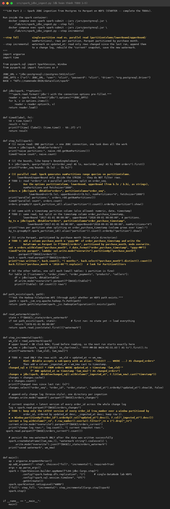

## 1. Nguồn dữ liệu

Có 6 bảng. `orders` có 5,000 dòng, `order_seq` chạy từ 1 đến 5000 và `max(updated_at)` là `2018-09-08 09:48:29`.
Theo trạng thái: delivered 4,793, shipped 102, …

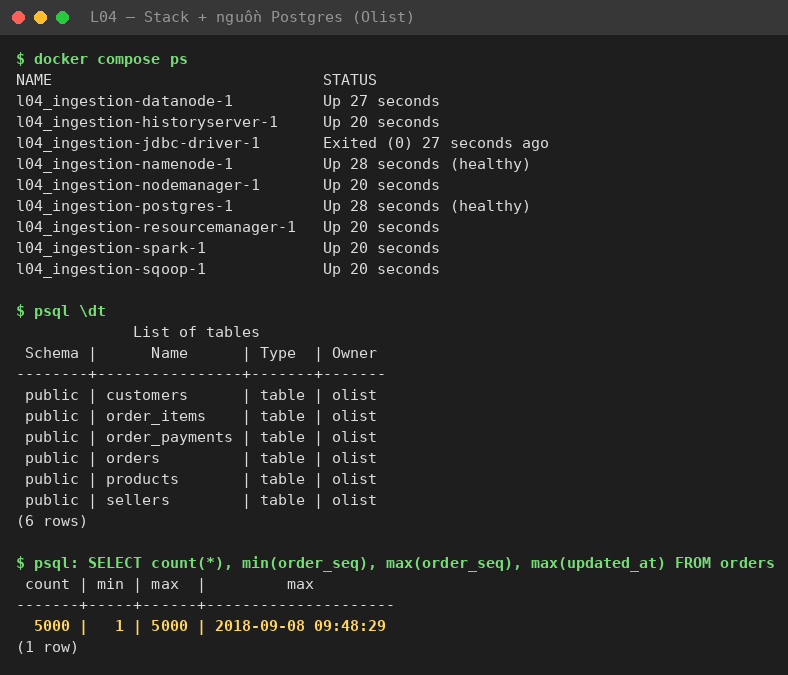

## 2. Sqoop full import và cách chia split

`sqoop import --table orders --split-by order_seq -m 4`:

- Sqoop chạy `BoundingValsQuery` (`SELECT MIN(order_seq), MAX(order_seq) FROM orders`), được (1, 5000), rồi chia thành 4 khoảng đều nhau.
- Log PostgreSQL ghi lại đúng 4 câu query:

| Map | Điều kiện WHERE | Số dòng |
|---|---|---|
| 0 | `order_seq >= 1 AND order_seq < 1251` | 1,250 |
| 1 | `order_seq >= 1251 AND order_seq < 2501` | 1,250 |
| 2 | `order_seq >= 2501 AND order_seq < 3751` | 1,250 |
| 3 | `order_seq >= 3751 AND order_seq <= 5000` | 1,250 |

- Đã chuyển 1.009 MB trong 25.23 s (thời gian MR); tổng thời gian lệnh CLI là 28.5 s.
- 4 file `part-m-0000x` chia đều nhau.

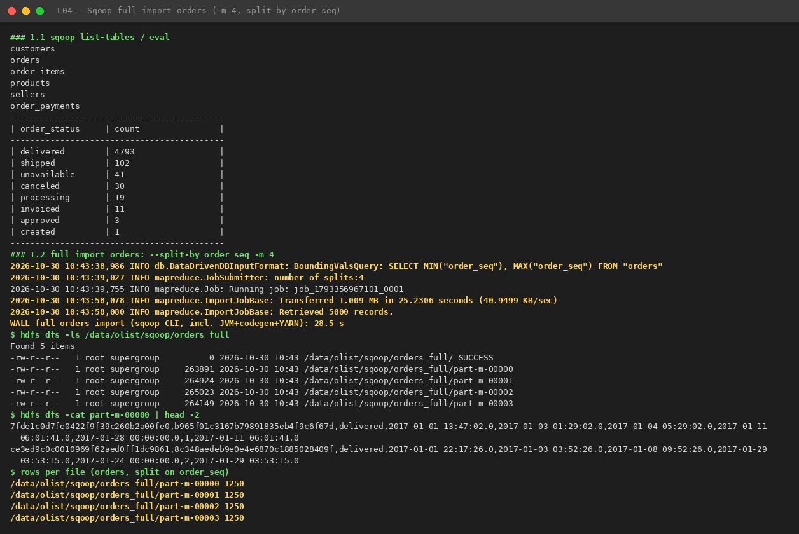
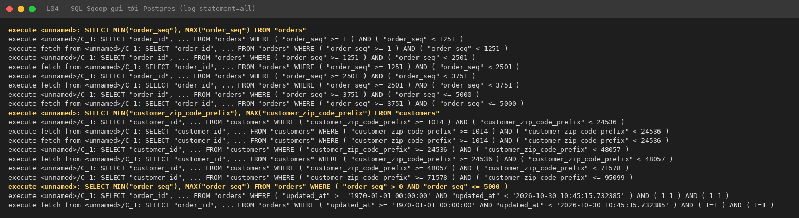
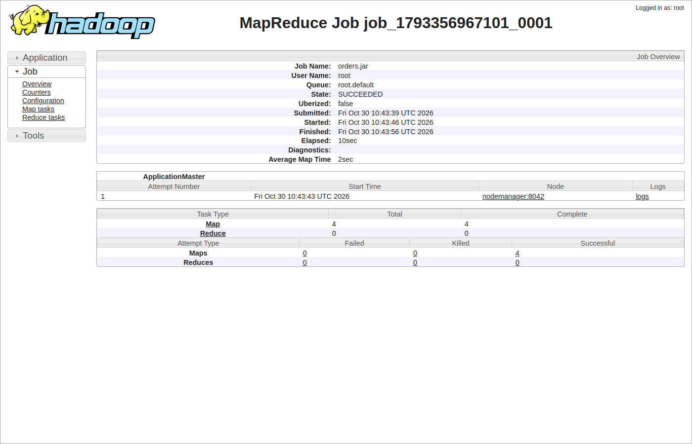

### TODO 1.2: `customers --split-by customer_zip_code_prefix -m 4`

| Bảng / cột split | part-m-00000 | part-m-00001 | part-m-00002 | part-m-00003 |
|---|---|---|---|---|
| `orders` / `order_seq` (1–5000) | 1,250 | 1,250 | 1,250 | 1,250 |
| `customers` / `customer_zip_code_prefix` (1014–95099) | **2,450** | 1,146 | **427** | 977 |

Khoảng zip được chia đều tại 24536, 48057 và 71578, nhưng zip code tập trung ở vùng São Paulo (01xxx–19xxx). Vì vậy split đầu nhận gần một nửa số dòng, còn split thứ ba chỉ nhận 427 dòng: **data skew**.

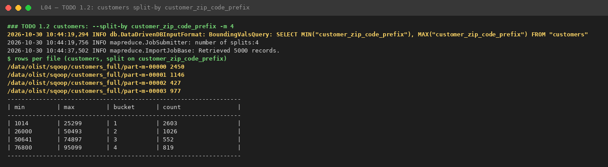

## 3. Sqoop incremental: append, lastmodified, saved job, merge, export

| Bước | Kết quả |
|---|---|
| Append, lần nạp đầu | lower 0, upper 5000 → 5,000 dòng; Sqoop gợi ý `--last-value 5000` |
| Lastmodified, baseline | 5,000 dòng; last-value `2026-10-30 10:45:15.732385` |
| Saved job `orders_incr` | `incremental.last.value = 5000` lưu trong metastore của Sqoop |
| `simulate_changes` #1 | tạo `order_seq` 5001–5003; cập nhật đơn 139 và 278 thành `delivered` |
| `sqoop job --exec orders_incr` | lower 5000, upper 5003 → lấy **3** dòng; `last.value` thành 5003; tổng 5,003 dòng |
| Lastmodified + `--merge-key order_id` | lấy **5** dòng (3 mới + 2 cập nhật); merge job → một `part-r-00000` gồm 5,003 dòng, không trùng |
| `sqoop export` ngược về PostgreSQL | 5,000 record |

Saved job tự lưu `last.value`, nên lần chạy sau chỉ đọc phần mới.
Append chỉ nhìn thấy 3 dòng INSERT. Lastmodified thấy thêm 2 dòng UPDATE, và merge-key gộp mỗi `order_id` về bản mới nhất.

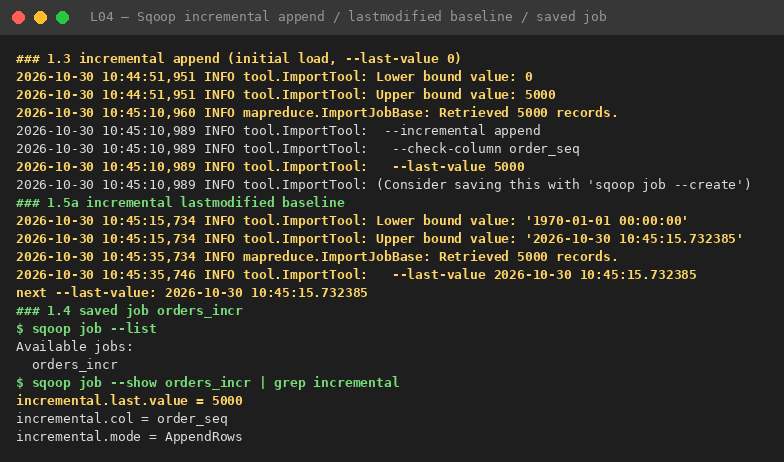
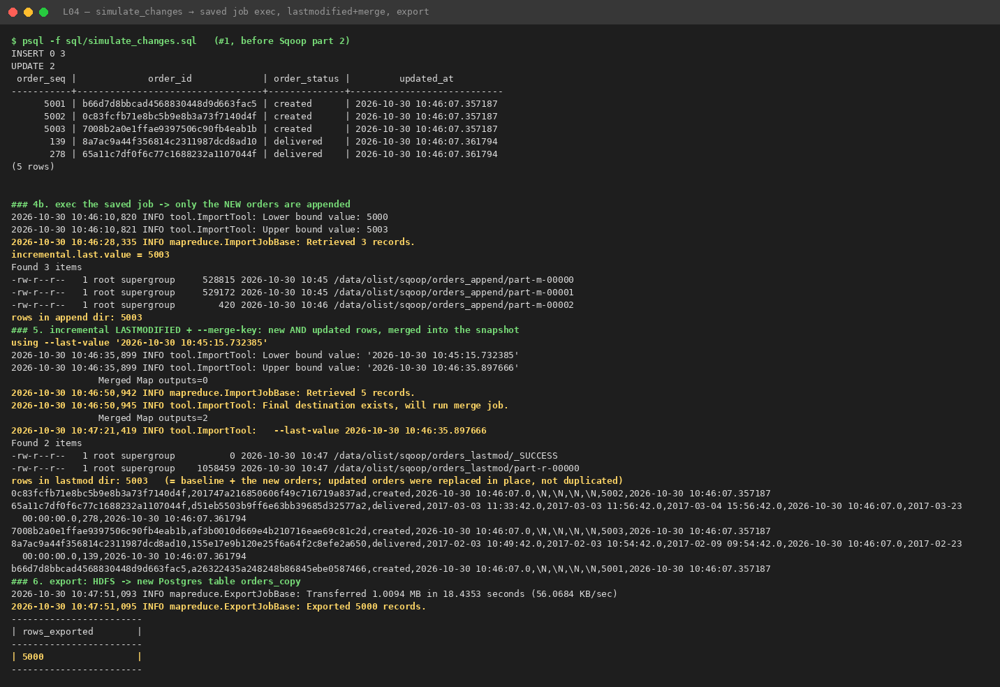
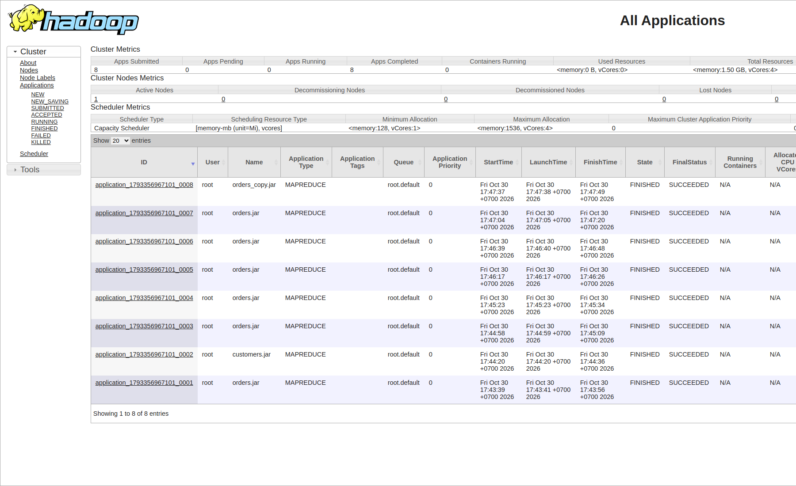
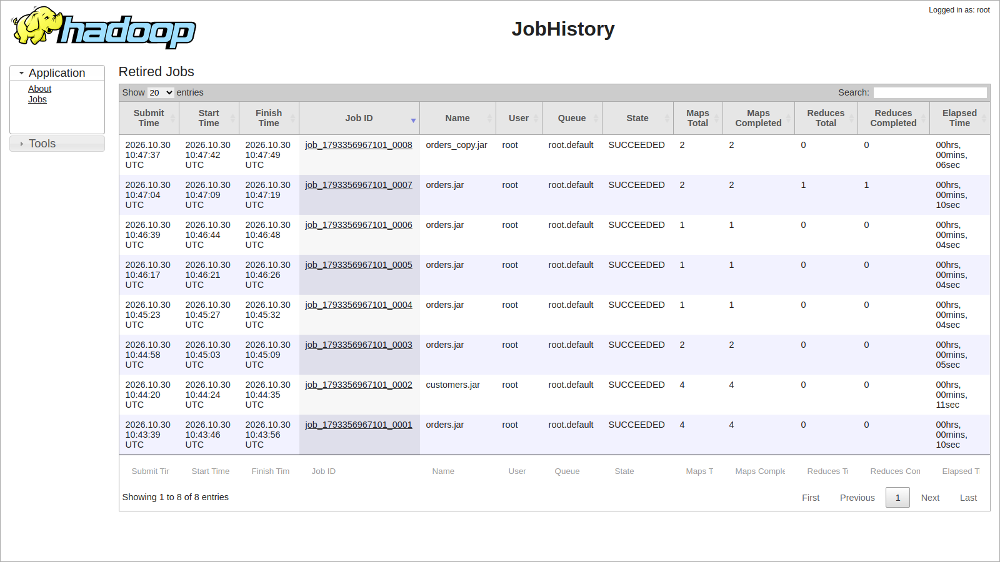

## 4. Spark JDBC: đọc song song và ghi Parquet (TODO 1–3)

| Cách đọc | Số partition | Thời gian `count()` | Phân bố dòng |
|---|---|---|---|
| Naive (không có `partitionColumn`) | 1 | 1.17 s | tất cả 5,003 dòng trong 1 task |
| `partitionColumn=order_seq`, bounds 1..5003, 4 partitions | 4 | 0.22 s | 1,251 / 1,250 / 1,250 / 1,252 |
| `partitionColumn=order_purchase_timestamp` (2017-01-01 → 2018-09-01) | 4 | — | 782 / 1,116 / 1,419 / 1,686 |

- Spark tự sinh 4 câu SQL (log PostgreSQL): `WHERE "order_seq" < 1252 or "order_seq" is null`, … , `WHERE "order_seq" >= 3752`.
  Partition đầu và cuối để **hở**, nên mọi dòng ngoài bounds vẫn được đọc.
- Split theo timestamp bị lệch vì số đơn tăng dần theo thời gian.
- Ghi Parquet `partitionBy("purchase_month")`:
  - mất 3.10 s, ra 21 thư mục tháng, đủ 5,003 dòng;
  - query lọc `purchase_month = '2018-08'` cho thấy `PartitionFilters` trong physical plan, tức là có partition pruning.
- Các bảng khác:

  | Bảng | Số dòng |
  |---|---|
  | customers | 5,003 |
  | order_items | 5,852 |
  | order_payments | 5,472 |
  | products | 1,500 |
  | sellers | 312 |

- Toàn bộ `spark-submit ... full` chạy hết 21.2 s.

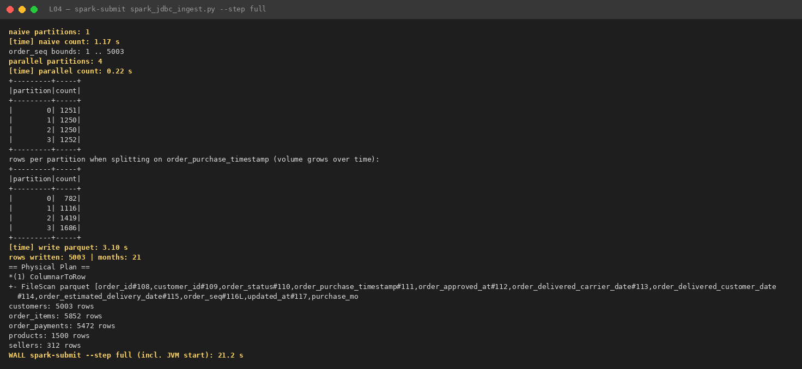
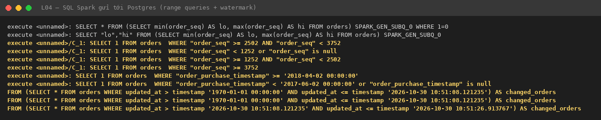
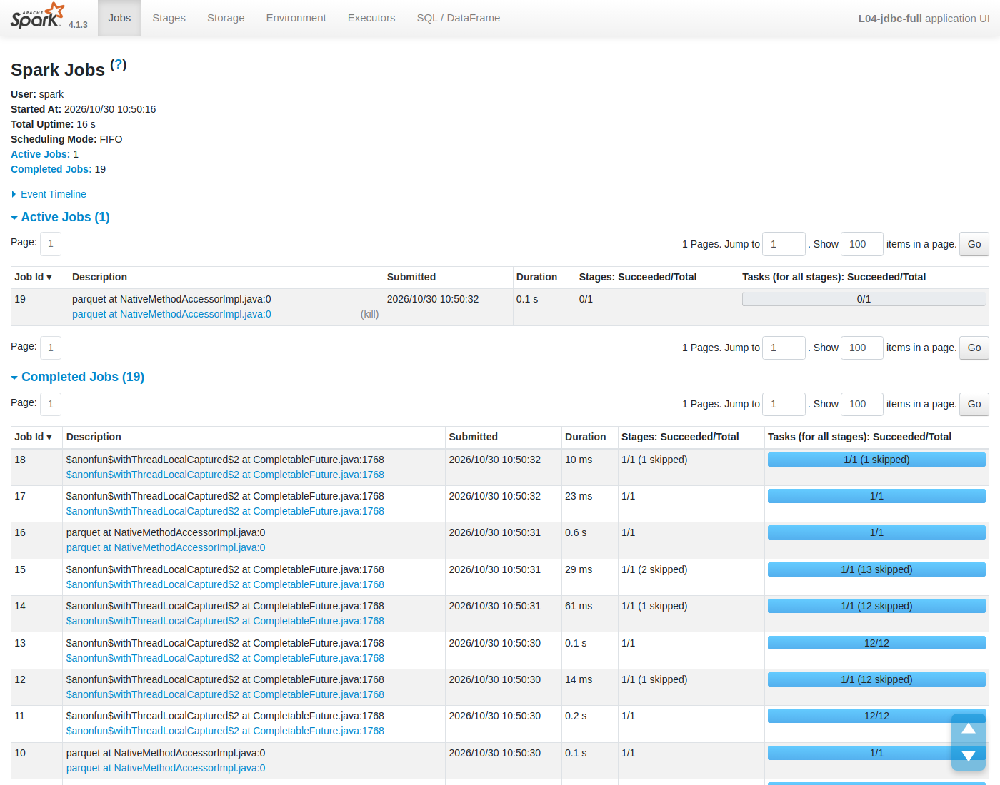
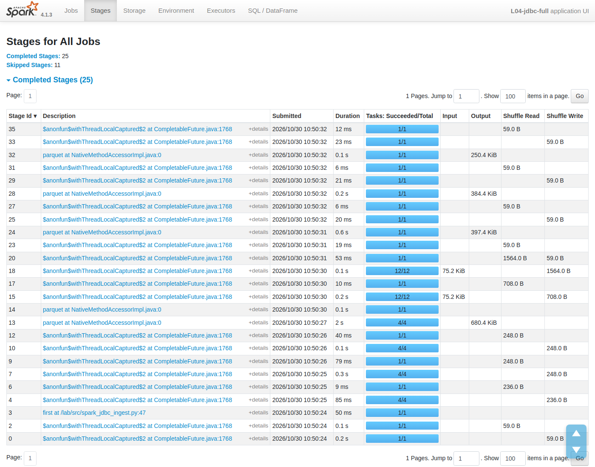
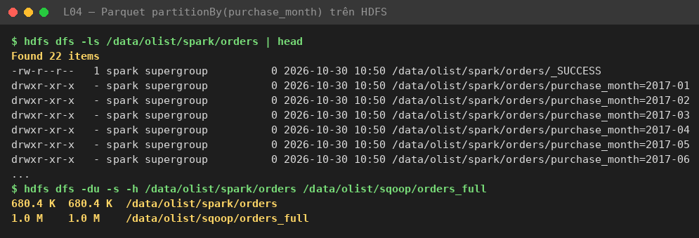

### So sánh Sqoop và Spark JDBC (orders)

| | Sqoop (MapReduce) | Spark JDBC |
|---|---|---|
| Song song | `-m 4`, chia theo MIN/MAX của `--split-by` | `numPartitions=4`, chia theo `lowerBound`/`upperBound` do mình truyền vào |
| Thời gian | 25.2 s MR job (28.5 s cả lệnh) | 3.10 s ghi Parquet (21.2 s cả `spark-submit` 7 bảng, tính cả khởi động JVM/YARN) |
| Định dạng ra | Text CSV, 1.0 MB | Parquet Snappy phân vùng theo tháng, 680.4 KB |
| Incremental | Có sẵn (`--incremental`, saved job, merge) | Phải tự viết: watermark, change log, dedup |
| Biến đổi trong lúc nạp | Không | Có (`withColumn`, `partitionBy`, …) |

Sqoop chậm chủ yếu vì phải khởi động một MR job riêng cho mỗi bảng.
Spark dùng chung một SparkSession cho cả 7 bảng và ghi thẳng ra định dạng cột.
Sqoop 1 cũng đã ngừng phát triển (Apache attic), nên ngày nay thường dùng Spark JDBC hoặc CDC.

## 5. Spark incremental: watermark, change log, snapshot (TODO 4–5)

| Lần chạy | Cửa sổ watermark | Dòng đọc được | Change log | Snapshot |
|---|---|---|---|---|
| 1 (lần đầu) | `(1970-01-01, 2026-10-30 10:51:08.121235]` | 5,003 | 5,003 | 5,003 |
| sau `simulate_changes` #2 (tạo 5004–5006, cập nhật 337 và 355) | | | | |
| 2 | `(10:51:08.121235, now]` | **5** | 5,008 | **5,006** |
| 3 (không có thay đổi) | `(…, now]` | **0** | 5,008 | 5,006 |

- Change log chỉ append và giữ mọi phiên bản: 5,003 + 5 = 5,008.
- Snapshot dùng `row_number()` theo `order_id`, sắp `updated_at DESC, _ingested_at DESC`, nên mỗi đơn chỉ còn bản mới nhất: 5,006 đơn.
- Lần chạy thứ ba đọc 0 dòng, nghĩa là watermark được lưu đúng và pipeline idempotent.

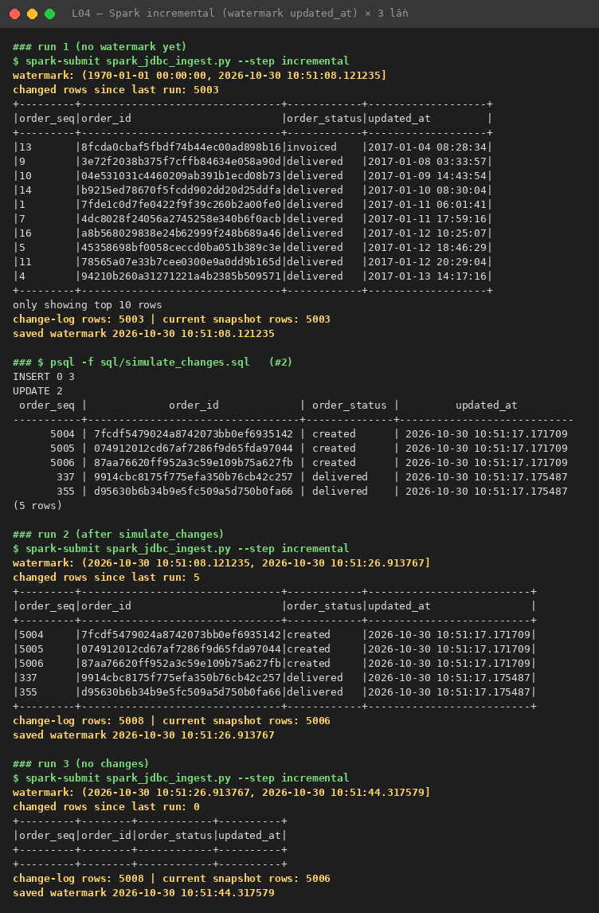

## Trả lời checkpoint

**Q1.** Trước khi import, Sqoop chạy bounding query `SELECT MIN(order_seq), MAX(order_seq) FROM orders` (thấy rõ trong log PostgreSQL), được (1, 5000).
Nó chia khoảng này thành `-m 4` đoạn **bằng nhau về giá trị**, mỗi đoạn rộng (5000 − 1)/4 ≈ 1250, và mỗi map task chạy một câu `SELECT … WHERE order_seq >= lo AND order_seq < hi`.
Đoạn cuối dùng `<=` để lấy cả MAX. Vì `order_seq` dày đặc từ 1 đến 5000, mỗi map nhận đúng 1,250 dòng.

**Q2.** Sqoop chia theo **khoảng giá trị**, không theo số dòng. Zip code của khách Olist tập trung ở São Paulo (01xxx–19xxx), nên đoạn [1014, 24536) nhận 2,450 dòng còn đoạn [48057, 71578) chỉ có 427 dòng.
Task chậm nhất quyết định thời gian của cả job.
`customer_id` là chuỗi hash dạng text. Sqoop mặc định từ chối split theo cột text và báo lỗi, trừ khi bật `-Dorg.apache.sqoop.splitter.allow_text_splitter=true`.
Kể cả khi bật, việc chia theo thứ tự chuỗi vẫn kém tin cậy (phụ thuộc collation), và split có thể lệch hoặc rỗng.
Nên chọn một cột số, phân bố đều và có index, như `order_seq`.

**Q3.** **Có.** `lowerBound`/`upperBound` chỉ dùng để tính **bước chia** (stride), **không phải bộ lọc**.
Spark sinh partition đầu là `order_seq < 1252 OR order_seq IS NULL` và partition cuối là `order_seq >= 3752`, không có cận trên.
Vì vậy dòng `order_seq = 9,999` vẫn được đọc và rơi vào **partition cuối**.
Nếu nhiều dòng nằm ngoài bounds, partition đầu hoặc cuối sẽ phình to và gây skew. Phải lấy bounds thật (MIN/MAX) trước khi đọc, như script đã làm (`bounds 1..5003`).

**Q4.**
- **Chốt cận trên trước khi đọc:** `wm_new = now()` được lấy *trước* khi đọc, và query dùng `updated_at > wm_old AND updated_at <= wm_new`.
  Nếu lấy `now()` *sau* khi đọc, những dòng được cập nhật **trong lúc** đang đọc sẽ có `updated_at` nằm trước watermark mới mà không nằm trong dữ liệu đã đọc. Lần chạy sau sẽ bỏ qua chúng vĩnh viễn: **mất dữ liệu**.
  Cận trên cố định cũng giúp các partition JDBC song song nhìn cùng một cửa sổ, và lần sau bắt đầu đúng từ chỗ lần này dừng.
- **Chỉ lưu watermark sau khi ghi thành công:** nếu job chết giữa chừng, watermark cũ vẫn còn và lần chạy lại sẽ đọc lại cả cửa sổ.
  Như vậy dữ liệu được giao **at-least-once**: có thể trùng nhưng không mất. Phần trùng được dedup idempotent bằng `row_number()` theo `order_id` khi dựng snapshot.
  Nếu lưu watermark trước khi ghi mà ghi thất bại, cửa sổ đó sẽ bị bỏ qua mãi mãi.

**Q5.** `append` chỉ dựa vào `order_seq > last_value`, nên chỉ bắt được **INSERT** (lần chạy job chỉ lấy 3 dòng mới).
`lastmodified` dựa vào `updated_at > last_value`, nên bắt được cả **INSERT và UPDATE** (lấy 5 dòng: 3 mới + 2 đơn 139 và 278). Cần `--merge-key` để gộp bản cũ với bản mới.
**Không chế độ nào bắt được DELETE**: dòng đã xoá thì không còn trong bảng để query ra.

**Q6.** Watermark trên `updated_at` **không** giải quyết được:
1. **DELETE**: dòng bị xoá không bao giờ xuất hiện trong query, nên bản sao trên HDFS giữ dữ liệu "ma" (trừ khi ứng dụng dùng soft delete).
2. **Các lần UPDATE trung gian**: nếu một dòng đổi nhiều lần giữa hai lần chạy (ví dụ `shipped` → `delivered` → `canceled`), ta chỉ thấy trạng thái cuối và mất lịch sử.
3. **`updated_at` không đáng tin**:
   - ứng dụng quên cập nhật cột, hoặc ghi bằng giờ của app server lệch đồng hồ;
   - transaction dài commit *sau* khi watermark đã vượt qua timestamp của nó, nên dòng bị bỏ sót.
4. **Tải lên nguồn**: mỗi lần chạy là một query quét theo `updated_at` (cần index), độ trễ bằng chu kỳ poll.

**CDC** (Debezium, L08) không query bảng mà đọc **transaction log (WAL)** của PostgreSQL qua logical replication.
Mọi INSERT, UPDATE và DELETE được phát ra thành event theo đúng thứ tự commit, kèm ảnh trước và sau. Không phụ thuộc cột `updated_at`, gần như không tạo tải query, và độ trễ chỉ vài giây.

**Q7.** `-m 50` hoặc `numPartitions=50` mở **50 kết nối đồng thời**, mỗi kết nối chạy một range scan.
Như vậy dễ vượt `max_connections` (PostgreSQL mặc định 100), làm ứng dụng production không lấy được kết nối.
Nó cũng tranh CPU, I/O và buffer cache với tải OLTP, và với bảng nhỏ (5,000 dòng) thì mỗi task chỉ có ~100 dòng, chi phí khởi tạo lấn át lợi ích.
Thực tế nên giới hạn khoảng 4–8 kết nối, đọc từ **read replica** hoặc ngoài giờ cao điểm, và đặt `fetchsize` hợp lý.
