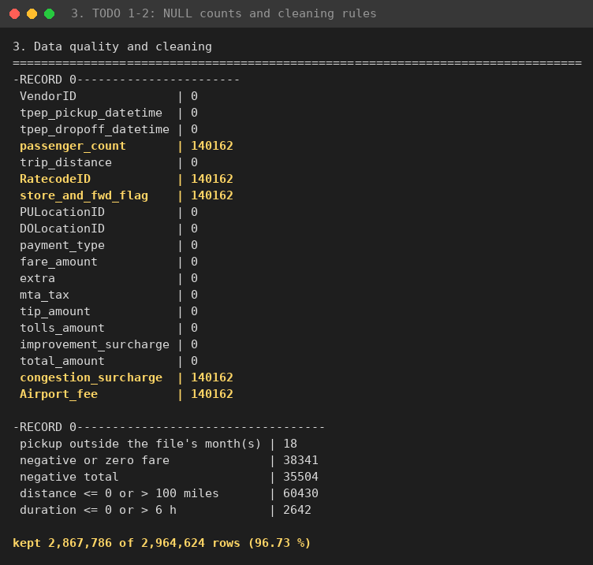
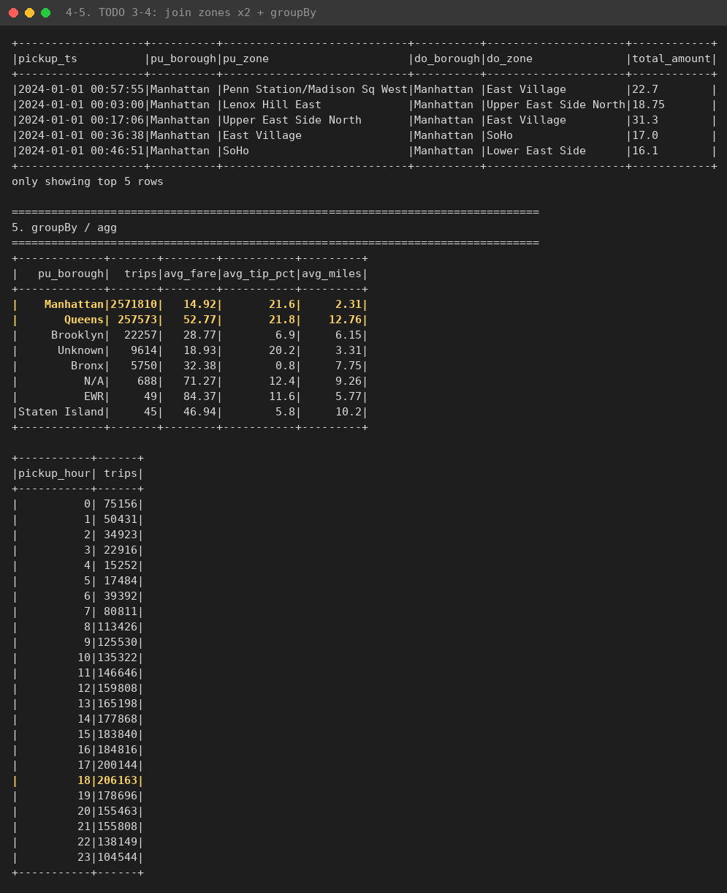
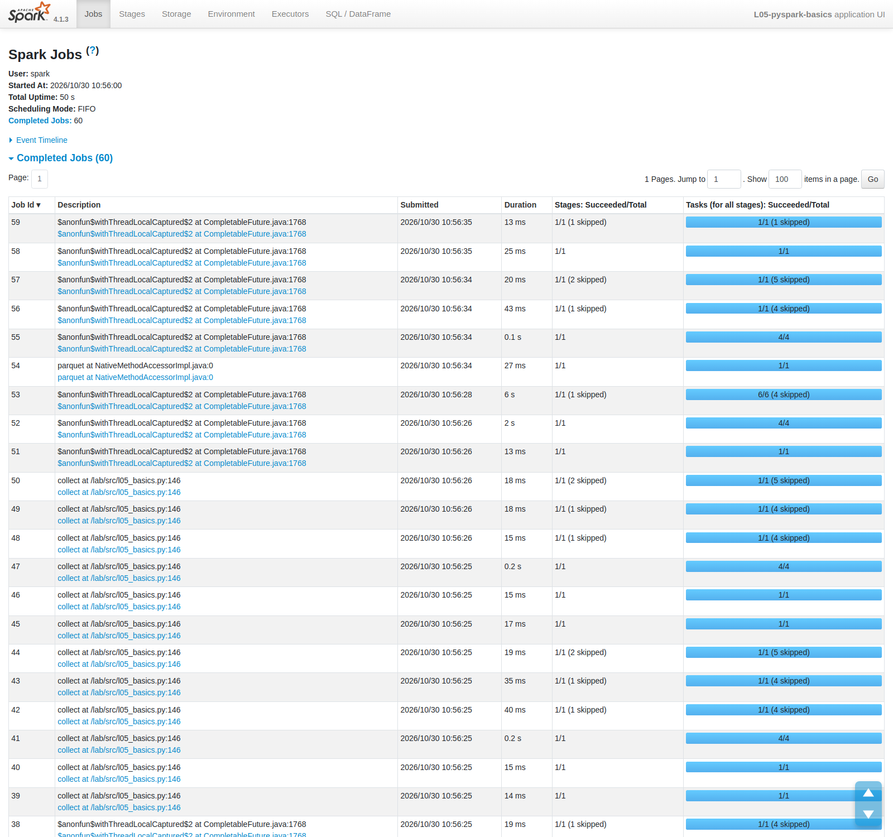
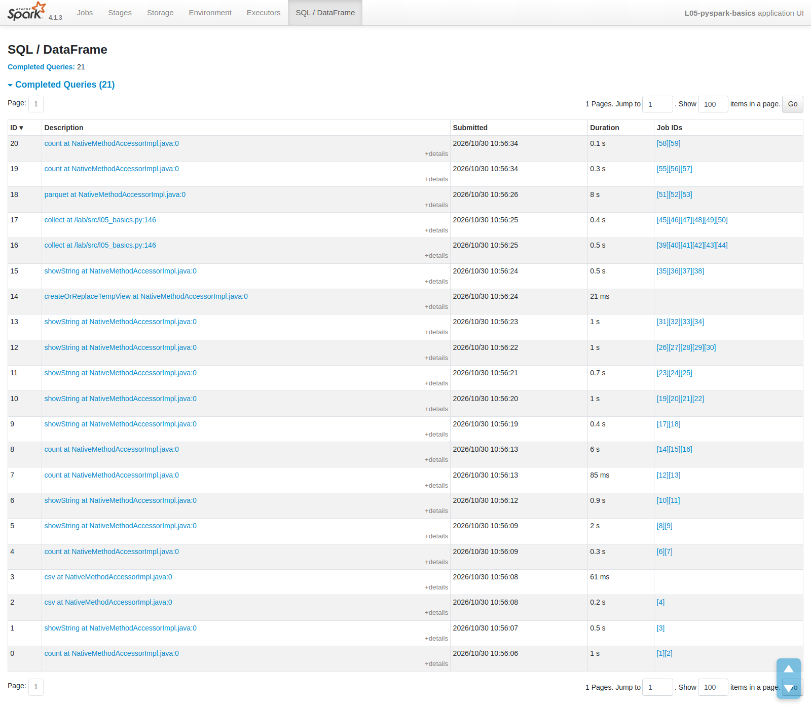
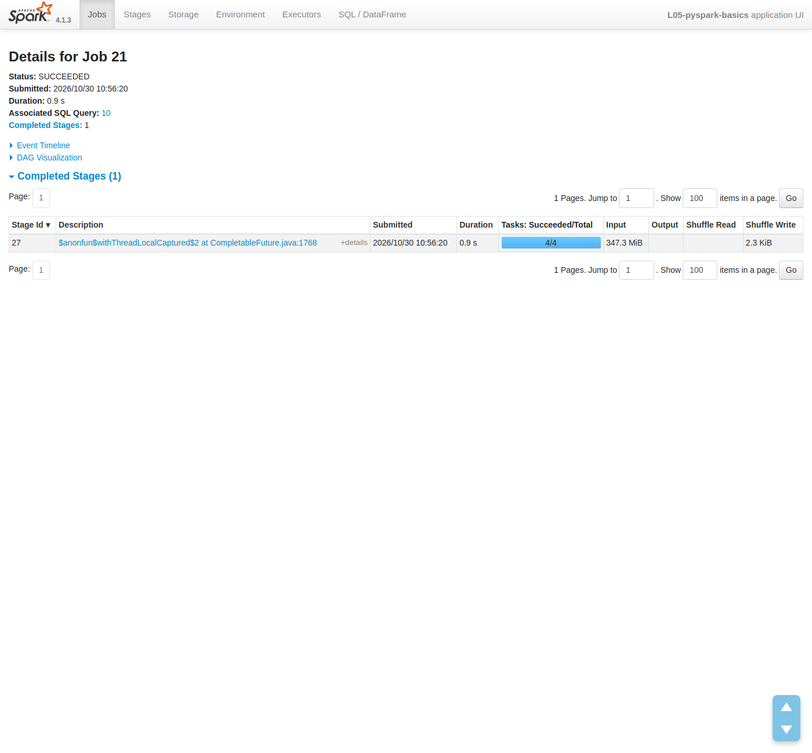
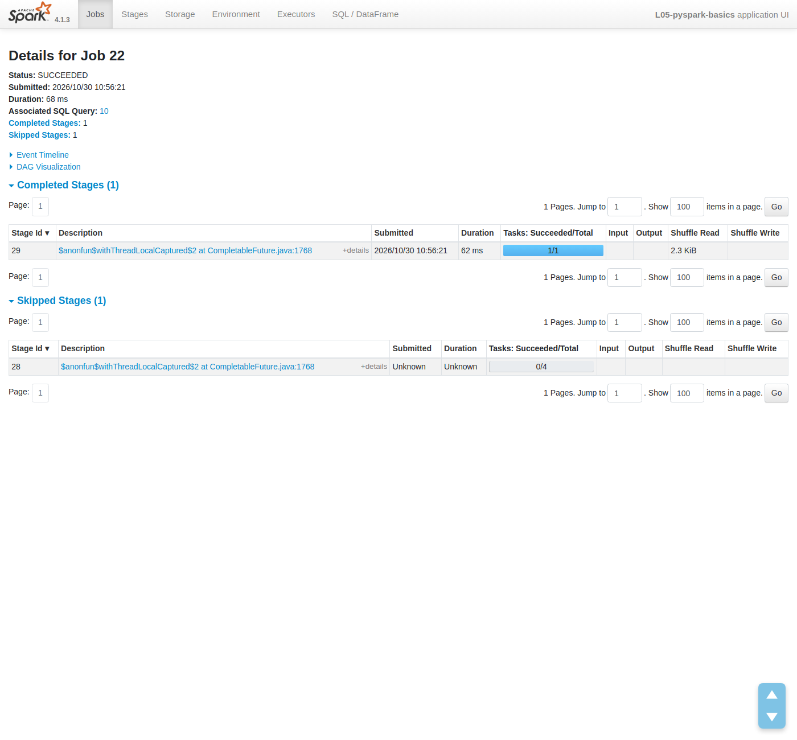
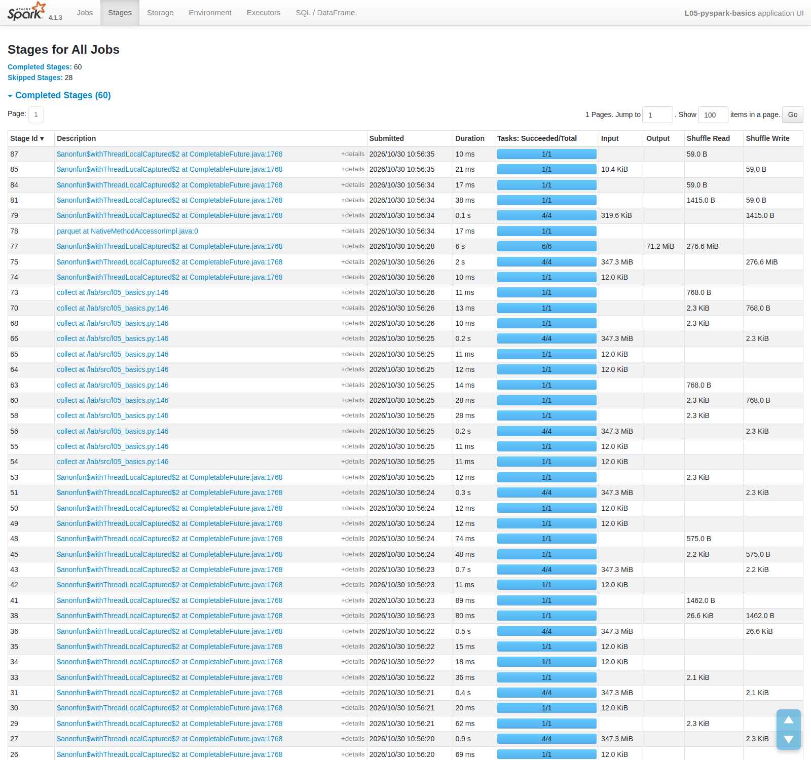

# PySpark cơ bản: DataFrame, Spark SQL, kế hoạch thực thi và Spark UI {#sec:l05}

## Tóm tắt {.unnumbered}

Bài thực hành này dùng API DataFrame của PySpark (Spark 4.1.3, chế độ `local[4]` trong Docker) để xử lý dữ liệu taxi
vàng New York tháng 01/2024 gồm 2,964,624 chuyến. Chúng tôi đọc Parquet và CSV, kiểm tra cơ chế lazy evaluation, làm
sạch dữ liệu theo năm luật, join với bảng khu vực, tổng hợp theo quận, dùng hàm cửa sổ, viết lại bằng Spark SQL, đọc
kế hoạch vật lý cùng Spark UI và cuối cùng ghi Parquet phân vùng theo ngày. Dựng ba transformation mất 0.096 s và không
sinh job, còn `count()` mất 0.28 s. Sau làm sạch còn 2,867,786 dòng (96.73 %). Kết quả SQL trùng với DataFrame. Nhờ
tổng hợp partial trước shuffle, chỉ 24 dòng đi qua shuffle thay vì 2.87 triệu. Khi ghi không `repartition` thu được 56
tệp, có `repartition` thu được đúng 31 tệp, đổi lại thời gian ghi tăng từ 6.8 s lên 8.2 s. Ranh giới stage nằm ở các
toán tử `Exchange`, và tổng hợp hai pha của Spark làm cùng việc với combiner trong MapReduce.

**Từ khóa:** Apache Spark, PySpark, DataFrame, Spark SQL, lazy evaluation, Catalyst, AQE, broadcast join, Spark UI,
partitioned Parquet.

## Giới thiệu {#sec:l05-intro}

Các bài trước đã đi qua HDFS, MapReduce và Hive. Bài này chuyển sang Apache Spark, hệ thống xử lý phân tán giữ dữ liệu
trung gian trong bộ nhớ [1]. Với MapReduce, người lập trình tự viết pha map và reduce. Với Spark, ta chỉ mô tả phép
tính qua DataFrame hoặc SQL, còn bộ tối ưu Catalyst [2] quyết định cách chạy. Vì vậy muốn dùng Spark cho đúng thì phải
biết nó làm gì với đoạn mã: lúc nào job thật sự chạy, stage bị cắt ở đâu, dữ liệu có bị shuffle hay không.

Mục tiêu cụ thể:

1. Tạo `SparkSession`, đọc Parquet và CSV, kiểm tra schema và số partition đầu vào.
2. Kiểm chứng lazy evaluation: transformation chỉ dựng kế hoạch, action mới chạy job.
3. Làm sạch dữ liệu thực (NULL, giá cước âm, quãng đường hoặc thời lượng bất thường, ngày ngoài phạm vi) và xử lý chế
   độ ANSI mặc định của Spark 4.
4. Thực hiện join, `groupBy/agg` và hàm cửa sổ (`dense_rank`, `lag`, tổng lũy kế).
5. Viết lại cùng logic bằng Spark SQL và so sánh kết quả.
6. Đọc kế hoạch vật lý bằng `explain("formatted")` và đối chiếu với các stage trong Spark UI.
7. Ghi Parquet phân vùng và kiểm tra partition pruning khi đọc lại.

@sec:l05-theory tóm lược lý thuyết, @sec:l05-method mô tả môi trường và quy trình, @sec:l05-results trình bày kết quả,
@sec:l05-discussion trả lời tám câu hỏi checkpoint, @sec:l05-conclusion kết luận.

## Cơ sở lý thuyết {#sec:l05-theory}

### Driver, job, stage, task

Một ứng dụng Spark gồm một driver điều phối và các executor thực thi. Mỗi action (`count`, `show`, `collect`, `write`)
sinh một hoặc nhiều job. DAG scheduler chia job thành các stage tại những chỗ cần trao đổi dữ liệu giữa các partition
(shuffle), mỗi stage có một task cho mỗi partition [1], [3]. Ở `local[4]`, driver và bốn luồng task chạy chung một JVM.
Đây là mô hình cluster thu nhỏ nhưng vẫn giữ đủ các khái niệm trên.

### Transformation, action và lazy evaluation

`filter`, `withColumn`, `select`, `join`, `groupBy` là transformation. Chúng chỉ trả về một DataFrame mới mang cây kế
hoạch logic, chưa đọc dữ liệu. Khi gọi action, Spark mới tối ưu cả kế hoạch rồi thực thi. Nhờ vậy Catalyst có thể gộp
bộ lọc và đẩy chúng xuống nguồn dữ liệu trước khi đọc [2].

### Catalyst, AQE và tổng hợp hai pha

Catalyst chuyển kế hoạch logic thành kế hoạch vật lý, áp dụng các quy tắc như predicate pushdown (đẩy điều kiện lọc
xuống reader) và column pruning (chỉ đọc cột cần) [2]. Adaptive Query Execution (AQE) tối ưu lại kế hoạch ngay khi chạy,
dựa trên thống kê thực của từng query stage, ví dụ gộp các partition shuffle nhỏ (`AQEShuffleRead coalesced`) [5].
Phép tổng hợp được tách hai pha: `HashAggregate` partial trước shuffle và final sau shuffle, tương đương combiner trong
MapReduce [7].

### Chiến lược join

Nếu một phía của join nhỏ hơn `spark.sql.autoBroadcastJoinThreshold` (mặc định 10 MB), Spark gửi bản sao phía đó tới
mọi task (broadcast hash join) và không phải shuffle phía lớn. Khi cả hai phía đều lớn, Spark shuffle cả hai theo khóa
rồi dùng sort-merge join [3], [5].

### Chế độ ANSI trong Spark 4

Từ Spark 4.0, `spark.sql.ansi.enabled` mặc định là `true`: chia cho 0 hay ép kiểu sai sẽ báo lỗi thay vì trả NULL như
Spark 3. Muốn nhận NULL thì phải gọi tường minh `try_divide`, `try_cast` [6].

### Parquet phân vùng và partition pruning

`DataFrameWriter.partitionBy(col)` ghi dữ liệu thành các thư mục con `col=value`. Khi đọc lại với bộ lọc trên cột phân
vùng, Spark chỉ liệt kê và mở các thư mục khớp điều kiện (`PartitionFilters`) [4].

## Môi trường và phương pháp thực nghiệm {#sec:l05-method}

### Môi trường

Cấu hình ở @tbl:l05-env lấy từ `conf/spark-defaults.conf`, kiểm tra lại trong tab Environment của Spark UI
(@fig:l05-ui-env).

| Thành phần | Giá trị |
|---|---|
| Phiên bản Spark | 4.1.3 (image Docker `spark:4.1.3-python3`) |
| Java / Scala / Python | Java 17 (17.0.20.1, Eclipse Adoptium) / Scala 2.13.17 / Python 3.10 |
| Chế độ chạy | `local[4]`: driver và 4 luồng task trong một JVM |
| Bộ nhớ driver | 2 GB (`spark.driver.memory=2g`) |
| `spark.sql.shuffle.partitions` | 8 (thay cho mặc định 200) |
| `spark.sql.session.timeZone` | UTC |
| `spark.sql.ansi.enabled` | `true` (mặc định của Spark 4) |
| Event log | bật, ghi vào `file:///tmp/spark-events` |
| Spark UI | cổng 4040, giữ sống bằng tham số `--hold 300` |

: Môi trường thực nghiệm và cấu hình Spark. {#tbl:l05-env}

{#fig:l05-ui-env width=85%}

### Dữ liệu

Hai tệp công khai của NYC Taxi and Limousine Commission [8] được mô tả ở @tbl:l05-data.

| Tệp | Định dạng | Kích thước | Số dòng | Số cột |
|---|---|---|---|---|
| `yellow_tripdata_2024-01.parquet` | Parquet | khoảng 48 MB | 2,964,624 | 19 |
| `taxi_zone_lookup.csv` | CSV có header | 12.0 KiB | 265 | 4 |

: Dữ liệu đầu vào. {#tbl:l05-data}

Bảng chuyến đi có hai cột thời gian `tpep_pickup_datetime`, `tpep_dropoff_datetime` kiểu `timestamp_ntz`, các cột tiền
(`fare_amount`, `tip_amount`, `total_amount`...) kiểu `double` và mã khu vực `PULocationID`, `DOLocationID`. Bảng khu vực
gồm `LocationID`, `Borough`, `Zone`, `service_zone`.

### Quy trình

Toàn bộ thực nghiệm nằm trong script `l05_basics.py`, chạy bằng `spark-submit` trong container. Các bước:

1. Đọc Parquet và CSV, in schema, số dòng và số partition đầu vào.
2. Dựng ba transformation (`filter`, `withColumn`, `select`) rồi gọi `count()`, đo thời gian từng giai đoạn.
3. Đếm NULL theo cột, đếm số dòng vi phạm từng luật làm sạch trong một lần quét, lọc, điền giá trị mặc định, tính
   `tip_pct` bằng `F.try_divide` và `cache()` DataFrame `clean`.
4. Join hai lần với bảng khu vực, theo điểm đón và theo điểm trả.
5. Tổng hợp theo quận đón và theo giờ đón.
6. Xếp hạng top-3 khu vực đón mỗi quận bằng `dense_rank`; tính số chuyến theo ngày, chênh lệch với ngày trước (`lag`)
   và doanh thu lũy kế.
7. Tạo temp view `trips`, viết lại phép tổng hợp theo quận bằng SQL và so sánh với DataFrame.
8. In `by_borough.explain("formatted")`.
9. Ghi `enriched` thành Parquet phân vùng theo `pickup_date`, đếm tệp, đọc lại ngày 2024-01-15.

Tham số thay đổi giữa hai lần chạy là có hay không `repartition("pickup_date")` trước khi ghi. Để khỏi sửa mã giữa hai
lần, chúng tôi thêm cờ `--no-repartition` vào script. Lần đầu chạy với cờ này. Lần thứ hai (lần chạy chính) dùng
`repartition` kèm `--hold 300` để Spark UI còn sống trong lúc chụp màn hình. Hành vi ANSI khi chia cho 0 được kiểm tra
riêng bằng một đoạn thử nhỏ.

## Kết quả thực nghiệm {#sec:l05-results}

Số liệu dưới đây lấy từ log `03_run_with_repartition.txt` nếu không ghi chú khác. Lần chạy không `repartition`
(`01_run_no_repartition.txt`) cho kết quả giống hệt, trừ phần ghi Parquet và thời gian đo.

### Đọc dữ liệu và đánh giá trễ

Spark đọc được 19 cột, 2,964,624 dòng, chia thành 4 partition đầu vào (@fig:l05-read). Ba transformation ở bước 2 được
dựng trong 0.096 s và không sinh job nào. `count()` ngay sau đó trả về 228,254 chuyến dài hơn 10 dặm sau 0.28 s. Ở lần
chạy không `repartition`, hai con số là 0.076 s và 0.26 s, cùng bậc độ lớn.

{#fig:l05-read width=85%}

### Chất lượng dữ liệu và làm sạch

Số NULL của mọi cột được đếm trong một phép `select` duy nhất. 14 cột không có NULL, còn đúng năm cột `passenger_count`,
`RatecodeID`, `store_and_fwd_flag`, `congestion_surcharge`, `Airport_fee` cùng có 140,162 NULL (@fig:l05-cleaning). Số
dòng vi phạm từng luật được đếm bằng tổng hợp có điều kiện trong một lần quét (@tbl:l05-rules).

| Luật | Số dòng vi phạm |
|---|---|
| Thời điểm đón nằm ngoài tháng của tệp (2024-01) | 18 |
| Giá cước `fare_amount` ≤ 0 | 38,341 |
| Tổng tiền `total_amount` < 0 | 35,504 |
| Quãng đường ≤ 0 hoặc > 100 dặm | 60,430 |
| Thời lượng ≤ 0 hoặc > 6 giờ | 2,642 |
| **Giữ lại sau làm sạch** | **2,867,786 / 2,964,624 (96.73 %)** |

: Số dòng vi phạm từng luật làm sạch (một dòng có thể vi phạm nhiều luật). {#tbl:l05-rules}

Tổng số dòng bị loại là 96,838, ít hơn tổng cột bên phải vì các luật chồng lên nhau: chuyến có giá cước âm thường cũng
có tổng tiền âm. Dòng có NULL không bị loại mà được điền mặc định `passenger_count=1`, `RatecodeID=1`,
`congestion_surcharge=0.0`, `Airport_fee=0.0`.

{#fig:l05-cleaning width=85%}

Vì Spark 4 bật ANSI mode, phép chia `tip_amount / fare_amount` thông thường sẽ làm hỏng cả job nếu gặp mẫu số bằng 0,
nên tỷ lệ tip được tính bằng `F.try_divide`. Đoạn thử riêng (@fig:l05-ansi) xác nhận `spark.sql.ansi.enabled = true`:
`try_divide(1, 0)` trả NULL, còn `1/0` ném `ArithmeticException [DIVIDE_BY_ZERO]` với SQLSTATE 22012.

![Chế độ ANSI: `try_divide` trả NULL, phép chia thường ném lỗi `[DIVIDE_BY_ZERO]`.](img/08_ansi_divide_by_zero.png){#fig:l05-ansi width=85%}

### Join với bảng khu vực và tổng hợp theo quận

Trước mỗi lần join, bảng khu vực được đổi tên cột (`PULocationID`/`pu_borough`/`pu_zone` và
`DOLocationID`/`do_borough`/`do_zone`). Nếu không đổi tên, hai lần join cùng một bảng sẽ sinh hai cột `Borough` trùng
tên và Spark báo `AMBIGUOUS_REFERENCE`. Kết quả join và tổng hợp ở @fig:l05-join, số liệu theo quận đón ở
@tbl:l05-borough.

| Quận đón | Số chuyến | Giá cước TB | Tip TB (%) | Quãng đường TB (dặm) |
|---|---:|---:|---:|---:|
| Manhattan | 2,571,810 | 14.92 | 21.6 | 2.31 |
| Queens | 257,573 | 52.77 | 21.8 | 12.76 |
| Brooklyn | 22,257 | 28.77 | 6.9 | 6.15 |
| Unknown | 9,614 | 18.93 | 20.2 | 3.31 |
| Bronx | 5,750 | 32.38 | 0.8 | 7.75 |
| N/A | 688 | 71.27 | 12.4 | 9.26 |
| EWR | 49 | 84.37 | 11.6 | 5.77 |
| Staten Island | 45 | 46.94 | 5.8 | 10.2 |

: Tổng hợp theo quận đón sau làm sạch (`by_borough`). {#tbl:l05-borough}

Manhattan chiếm khoảng 89.7 % số chuyến, toàn chuyến ngắn và rẻ. Giá cước trung bình ở Queens cao gấp khoảng 3.5 lần
Manhattan, quãng đường cũng dài hơn nhiều, dễ hiểu vì JFK và LaGuardia đều nằm ở Queens. Tip ở Bronx chỉ 0.8 %; chúng
tôi đoán phần lớn tiền boa ở đây trả bằng tiền mặt nên không được ghi nhận, nhưng dữ liệu không đủ để khẳng định. Theo
giờ đón, khung 18:00 đông nhất với 206,163 chuyến, khung 04:00 vắng nhất với 15,252 chuyến.

{#fig:l05-join width=85%}

### Hàm cửa sổ

Top-3 khu vực đón mỗi quận dùng `dense_rank()` trên cửa sổ `partitionBy("pu_borough")`. @tbl:l05-top3 ghi kết quả cho
hai quận lớn nhất. Riêng Staten Island trả về hơn 3 dòng, do `dense_rank` để nhiều khu vực đồng hạng: ba khu vực cùng 4
chuyến ở hạng 2 và bốn khu vực cùng 2 chuyến ở hạng 3.

| Quận | Hạng 1 | Hạng 2 | Hạng 3 |
|---|---|---|---|
| Manhattan | Midtown Center (140,065) | Upper East Side South (140,059) | Upper East Side North (133,891) |
| Queens | JFK Airport (138,296) | LaGuardia Airport (87,657) | East Elmhurst (11,861) |

: Top-3 khu vực đón tại Manhattan và Queens. {#tbl:l05-top3}

Chuỗi theo ngày dùng `lag` và tổng lũy kế trên `Window.orderBy("pickup_date")`. @tbl:l05-daily và @fig:l05-window cho
mười ngày đầu. Ngày 2024-01-07 (Chủ nhật) giảm 30.4 % so với hôm trước, còn 2024-01-04 tăng 25.3 %.

| Ngày | Số chuyến | Doanh thu | Ngày trước | Thay đổi (%) | Doanh thu lũy kế |
|---|---:|---:|---:|---:|---:|
| 2024-01-01 | 75,440 | 2,335,972 | NULL | NULL | 2,335,972 |
| 2024-01-02 | 72,940 | 2,251,748 | 75,440 | -3.3 | 4,587,720 |
| 2024-01-03 | 79,903 | 2,336,980 | 72,940 | 9.5 | 6,924,700 |
| 2024-01-04 | 100,085 | 2,779,093 | 79,903 | 25.3 | 9,703,793 |
| 2024-01-05 | 100,073 | 2,700,263 | 100,085 | 0.0 | 12,404,056 |
| 2024-01-06 | 93,682 | 2,400,380 | 100,073 | -6.4 | 14,804,436 |
| 2024-01-07 | 65,174 | 1,870,461 | 93,682 | -30.4 | 16,674,897 |
| 2024-01-08 | 77,683 | 2,198,845 | 65,174 | 19.2 | 18,873,742 |
| 2024-01-09 | 90,303 | 2,322,347 | 77,683 | 16.2 | 21,196,089 |
| 2024-01-10 | 92,475 | 2,526,815 | 90,303 | 2.4 | 23,722,904 |

: Số chuyến và doanh thu theo ngày với `lag` và tổng lũy kế (10 ngày đầu). {#tbl:l05-daily}

Lúc chạy bước này, log in ra cả chục dòng cảnh báo *"No Partition Defined for Window operation! Moving all data to a
single partition"*. Lúc đầu chúng tôi tưởng đó là lỗi, nhưng ở đây cảnh báo vô hại: cửa sổ chỉ áp lên DataFrame `daily`
đã tổng hợp còn 31 dòng. Nếu áp cùng cửa sổ không `partitionBy` lên 2.87 triệu chuyến gốc thì toàn bộ dữ liệu dồn vào
một task, mất song song và có thể tràn bộ nhớ.

{#fig:l05-window width=85%}

### Spark SQL và kế hoạch vật lý

Truy vấn SQL trên temp view `trips` cho đúng bảng ở @tbl:l05-borough, script in ra `SQL result == DataFrame result:
True` (@fig:l05-sqlplan). Hai API đi qua cùng Catalyst nên sinh cùng kế hoạch vật lý.

{#fig:l05-sqlplan width=85%}

Kế hoạch `explain("formatted")` của `by_borough` (@fig:l05-sqlplan, @fig:l05-aggplan) đọc từ dưới lên như sau.
`Scan parquet` (3) mang `PushedFilters: [IsNotNull(tpep_pickup_datetime), IsNotNull(fare_amount),
IsNotNull(total_amount), IsNotNull(trip_distance), GreaterThan(fare_amount,0.0), GreaterThanOrEqual(total_amount,0.0),
GreaterThan(trip_distance,0.0), LessThanOrEqual(trip_distance,100.0)]`, nghĩa là các luật làm sạch đơn giản đã được đẩy
xuống reader Parquet. Luật theo tháng và theo thời lượng cần `date_format`, `unix_timestamp` nên vẫn nằm ở nút
`Filter` (5). `InMemoryTableScan` (1) đọc từ cache với `rowCount=2.87E+6`. Hai nhánh `Scan csv` đi qua `BroadcastExchange`
(`Statistics(sizeInBytes=1026.1 KiB, rowCount=265)`) vào `BroadcastHashJoin LeftOuter BuildRight` (13) và (20).
`HashAggregate` (22) với `partial_count(1), partial_avg(...)` phát ra các cặp `sum`/`count`, qua
`Exchange hashpartitioning(pu_borough, 8)` (23) có `ShuffleQueryStage` thống kê `sizeInBytes=1968.0 B, rowCount=24`, qua
`AQEShuffleRead coalesced` (25) rồi tới `HashAggregate` (26) final. Cuối cùng là `Exchange rangepartitioning(trips DESC
NULLS LAST, 8)` (27) với `rowCount=8`, `AQEShuffleRead` (29) và `Sort` (30) cho `orderBy`.

{#fig:l05-aggplan width=85%}

### Spark UI

Trong tab Jobs (@fig:l05-ui-jobs), mỗi action (`count`, `showString`, `collect`, `parquet`) sinh một hoặc nhiều job. Tab
SQL/DataFrame (@fig:l05-ui-sqllist) liệt kê 21 truy vấn; @tbl:l05-sqlq chọn ra các truy vấn đáng xem theo log
`ui_sql_queries.txt`.

{#fig:l05-ui-jobs width=100%}

{#fig:l05-ui-sqllist width=100%}

| Query | Action | Thời lượng (ms) | Ý nghĩa |
|---|---|---:|---|
| 0 | `count` | 1,477 | đếm số dòng đầu vào |
| 4 | `count` | 268 | `count()` ở bước 2 (228,254 chuyến dài) |
| 8 | `count` | 6,225 | `clean.count()` lần đầu, materialize cache |
| 10 | `showString` | 1,473 | `by_borough.show()` |
| 16, 17 | `collect` | 511, 418 | so sánh SQL và DataFrame |
| 18 | `parquet` | 8,127 | ghi Parquet phân vùng có `repartition` |
| 19 | `count` | 336 | đọc lại ngày 2024-01-15 |

: Một số truy vấn trong tab SQL (log `ui_sql_queries.txt`). {#tbl:l05-sqlq}

Truy vấn 10 (`by_borough.show()`) sinh bốn job 19–22, chi tiết ở @tbl:l05-jobs (lấy từ `ui_by_borough_jobs.txt` và ảnh
chụp job).

| Job | Stage | Số task | Công việc |
|---|---|---:|---|
| 19 | 25 | 1 | dựng broadcast bảng khu vực cho điểm đón (`BroadcastExchange`) |
| 20 | 26 | 1 | dựng broadcast bảng khu vực cho điểm trả |
| 21 | 27 | 4 | `InMemoryTableScan`, 2 × `BroadcastHashJoin`, `HashAggregate` partial, ghi shuffle |
| 22 | 28 (skipped), 29 | 1 | `AQEShuffleRead coalesced`, `HashAggregate` final, `TakeOrderedAndProject` |

: Các job và stage của truy vấn 10 (`by_borough.show()`). {#tbl:l05-jobs}

Trên đồ thị của truy vấn 10 (@fig:l05-ui-q10), `InMemoryTableScan` xuất 2,867,786 dòng, mỗi nhánh `BroadcastExchange`
265 dòng (1026.1 KiB), hai `BroadcastHashJoin` giữ nguyên số dòng, còn `HashAggregate` partial chỉ xuất 24 dòng và
`Exchange` ghi 24 bản ghi shuffle (1968.0 B). Job 21 (@fig:l05-ui-job21) chạy 4/4 task trong 0.9 s, đọc 347.3 MiB từ
cache và chỉ ghi 2.3 KiB shuffle. Ở job 22 (@fig:l05-ui-job22), stage 28 bị skipped (0/4 task, vì output shuffle của
stage 27 đã có sẵn), stage 29 chạy 1 task trong 62 ms với Shuffle Read 2.3 KiB.

{#fig:l05-ui-q10 width=70%}

{#fig:l05-ui-job21 width=85%}

{#fig:l05-ui-job22 width=85%}

Tab Stages (@fig:l05-ui-stages) có 60 stage hoàn thành và 28 stage bị bỏ qua. Các stage 4 task đọc 347.3 MiB từ cache,
các stage 1 task đọc 12.0 KiB từ tệp CSV khu vực. Tab Storage (@fig:l05-ui-storage) cho thấy `clean` được cache ở mức
*Disk Memory Deserialized 1x Replicated*, 4/4 partition (100 %), 347.3 MiB trong bộ nhớ, 0.0 B trên đĩa.

{#fig:l05-ui-stages width=100%}

{#fig:l05-ui-storage width=100%}

### Ghi Parquet phân vùng và partition pruning

@tbl:l05-write so sánh hai cách ghi, dựa trên `02_files_no_repartition.txt`, `04_files_with_repartition.txt` và dòng
thời gian ghi trong hai log chạy.

| Chỉ số | Không `repartition` | `repartition("pickup_date")` |
|---|---:|---:|
| Số tệp `.parquet` | 56 | 31 (1 tệp/ngày) |
| Số tệp trong `pickup_date=2024-01-15` | 2 (`part-00001`, `part-00003`) | 1 (`part-00004`) |
| Dung lượng thư mục output | 74 MB | 73 MB |
| Thời gian ghi | 6.8 s | 8.2 s |
| Tổng thời gian chạy script | 35.70 s | không so sánh được (có `--hold 300`) |

: So sánh ghi Parquet phân vùng theo ngày có và không có `repartition`. {#tbl:l05-write}

Cả hai lần đều ghi ra 31 thư mục ngày. Đọc lại với `filter(pickup_date == '2024-01-15')` trả về 74,743 chuyến, và nút
`Scan parquet` có `PartitionFilters: [isnotnull(pickup_date), (pickup_date = 2024-01-15)]` (@fig:l05-write), tức chỉ một
thư mục được mở. Ở đồ thị truy vấn 18 (@fig:l05-ui-q18), `repartition` thêm một `Exchange` mà cả 2,867,786 dòng phải đi
qua. Trong tab Stages, stage 75 ghi 276.6 MiB shuffle, stage 77 (6 task sau khi AQE gộp partition) đọc lại lượng đó và
xuất 71.2 MiB Parquet (@fig:l05-ui-stages).

{#fig:l05-write width=85%}

{#fig:l05-ui-q18 width=70%}

## Thảo luận {#sec:l05-discussion}

### Vì sao tệp 48 MB lại có 4 partition đầu vào? {#sec:l05-q1}

Spark cắt tệp thành các split có kích thước tối đa
$\text{maxSplitBytes} = \min(\text{maxPartitionBytes}, \max(\text{openCostInBytes}, \text{bytesPerCore}))$, với
`spark.sql.files.maxPartitionBytes` mặc định 128 MB, `openCostInBytes` mặc định 4 MB, còn `bytesPerCore` là tổng dung
lượng (cộng chi phí mở tệp) chia cho `defaultParallelism`. Ở `local[4]`, `defaultParallelism` bằng 4 nên split bị hạ
xuống khoảng 48 MB / 4 thay vì 128 MB, ra 4 split và 4 partition (@fig:l05-read). Có điều Parquet chỉ cắt được ở ranh
giới row group: task nào nhận điểm bắt đầu của row group thì đọc cả row group đó. Chúng tôi không tự kiểm tra số row
group, nhưng theo đáp án tham khảo của bài lab tệp này có 3 row group, nên một partition có thể rỗng. Quan sát ở
@tbl:l05-write khớp với điều này: các tệp của ngày 2024-01-15 mang số `part-00001` và `part-00003`, không có task 2.

### Dòng nào là transformation, dòng nào là action, và sao dựng plan nhanh vậy? {#sec:l05-q2}

`filter`, `withColumn`, `select` là transformation. Chúng chỉ thêm nút vào kế hoạch logic, không chạm dữ liệu, nên mất
0.096 s và tab Jobs không có job mới. `count()` là action: Catalyst phân tích và tối ưu kế hoạch, DAG scheduler tạo
stage và task, rồi mới đọc tệp. Thời gian 0.28 s khớp với truy vấn 4 (268 ms) trong @tbl:l05-sqlq. `show`, `collect`,
`take`, `write` cũng là action. Dựng plan nhanh vì đó chỉ là thao tác trên cây biểu thức trong bộ nhớ driver, không có
I/O và không cần liên lạc với executor.

### `by_borough.show()` sinh bao nhiêu job, stage, và stage bị cắt ở đâu? {#sec:l05-q3}

Theo @tbl:l05-jobs, truy vấn 10 sinh **4 job (19–22) với 5 stage (25–29)**, trong đó stage 28 bị bỏ qua nên chỉ 4 stage
thực sự chạy. Job 19 và 20 mỗi job 1 task, dựng hai bảng broadcast. Job 21 chạy 4 task, mỗi task một partition của
cache, làm quét cache, hai broadcast join, tổng hợp partial và ghi shuffle. Job 22 đọc shuffle đã được AQE gộp từ 8
xuống 1 partition, tổng hợp final và lấy kết quả có thứ tự cho `show()`.

Ranh giới stage nằm ở các `Exchange`: giữa stage 27 và stage 29 là `Exchange hashpartitioning(pu_borough, 8)`.
Broadcast phải chạy thành job riêng vì `BroadcastExchange` cần thu dữ liệu về driver rồi phát lại trước khi phía lớn
join được. Với AQE, mỗi query stage được nộp như một job riêng để Spark tối ưu lại khi đã có thống kê thật, vì thế stage
28 (bản sao của stage 27 trong DAG của job 22) hiện là skipped (@fig:l05-ui-job22). Với `show()`, Spark dùng
`TakeOrderedAndProject` thay cho sort toàn cục. Nếu tính trọn `by_borough` (ví dụ `collect`), kế hoạch có thêm
`Exchange rangepartitioning(trips DESC, 8)` và `Sort`, tức thêm một stage, như trong `explain` (@fig:l05-sqlplan). Trước
khi gọi `show()`, các phép join và `groupBy` ở bước 4–5 chưa chạy gì, chúng chỉ dựng DAG.

### Vì sao năm cột có cùng 140,162 NULL, và nên xử lý thế nào? {#sec:l05-q4}

Năm cột trùng số NULL (@fig:l05-cleaning) vì đó là cùng 140,162 chuyến: các bản ghi này thiếu cả nhóm trường metadata
của chuyến (thường từ một nhà cung cấp, hoặc chuyến đón vẫy tay ngoài đường), chứ không phải năm lỗi độc lập. Nếu độc
lập thì gần như không thể trùng số tuyệt đối ở cả năm cột. Có ba cách xử lý: (i) giữ dòng và điền mặc định như script
đã làm (`passenger_count=1`, `RatecodeID=1`, phụ phí bằng 0); (ii) giữ NULL và chỉ bỏ các dòng này khỏi những chỉ số cần
đến các cột đó; (iii) tách sang vùng quarantine để kiểm tra sau. Cách nào thì cũng nên thống nhất với chủ dữ liệu và ghi
vào tài liệu pipeline. Chúng tôi chọn (i) cho đơn giản, nhưng điền `passenger_count=1` có thể làm lệch chỉ số số khách
trung bình nếu sau này cần tới.

### `HashAggregate` partial trước `Exchange` làm gì, ứng với khái niệm nào ở L02? {#sec:l05-q5}

`HashAggregate` (22) trước `Exchange` là pha partial: mỗi task gộp trước các dòng của mình theo `pu_borough`. Hàm `avg`
bị tách thành cặp `(sum, count)` (thấy trong `Aggregate Attributes` gồm `count#...`, `sum#...`), vì trung bình của các
trung bình không bằng trung bình chung, còn tổng và số đếm thì cộng dồn được. Mỗi task chỉ phát một dòng cho mỗi quận nó
gặp, nên 4 task cộng lại chỉ có **24 dòng** qua shuffle (1968.0 B, @fig:l05-ui-q10) thay vì 2,867,786 dòng. Sau
`Exchange hashpartitioning(pu_borough, 8)`, cũng là ranh giới stage, `AQEShuffleRead coalesced` gộp các partition nhỏ,
rồi `HashAggregate` (26) final dùng `count(1), avg(...)` để hợp nhất các kết quả partial.

Cơ chế partial/final này là combiner của MapReduce ở L02 [7]: combiner chạy phía map để giảm dữ liệu trung gian trước
khi gửi sang reducer. Việc tách `avg` thành `(sum, count)` giống cách làm ở bài mở rộng L02 (combiner tính giá cước
trung bình), nơi combiner không được phát ra trung bình mà phải phát cặp tổng và số đếm. Lúc làm L02 chúng tôi phải tự
nghĩ ra cặp này; ở Spark, Catalyst tự làm.

### Vì sao bảng khu vực được broadcast, và khi nào Spark chuyển sang sort-merge join? {#sec:l05-q6}

Bảng khu vực chỉ có 265 dòng (tệp 12 KB, khoảng 1 MB trong bộ nhớ theo `Statistics(sizeInBytes=1026.1 KiB)`), nhỏ hơn
nhiều so với ngưỡng `spark.sql.autoBroadcastJoinThreshold` mặc định 10 MB. Spark gửi một bản sao tới mọi task nên
2,867,786 chuyến không phải shuffle; trên @fig:l05-ui-q10, `BroadcastHashJoin` nằm chung một khối WholeStageCodegen với
phép quét cache. Khi cả hai phía đều vượt ngưỡng, khi ngưỡng đặt bằng -1, hoặc khi thống kê ước lượng vượt ngưỡng, Spark
shuffle cả hai phía theo khóa join và dùng SortMergeJoin. Bài L06 sẽ đo trực tiếp chênh lệch giữa hai chiến lược.

### `cache()` thay đổi gì trong plan và UI, và khi nào không nên cache? {#sec:l05-q7}

Sau `cache()`, kế hoạch đọc từ `InMemoryRelation`/`InMemoryTableScan` thay vì quét và lọc lại Parquet. Nhánh `Scan
parquet` vẫn còn trên đồ thị nhưng ra 0 dòng (@fig:l05-ui-q10). Tab Storage hiện RDD được cache (@fig:l05-ui-storage).
Theo @tbl:l05-sqlq, `clean.count()` lần đầu (truy vấn 8) mất 6,225 ms vì phải materialize cache, còn các truy vấn dùng
cache sau đó (9–17) chỉ mất 396 ms đến 1,473 ms.

Không nên cache khi dữ liệu chỉ dùng một lần, hoặc khi nó không vừa bộ nhớ và gây spill, eviction, áp lực GC. Ở đây cache
chiếm 347 MiB so với khoảng 48 MB Parquet nén, gấp khoảng 7 lần, nên với dữ liệu cả năm thì driver 2 GB khó mà chứa nổi.
Cache cũng có thể thừa khi nguồn đọc vốn đã rẻ: Parquet có column pruning đôi khi nhanh hơn một cache dạng hàng rộng.
Cuối cùng, quên `unpersist()` thì bộ nhớ bị giữ vô ích.

### Vì sao cần `repartition("pickup_date")` trước `partitionBy("pickup_date")`? {#sec:l05-q8}

`partitionBy` ghi một tệp cho mỗi cặp (task, giá trị phân vùng) mà task đó chứa. Không `repartition` thì mỗi task có thể
chứa dòng của nhiều ngày, số tệp tối đa là $N \times 31$ với $N$ task, ở đây là $4 \times 31 = 124$. Chúng tôi đo được 56
tệp (@tbl:l05-write), ít hơn giới hạn khá nhiều. Lý do là tệp nguồn gần như đã sắp theo thời gian, mỗi task chỉ chứa một
dải ngày liền nhau và chỉ vài ngày bị tách giữa hai task (như 2024-01-15 có `part-00001` và `part-00003`). Với dữ liệu
không có thứ tự và hàng trăm task trên cluster thật, con số sẽ lên tới hàng nghìn tệp nhỏ, gây áp lực cho NameNode và làm
chậm việc đọc.

`repartition("pickup_date")` shuffle trước để mọi dòng của một ngày về cùng một task, nên ra **đúng 31 tệp, mỗi ngày một
tệp**. Cái giá là một lần shuffle toàn bộ dữ liệu (276.6 MiB, @fig:l05-ui-q18), thời gian ghi tăng từ 6.8 s lên 8.2 s.
Với dữ liệu lệch (skew), một ngày quá lớn sẽ dồn vào một task và sinh một tệp khổng lồ; khi đó có thể dùng
`repartition(n, "pickup_date", salt)` hoặc `maxRecordsPerFile`.

### Hạn chế của thực nghiệm

Mọi thứ chạy ở `local[4]` trên một máy, không có độ trễ mạng thật, shuffle chỉ là ghi và đọc đĩa cục bộ. Dữ liệu chỉ một
tháng (khoảng 48 MB), nên các khác biệt dưới một giây bị nhiễu khởi động JVM ảnh hưởng nhiều. Mỗi cấu hình chỉ chạy một
lần, nên chênh lệch 6.8 s và 8.2 s mới là một mẫu, chưa đủ để kết luận chắc về chi phí của `repartition`. Lần chạy chính
kết thúc với mã 137 vì tiến trình bị dừng trong lúc `--hold 300`, khi mọi kết quả đã in xong, nên số liệu không bị ảnh
hưởng; cũng vì `--hold` mà tổng thời gian của lần chạy này (WALL 213.90 s) không dùng để so sánh được.

## Kết luận {#sec:l05-conclusion}

Script chạy đủ các bước và cho đúng các số liệu tham khảo: 2,964,624 dòng trong 4 partition, 228,254 chuyến dài,
2,867,786 dòng giữ lại sau làm sạch, Manhattan 2,571,810 chuyến, giờ cao điểm 18:00, 31 phân vùng ngày và 74,743 chuyến
ngày 2024-01-15. Qua bài này chúng tôi thấy được trên log và UI những điều trước đó chỉ đọc trong sách: transformation
chỉ dựng kế hoạch, action mới chạy job; stage bị cắt ở `Exchange`; tổng hợp hai pha đưa lượng dữ liệu shuffle từ
2,867,786 xuống 24 dòng giống combiner của MapReduce; bảng nhỏ được broadcast tự động; DataFrame và SQL cho cùng kết quả
vì dùng chung Catalyst.

Về thực hành, với Spark 4 nên dùng `try_divide`/`try_cast` ngay từ đầu, đặt `spark.sql.shuffle.partitions` theo kích
thước dữ liệu, chỉ `cache()` thứ được dùng lại nhiều lần và `repartition` theo cột phân vùng trước khi ghi. Nếu làm
tiếp, chúng tôi muốn thử dữ liệu nhiều tháng với thêm cấp phân vùng `pickup_month`, so sánh UDF Python với hàm dựng sẵn,
và dùng History Server để xem lại ứng dụng đã kết thúc thay vì phải giữ UI bằng `--hold`.

## Tài liệu tham khảo {.unnumbered}

[1] M. Zaharia *et al.*, "Resilient Distributed Datasets: A Fault-Tolerant Abstraction for In-Memory Cluster
Computing," in *Proc. 9th USENIX NSDI*, 2012.

[2] M. Armbrust *et al.*, "Spark SQL: Relational Data Processing in Spark," in *Proc. ACM SIGMOD*, 2015.

[3] B. Chambers and M. Zaharia, *Spark: The Definitive Guide*. Sebastopol, CA: O'Reilly Media, 2018.

[4] Apache Software Foundation, "Spark SQL, DataFrames and Datasets Guide," Apache Spark Documentation.
https://spark.apache.org/docs/latest/sql-programming-guide.html

[5] Apache Software Foundation, "Performance Tuning," Apache Spark Documentation.
https://spark.apache.org/docs/latest/sql-performance-tuning.html

[6] Apache Software Foundation, "ANSI Compliance," Apache Spark Documentation.
https://spark.apache.org/docs/latest/sql-ref-ansi-compliance.html

[7] J. Dean and S. Ghemawat, "MapReduce: Simplified Data Processing on Large Clusters," in *Proc. 6th USENIX OSDI*,
2004.

[8] NYC Taxi and Limousine Commission, "TLC Trip Record Data."
https://www.nyc.gov/site/tlc/about/tlc-trip-record-data.page

## Phụ lục A: Danh mục tệp nộp kèm {.unnumbered}

Các tệp nộp kèm được liệt kê ở @tbl:l05-files.

| Tệp | Nội dung |
|---|---|
| `l05_basics.py` | Script hoàn chỉnh, có thêm cờ `--no-repartition` |
| `01_run_no_repartition.txt` | Log lần chạy ghi không `repartition` (WALL 35.70 s) |
| `02_files_no_repartition.txt` | Đếm tệp output khi không `repartition` (56 tệp, 74 MB) |
| `03_run_with_repartition.txt` | Log lần chạy chính có `repartition` và `--hold 300` để chụp UI |
| `04_files_with_repartition.txt` | Đếm tệp output khi có `repartition` (31 tệp, 73 MB) |
| `05_ansi_divide_by_zero.txt` | Thử nghiệm ANSI mode: `try_divide` và `[DIVIDE_BY_ZERO]` |
| `ui_sql_queries.txt` | Danh sách 21 truy vấn SQL kèm thời lượng (ms) |
| `ui_by_borough_jobs.txt` | Các job 19–22 của truy vấn 10 cùng stage và số task |
| `img/` | Ảnh chụp terminal (`01`–`08`) và Spark UI (`20`–`28`) |

: Danh mục tệp nộp kèm. {#tbl:l05-files}

## Phụ lục B: Trích đoạn mã nguồn {.unnumbered}

Đếm NULL của mọi cột trong một lần quét và tính tỷ lệ tip an toàn với ANSI mode (phần làm sạch trong
`l05_basics.py`):

```python
null_counts = trips.select([F.sum(F.col(c).isNull().cast("int")).alias(c)
                            for c in trips.columns])

# ANSI mode: try_divide trả NULL khi fare_amount = 0 thay vì làm hỏng job
.withColumn("tip_pct",
            F.round(F.try_divide(F.col("tip_amount"), F.col("fare_amount")) * 100, 1))
```

Ba luật làm sạch bổ sung vào từ điển luật; mỗi luật là một biểu thức boolean để đếm vi phạm trong một lần quét:

```python
"negative total": F.col("total_amount") < 0,
"distance <= 0 or > 100 miles": (F.col("trip_distance") <= 0)
                                | (F.col("trip_distance") > 100),
"duration <= 0 or > 6 h": (F.col("duration_min") <= 0) | (F.col("duration_min") > 360),
```

Join hai lần với bảng khu vực, đổi tên cột trước mỗi lần để tránh `AMBIGUOUS_REFERENCE`:

```python
pu = zones.select(F.col("LocationID").alias("PULocationID"),
                  F.col("Borough").alias("pu_borough"), F.col("Zone").alias("pu_zone"))
do = zones.select(F.col("LocationID").alias("DOLocationID"),
                  F.col("Borough").alias("do_borough"), F.col("Zone").alias("do_zone"))
enriched = clean.join(pu, "PULocationID", "left").join(do, "DOLocationID", "left")
```

Xếp hạng khu vực theo quận và chuỗi theo ngày với `lag`, tổng lũy kế:

```python
w_rank = Window.partitionBy("pu_borough").orderBy(F.desc("trips"))
top3 = (zone_counts.withColumn("rank", F.dense_rank().over(w_rank))
        .filter("rank <= 3").orderBy("pu_borough", "rank"))

w_day = Window.orderBy("pickup_date")
daily = (daily.withColumn("prev_day_trips", F.lag("trips").over(w_day))
         .withColumn("dod_change_pct",
                     F.round((F.col("trips") / F.col("prev_day_trips") - 1) * 100, 1))
         .withColumn("running_revenue",
                     F.sum("revenue").over(w_day.rowsBetween(Window.unboundedPreceding, 0)))
         .orderBy("pickup_date"))
```

Ghi Parquet phân vùng; cờ `--no-repartition` cho phép chạy cả hai cấu hình mà không sửa mã:

```python
out = enriched.drop("pickup_ts")
if not args.no_repartition:
    out = out.repartition("pickup_date")
out.write.mode("overwrite").partitionBy("pickup_date").parquet(OUTPUT)
```
