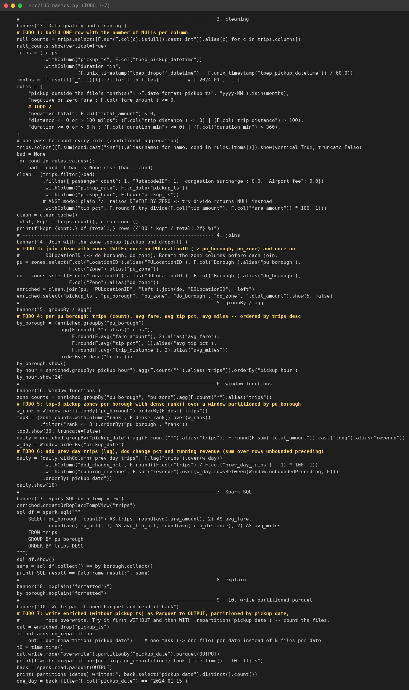

# L05 — PySpark cơ bản: DataFrame, Spark SQL và Spark UI

Môi trường: Spark **4.1.3** (image `spark:4.1.3-python3`, Java 17, Python 3.10), `local[4]`, driver 2 GB, `spark.sql.shuffle.partitions=8`.
Dữ liệu: `yellow_tripdata_2024-01.parquet` (2,964,624 dòng) và `taxi_zone_lookup.csv`.

Log gốc:

| File | Nội dung |
|---|---|
| `01_run_no_repartition.txt` | lần chạy ghi **không** `repartition` |
| `03_run_with_repartition.txt` | lần chạy chính, có `repartition` và `--hold 300` để chụp UI |
| `02_files_no_repartition.txt`, `04_files_with_repartition.txt` | đếm file output |
| `05_ansi_divide_by_zero.txt` | demo ANSI mode |

## File nộp

`l05_basics.py`: đã hoàn thành TODO 1–7.
Thêm cờ `--no-repartition` để chạy thí nghiệm TODO 7 mà không phải sửa code.

## Kết quả chính (khớp đáp án)

| Hạng mục | Kết quả |
|---|---|
| Số dòng / số partition đầu vào | 2,964,624 / 4 |
| 3 transformation (filter, withColumn, select) | **0.096 s**, chưa có job nào |
| `count()` (action) | 228,254 chuyến > 10 dặm, 0.28 s |
| NULL ở 5 cột `passenger_count`, `RatecodeID`, `store_and_fwd_flag`, `congestion_surcharge`, `Airport_fee` | **140,162** mỗi cột |
| Luật làm sạch | ngoài tháng 18 · fare ≤ 0: 38,341 · total < 0: 35,504 · distance: 60,430 · duration: 2,642 |
| Giữ lại sau làm sạch | **2,867,786 / 2,964,624 (96.73 %)** |
| Manhattan | 2,571,810 chuyến, fare 14.92, tip 21.6 %, 2.31 dặm |
| Queens | 257,573 chuyến, fare 52.77, 12.76 dặm (sân bay) |
| Giờ đông nhất | 18:00 (206,163 chuyến) |
| Top-3 Manhattan | Midtown Center 140,065 · UES South 140,059 · UES North 133,891 |
| Top-3 Queens | JFK 138,296 · LaGuardia 87,657 · East Elmhurst 11,861 |
| SQL so với DataFrame | `SQL result == DataFrame result: True` |
| Ghi Parquet phân vùng theo ngày | 31 partition, 73 MB, 8.2 s |
| Đọc lại ngày 2024-01-15 | 74,743 chuyến, có `PartitionFilters` |

Spark 4 bật **ANSI mode** mặc định: `1/0` báo lỗi `[DIVIDE_BY_ZERO]` thay vì trả NULL.
Vì vậy script tính `tip_pct` bằng `F.try_divide`.

## Plan và Spark UI

| Tab | Ảnh | Nhận xét |
|---|---|---|
| Jobs |  | mỗi action (`count`, `showString`, `collect`, `parquet`) sinh ra một hoặc nhiều job |
| Stages |  | có cột Shuffle Read/Write; stage 4 task đọc từ cache |
| Storage |  | DataFrame `clean` được cache: 4/4 partition, **100 %**, **347.3 MiB** trong bộ nhớ |
| SQL (query 10 = `by_borough.show()`) |  | `InMemoryTableScan` 2,867,786 dòng → 2 × `BroadcastHashJoin` (265 dòng) → `HashAggregate` partial: **24 dòng** → `Exchange` |
| Job 22 |  | stage 28 *skipped* (dùng lại shuffle của job 21); stage 29 chạy 1 task, Shuffle Read 2.3 KiB |
| Khác |     | |

## Ghi Parquet phân vùng (TODO 7)

| | Không `repartition` | `repartition("pickup_date")` |
|---|---|---|
| Số file `.parquet` | **56** | **31** (1 file/ngày) |
| File trong `pickup_date=2024-01-15` | 2 | 1 |
| Dung lượng | 74 MB | 73 MB |
| Thời gian ghi | 6.8 s | 8.2 s (thêm 1 shuffle) |

Không `repartition`, mỗi task trong 4 task ghi một file cho **mỗi ngày mà nó chứa**.
Ở đây chỉ ra 56 file chứ không phải 4 × 31 = 124, vì file nguồn gần như đã sắp theo thời gian: mỗi task chỉ chứa một khoảng ngày liền nhau, và các ngày ở ranh giới bị tách thành 2 file.
Với dữ liệu không có thứ tự và hàng trăm task, số file sẽ là N × 31.
Khi đọc lại, `PartitionFilters: [isnotnull(pickup_date), (pickup_date = 2024-01-15)]` cho thấy Spark chỉ mở **một thư mục**.

## Trả lời checkpoint

**Q1.** Spark chia file thành input partition dựa trên:
- `spark.sql.files.maxPartitionBytes`, mặc định 128 MB;
- mục tiêu có ít nhất `defaultParallelism` split (= 4 core với `local[4]`), nên kích thước split được hạ xuống khoảng 48 MB / 4.

Parquet chỉ cắt được ở ranh giới **row group**: task nào nhận được điểm bắt đầu của row group thì đọc row group đó.
Vì vậy dù chỉ có một file 48 MB vẫn ra **4 partition**, và một partition có thể rỗng nếu số row group ít hơn 4.

**Q2.** `filter`, `withColumn` và `select` là **transformation**: chúng chỉ thêm node vào logical plan, không đụng tới dữ liệu, nên mất 0.096 s.
`count()` là **action**: Catalyst tối ưu plan, DAG scheduler tạo stage và task, rồi mới đọc file (0.28 s).
`show`, `collect`, `take`, `write` và `count` cũng là action.
Plan dựng trong vài mili-giây vì đó chỉ là thao tác trên cây biểu thức trong bộ nhớ của driver.

**Q3 (lazy evaluation và DAG).** `by_borough.show()` là SQL query 10. Nó sinh ra **4 job** (19–22) với AQE:

| Job | Stage | Số task | Việc làm |
|---|---|---|---|
| 19 | 25 | 1 | dựng broadcast bảng zone cho **pickup** (`BroadcastExchange`) |
| 20 | 26 | 1 | dựng broadcast bảng zone cho **dropoff** |
| 21 | 27 | **4** | đọc `InMemoryTableScan` (cache), 2 × `BroadcastHashJoin`, `HashAggregate` partial, **ghi shuffle** (`Exchange hashpartitioning(pu_borough, 8)`) |
| 22 | 28 (skipped, dùng lại output của 27), **29** | 1 | `AQEShuffleRead coalesced` (8 → 1 partition), `HashAggregate` final, `TakeOrderedAndProject` cho `orderBy + show` |

- **Ranh giới stage là các toán tử `Exchange` (shuffle).**
- Broadcast chạy thành job riêng.
- Với AQE, mỗi query stage được nộp thành một job riêng, nên stage của job trước hiện là *skipped* trong job sau.
- Khi chạy toàn bộ `by_borough` (ví dụ `collect`), plan còn có `Exchange rangepartitioning(trips DESC, 8)` cho `orderBy`, tức là thêm một stage sort nữa (xem `explain`).
- Không có gì chạy cho tới khi gọi `show()`. Các transformation ở mục 4–5 chỉ dựng DAG.

**Q4.** 5 cột có cùng 140,162 NULL vì đó là **cùng 140,162 chuyến**.
Các bản ghi này được gửi lên thiếu toàn bộ nhóm trường "metadata" (thường từ một vendor hoặc từ chuyến street-hail), chứ không phải 5 lỗi độc lập.
Có ba cách xử lý:
- giữ lại và gán mặc định, như script làm: `passenger_count=1`, `RatecodeID=1`, phụ phí = 0;
- giữ NULL và chỉ loại khỏi các chỉ số cần những cột đó;
- tách ra vùng quarantine.

Cách nào cũng cần thống nhất với chủ dữ liệu và ghi lại trong tài liệu.

**Q5 (đọc formatted plan).** Đọc từ dưới lên:
1. `Scan parquet` với `PushedFilters` (`GreaterThan(fare_amount,0.0)`, `LessThanOrEqual(trip_distance,100.0)`…): luật làm sạch được đẩy xuống reader Parquet.
2. `InMemoryTableScan`: đọc từ cache.
3. 2 × `BroadcastExchange` và `BroadcastHashJoin LeftOuter BuildRight`.
4. `HashAggregate` (22) với `partial_count(1), partial_avg(...)`.
   Mỗi task **gộp trước** các dòng của nó theo `pu_borough`. `avg` được tách thành cặp `(sum, count)`, nên mỗi task chỉ phát ra khoảng 6–8 dòng; tổng cộng **24 dòng** đi qua shuffle thay vì 2.87 triệu.
5. `Exchange hashpartitioning(pu_borough, 8)`: **shuffle**, cũng là ranh giới stage.
6. `AQEShuffleRead coalesced`: AQE gộp 8 partition shuffle nhỏ lại.
7. `HashAggregate` (26) final với `count(1), avg(...)`: gộp các kết quả partial.
8. `Exchange rangepartitioning` và `Sort` cho `orderBy`.

Partial/final aggregate chính là **combiner của L02**. Tách `avg` thành `(sum, count)` cũng giống hệt cách làm ở bài stretch L02 (combiner tính giá cước trung bình).

**Q6.** Bảng zone chỉ có 265 dòng (12 KB, khoảng 1 MB trong bộ nhớ theo `Statistics(sizeInBytes=1026.1 KiB)`), nhỏ hơn nhiều so với `spark.sql.autoBroadcastJoinThreshold` (10 MB).
Spark gửi một bản sao cho mọi task, nên 2.87 triệu chuyến **không phải shuffle**.
Khi cả hai bên đều lớn hơn ngưỡng (hoặc đặt ngưỡng = -1, hoặc thống kê kích thước vượt ngưỡng), Spark shuffle cả hai bên theo key và dùng **SortMergeJoin**. L06 đo sự khác biệt này.

**Q7.** Sau khi `cache()`:
- **Plan** đọc từ `InMemoryRelation`/`InMemoryTableScan` thay vì quét và lọc lại Parquet.
- **Tab Storage** hiện RDD đã cache: 4 partition, 100 %, 347.3 MiB.
- Các action sau nhanh hơn, ví dụ `clean.count()` lần đầu (materialize cache) mất khoảng 6 s, còn các query sau chỉ 0.3–1.5 s.

Cache là ý tồi khi:
- dữ liệu chỉ dùng một lần;
- dữ liệu không vừa bộ nhớ, gây spill, eviction và áp lực GC (347 MiB cache so với 48 MB Parquet nén là hệ số khoảng 7×);
- đọc nguồn vốn đã rẻ (Parquet có column pruning có thể nhanh hơn cache dạng hàng rộng);
- quên `unpersist()`, làm giữ bộ nhớ không cần thiết.

**Q8.** `partitionBy` ghi **một file cho mỗi task × mỗi giá trị partition** mà task đó chứa.
Không `repartition`, mỗi task có thể chứa dòng của nhiều ngày, và số file có thể lên tới N task × 31 ngày. Ở đây đo được 56 file; trên cluster thật sẽ là hàng nghìn file nhỏ, gây hại cho NameNode và cho tốc độ đọc.
`repartition("pickup_date")` shuffle trước để mọi dòng của một ngày về cùng một task, nên ra **đúng 1 file/ngày (31 file)**. Cái giá là thêm một shuffle (6.8 s → 8.2 s).
Cần cẩn thận khi một giá trị quá lớn (skew): một task sẽ phải ghi cả file khổng lồ. Khi đó dùng `repartition(n, "pickup_date", salt)` hoặc `maxRecordsPerFile`.
