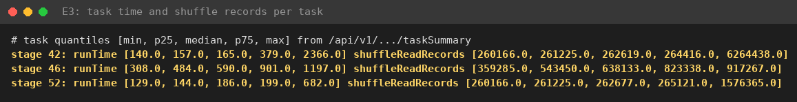
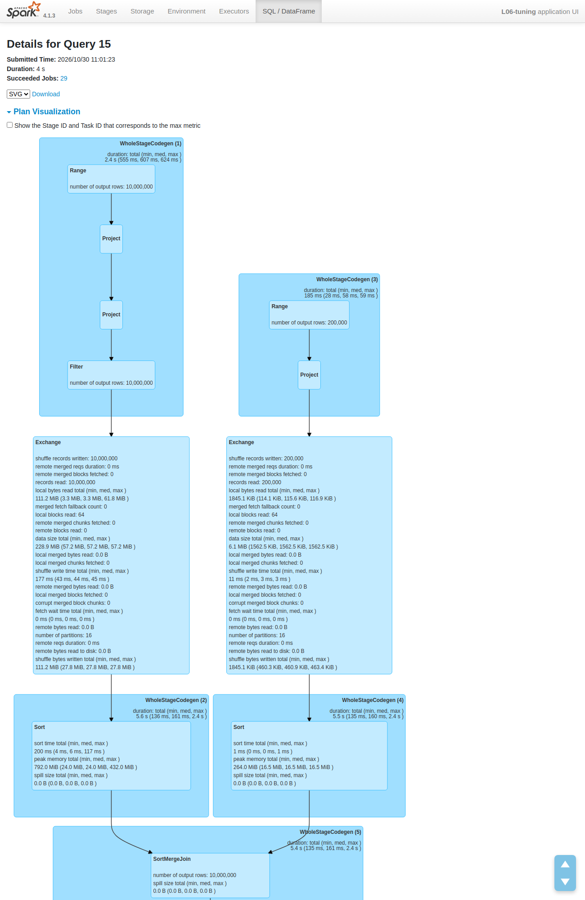
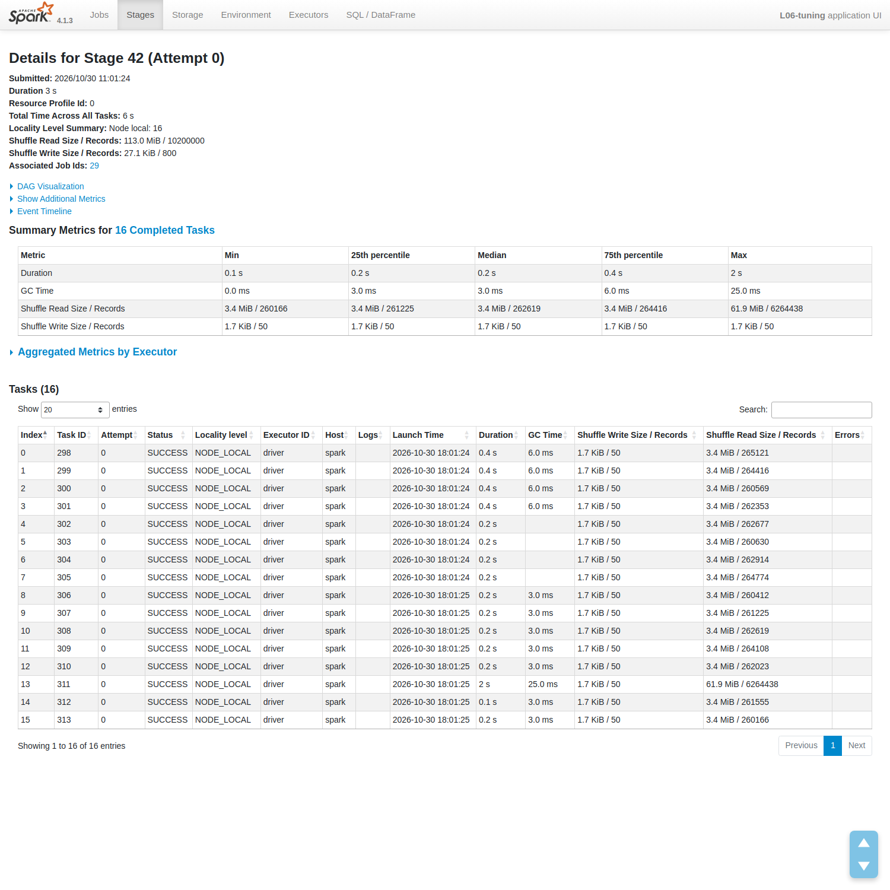
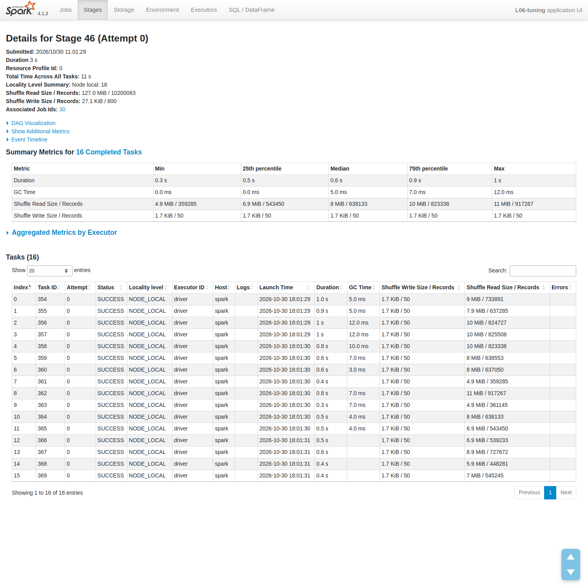
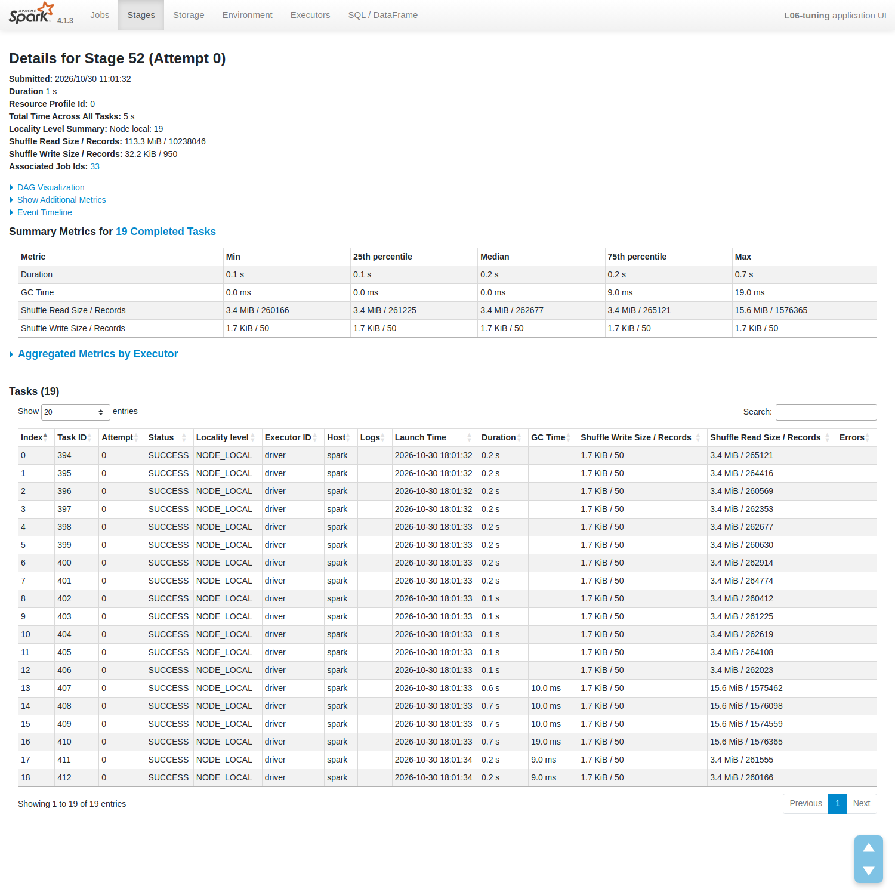
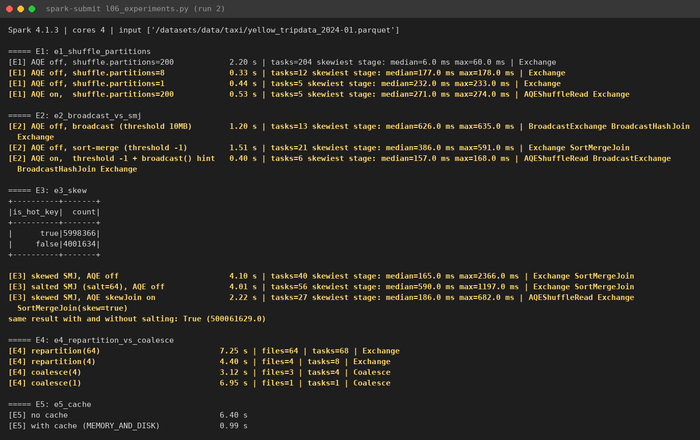
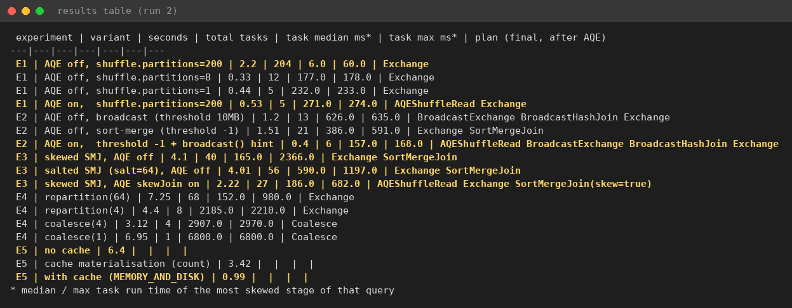
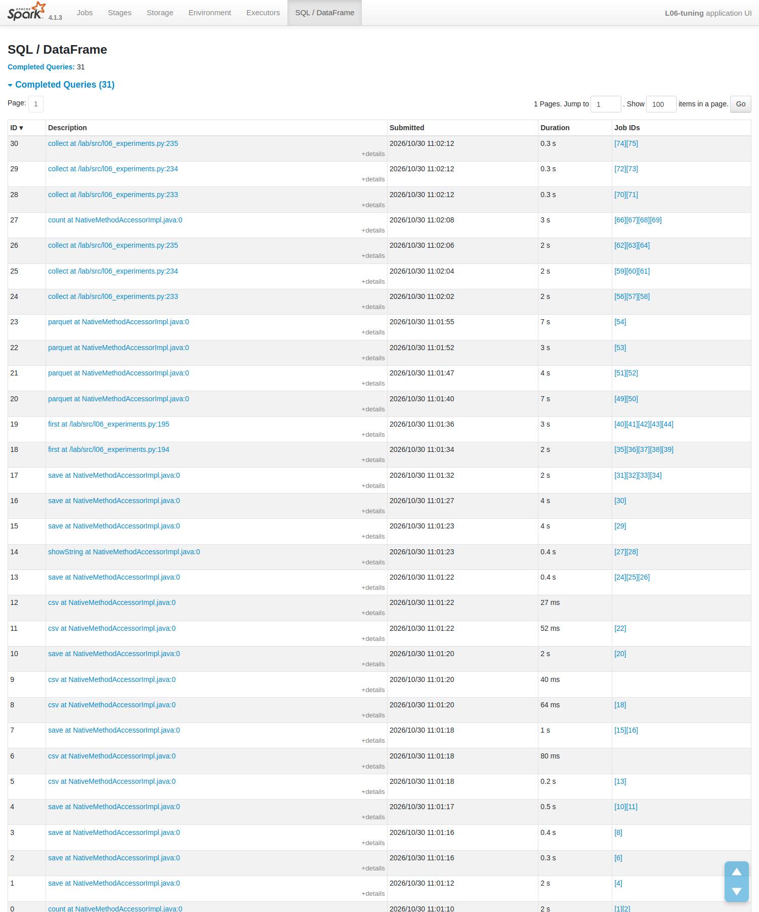

# Tối ưu hiệu năng Spark: shuffle, chiến lược join, data skew, AQE, phân vùng và cache {#sec:l06}

## Mục tiêu và môi trường {#sec:l06-intro}

Lab L06 đo tác dụng của các tham số tinh chỉnh Spark qua năm thí nghiệm: E1 số partition shuffle và cơ chế gộp partition của *Adaptive Query Execution* (AQE); E2 broadcast hash join so với sort-merge join; E3 data skew trong join, xử lý bằng salting và AQE skew join; E4 `repartition` so với `coalesce` trước khi ghi; E5 khi nào `cache`/`persist` có lợi. Mọi thứ chạy trong một container Docker ở chế độ local 4 core (@tbl:l06-env).

| Thành phần | Giá trị |
|---|---|
| Máy chủ | Laptop 12 luồng CPU, 32 GB RAM |
| Ảo hóa | Docker Desktop trên WSL2, cấp 31 GB |
| Spark | 4.1.3 (image `spark:4.1.3-python3`), PySpark |
| Chế độ chạy | `local[4]` (4 core, `defaultParallelism` = 4), driver 2 GB |
| Thu thập số liệu | `time.time()` quanh mỗi action; Spark REST API (`/sql`, `/stages/.../taskSummary`) |
| Ngày thực hiện | 2026-10-30 |

: Môi trường thực nghiệm. {#tbl:l06-env}

Dữ liệu là tập chuyến taxi New York tháng 01/2024 và hai bảng tổng hợp cho E3 (@tbl:l06-data).

| Tập dữ liệu | Nguồn | Kích thước | Dùng trong |
|---|---|---|---|
| Trips | `yellow_tripdata_2024-01.parquet` | 2,964,624 dòng, 47.6 MiB, 3 row group | E1, E2, E4, E5 |
| Zones | `taxi_zone_lookup.csv` | 265 dòng | E2 |
| Fact tổng hợp | `spark.range(10,000,000)`, `HOT_SHARE = 0.6` (key = 0), còn lại rải đều trên 200,000 khóa | 10,000,000 dòng (5,998,366 hot, 4,001,634 thường) | E3 |
| Dim tổng hợp | `spark.range(200,000)`, cột `segment` = `seg_{key % 50}` | 200,000 dòng | E3 |

: Dữ liệu thực nghiệm. {#tbl:l06-data}

Script `l06_experiments.py` chạy một `count()` khởi động không tính giờ, rồi với mỗi biến thể thì đặt lại cấu hình (`reset_conf`), đổi tham số và ép thực thi bằng `df.write.format("noop")` (tính đủ nhưng không ghi file); E4 ghi Parquet thật để đếm file, E5 dùng `collect()`. Sau mỗi action, hàm `last_sql_summary()` gọi REST API [2] lấy các nút của kế hoạch cuối (sau AQE), tổng số task, và median/max thời gian task ở stage lệch nhất (stage có hiệu max trừ median lớn nhất). Chúng tôi chạy cả script hai lần (34 dòng trong `results.csv`) và dùng lần thứ hai; cờ `--hold` giữ Spark UI để chụp kế hoạch và Summary Metrics.

## Thực hiện và kết quả {#sec:l06-results}

### E1: số partition shuffle và AQE coalescing {#sec:l06-e1}

Truy vấn `groupBy(PULocationID, DOLocationID).agg(count, avg)` đọc 47.6 MiB nhưng chỉ ghi khoảng 1167.1 KiB dữ liệu shuffle. Script chạy nó với AQE tắt và `shuffle.partitions` $\in \{200, 8, 1\}$; phần chúng tôi tự viết là biến thể bật AQE, giữ 200 partition. Với 200 partition và AQE tắt, truy vấn sinh 204 task (4 map, 200 reduce), mỗi task reduce chạy khoảng 6 ms, chậm nhất trong E1; kế hoạch chỉ có một `Exchange` 200 partition (@fig:l06-e1off).

{#fig:l06-e1off width=70%}

AQE tối ưu lại kế hoạch trong lúc chạy, dựa trên thống kê thật của stage shuffle đã xong thay vì ước lượng [1]. Bật AQE mà vẫn để 200 partition thì sau `Exchange` xuất hiện `AQEShuffleRead` (@fig:l06-e1on), các partition nhỏ được gộp lại, tổng chỉ còn 5 task, thời gian xấp xỉ bản tinh chỉnh tay 8 partition (@tbl:l06-full). Bản 1 partition cũng nhanh, nhưng chỉ vì kết quả quá nhỏ (khoảng 20 nghìn nhóm), xem @sec:l06-q1.

{#fig:l06-e1on width=70%}

### E2: broadcast hash join và sort-merge join {#sec:l06-e2}

Phép join $\text{trips} \bowtie \text{zones}$ được chạy với `autoBroadcastJoinThreshold` 10 MB, với ngưỡng -1, và (phần tự viết) với ngưỡng -1 kèm gợi ý `F.broadcast(zones_df())`. Khi ngưỡng là -1, Spark phải dùng `SortMergeJoin`: khoảng 3 triệu chuyến bị shuffle cùng bảng zone rồi sort ở cả hai phía (@fig:l06-e2smj). Khi broadcast, chỉ 265 dòng được gửi tới mọi executor và phía trips không có `Exchange` trước join (@fig:l06-e2bhj).

{#fig:l06-e2bhj width=85%}

{#fig:l06-e2smj width=100%}

Đặt ngưỡng -1 chỉ tắt việc chọn broadcast tự động của planner [3]; gợi ý `broadcast()` vẫn có hiệu lực, cho kế hoạch `BroadcastHashJoin` và là biến thể nhanh nhất của E2 (0.40 s, 6 task). Hơi bất ngờ là broadcast tắt AQE (1.20 s) chỉ nhanh hơn SMJ (1.51 s) một chút, có lẽ vì script mặc định chỉ dùng 8 partition nên SMJ ở đây khá nhẹ, cộng thêm dao động giữa các lần chạy (@tbl:l06-runs). Khác biệt thật nằm ở kế hoạch: broadcast bỏ được `Exchange` và `Sort` ở phía bảng lớn, và khoản này sẽ lớn dần theo kích thước dữ liệu.

### E3: data skew, salting và AQE skew join {#sec:l06-e3}

Shuffle băm theo khóa nên mọi bản ghi của khóa 0 (60 % bảng fact) dồn vào một partition. Ba biến thể được chạy: sort-merge join với AQE tắt, salting với 64 giá trị salt, và AQE skew join. Phân vị thời gian task và số bản ghi shuffle đọc mỗi task tại stage join của từng biến thể được lấy qua REST API (@tbl:l06-quantiles, @fig:l06-quantiles).

| Stage (biến thể) | Thời gian task (ms) | Bản ghi shuffle đọc / task |
|---|---|---|
| 42: baseline, AQE off | 140 / 157 / 165 / 379 / 2,366 | 260,166 / 261,225 / 262,619 / 264,416 / 6,264,438 |
| 46: salting 64 | 308 / 484 / 590 / 901 / 1,197 | 359,285 / 543,450 / 638,133 / 823,338 / 917,267 |
| 52: AQE skew join | 129 / 144 / 186 / 199 / 682 | 260,166 / 261,225 / 262,677 / 265,121 / 1,576,365 |

: Phân vị min / 25 % / median / 75 % / max tại stage join của E3 (lần chạy thứ hai). {#tbl:l06-quantiles}

{#fig:l06-quantiles width=85%}

*Baseline.* Kế hoạch là `Exchange` + `SortMergeJoin` với 16 partition (@fig:l06-e3base). Ở stage 42, task chậm nhất lâu hơn median khoảng 14 lần. Theo Summary Metrics (@fig:l06-stage42), task này đọc 61.9 MiB, trong khi các task khác chỉ khoảng 3.4 MiB. Cả stage đọc 113.0 MiB / 10,200,000 bản ghi qua 16 task. Trong lúc task đó chạy, ba core còn lại không có việc.

{#fig:l06-e3base width=85%}

{#fig:l06-stage42 width=100%}

*Salting.* Chỉ hot key được gắn salt ngẫu nhiên 0..63, dòng dim tương ứng được nhân lên 64 bản, rồi join theo `(key, salt)`. Task max giảm gần một nửa và số bản ghi lớn nhất mỗi task chỉ còn chưa tới một triệu (@fig:l06-stage46). Bù lại, median tăng lên 590 ms (lý do ở @sec:l06-q3) và thời gian tổng gần như đứng yên (4.01 s so với 4.10 s). Tổng `amount` vẫn đúng (500061629), nên salting không làm sai kết quả.

{#fig:l06-stage46 width=100%}

*AQE skew join.* Cấu hình bật AQE và skew join, đặt `advisoryPartitionSizeInBytes=4m`, `skewedPartitionThresholdInBytes=16m`, `skewedPartitionFactor=3` và tắt coalesce. Kế hoạch cuối có `SortMergeJoin(skew=true)`, và `AQEShuffleRead` báo *number of skewed partitions: 1, skewed partition splits: 4, number of partitions: 19* (@fig:l06-e3aqe). Phía fact ghi 10,000,000 bản ghi shuffle (111.2 MiB); sau khi đọc, partition có median 3.5 MiB và max 16.7 MiB. Ở stage 52, số bản ghi lớn nhất mỗi task xấp xỉ một phần tư của baseline, đúng với 4 split (@fig:l06-stage52). Thời gian tổng còn **2.22 s, nhanh gần gấp đôi baseline**, mà không phải sửa dòng truy vấn nào. Lúc đầu chúng tôi để ngưỡng mặc định thì AQE không tách gì, vì partition nóng chỉ có 61.9 MiB, thấp hơn nhiều so với mức 256 MB mặc định, nên phải hạ ngưỡng như trên.

{#fig:l06-e3aqe width=85%}

{#fig:l06-stage52 width=100%}

### E4: repartition và coalesce trước khi ghi {#sec:l06-e4}

Trips được ghi ra Parquet theo bốn cách: `repartition(64)`, `repartition(4)`, `coalesce(4)`, `coalesce(1)`. `repartition(64)` chậm nhất vì vừa có một shuffle đầy đủ vừa ghi 64 file nhỏ. `coalesce(4)` không shuffle nên nhanh nhất, nhưng chỉ ra 3 file chứ không phải 4. Ban đầu chúng tôi nghĩ có lỗi; xem lại thì file Parquet đầu vào chỉ có 3 row group nên một trong 4 partition đầu vào rỗng. `coalesce(1)` dồn cả đọc lẫn ghi vào một task và mất hết song song, còn `repartition(4)` cho 4 file đều nhau với giá một shuffle (@tbl:l06-full).

### E5: cache {#sec:l06-e5}

DataFrame "cleaned" gồm một phép lọc và `dropDuplicates` trên năm cột, tức là shuffle toàn bộ khoảng 3 triệu dòng. Nó được dùng cho ba phép tổng hợp (theo giờ, theo `PULocationID`, theo `payment_type`), lần đầu không cache, lần sau với `persist(MEMORY_AND_DISK)`. Không cache thì dedup chạy lại ba lần. Có cache thì `count()` để materialize mất 3.42 s và trả về 2,869,714 dòng, sau đó ba truy vấn chỉ còn **0.99 s**. Tab Storage (@fig:l06-storage) cho thấy 8/8 partition đã được cache (100 %), chiếm 59.4 MiB bộ nhớ và 0.0 B đĩa, mức `Disk Memory Serialized 1x Replicated`; REST API báo `memoryUsed` = 62,240,847 byte. Tính cả thời gian materialize, cache vẫn lời (khoảng 4.4 s so với 6.4 s).

{#fig:l06-storage width=100%}

### Bảng kết quả và độ ổn định {#sec:l06-record}

Theo đề, bảng ghi nhận là của lần chạy thứ hai. @fig:l06-console là đầu ra console của lần chạy thứ hai, @fig:l06-table là bảng Markdown script in ra ở cuối, và @tbl:l06-full gom đủ 17 biến thể; hai cột median/max là thời gian task ở stage lệch nhất. Tab SQL của phiên có giữ UI liệt kê 31 truy vấn đã xong (@fig:l06-sqllist), chúng tôi dùng danh sách này để tìm kế hoạch của từng biến thể.

{#fig:l06-console width=100%}

{#fig:l06-table width=100%}

| Thí nghiệm | Biến thể | Thời gian (s) | Tổng task | Median (ms) | Max (ms) | Kế hoạch cuối | Ghi chú |
|---|---|---|---|---|---|---|---|
| E1 | AQE off, shuffle.partitions=200 | 2.20 | 204 | 6 | 60 | Exchange | |
| E1 | AQE off, shuffle.partitions=8 | 0.33 | 12 | 177 | 178 | Exchange | |
| E1 | AQE off, shuffle.partitions=1 | 0.44 | 5 | 232 | 233 | Exchange | |
| E1 | AQE on, shuffle.partitions=200 | 0.53 | 5 | 271 | 274 | AQEShuffleRead Exchange | AQE gộp partition nhỏ |
| E2 | AQE off, broadcast (threshold 10MB) | 1.20 | 13 | 626 | 635 | BroadcastExchange BroadcastHashJoin Exchange | |
| E2 | AQE off, sort-merge (threshold -1) | 1.51 | 21 | 386 | 591 | Exchange SortMergeJoin | |
| E2 | AQE on, threshold -1 + broadcast() hint | 0.40 | 6 | 157 | 168 | AQEShuffleRead BroadcastExchange BroadcastHashJoin Exchange | hint thắng threshold |
| E3 | skewed SMJ, AQE off | 4.10 | 40 | 165 | **2366** | Exchange SortMergeJoin | |
| E3 | salted SMJ (salt=64), AQE off | 4.01 | 56 | 590 | 1197 | Exchange SortMergeJoin | cùng kết quả (500061629) |
| E3 | skewed SMJ, AQE skewJoin on | 2.22 | 27 | 186 | 682 | AQEShuffleRead Exchange SortMergeJoin(skew=true) | 1 partition skew, 4 split |
| E4 | repartition(64) | 7.25 | 68 | 152 | 980 | Exchange | 64 file |
| E4 | repartition(4) | 4.40 | 8 | 2185 | 2210 | Exchange | 4 file |
| E4 | coalesce(4) | 3.12 | 4 | 2907 | 2970 | Coalesce | 3 file |
| E4 | coalesce(1) | 6.95 | 1 | 6800 | 6800 | Coalesce | 1 file |
| E5 | no cache (3 queries) | 6.40 | | | | | 3 aggregation |
| E5 | cache materialisation (count) | 3.42 | | | | | 2,869,714 dòng, 59.4 MiB |
| E5 | with cache (3 queries) | 0.99 | | | | | 3 aggregation |

: Kết quả đầy đủ của lần chạy thứ hai (17 biến thể). {#tbl:l06-full}

{#fig:l06-sqllist width=85%}

Lần chạy đầu (tổng 71.71 s) cho cùng xu hướng ở mọi thí nghiệm, phần lớn chênh lệch nằm trong khoảng ±20 % mà đề bài cho phép (@tbl:l06-runs). Ngoại lệ là các biến thể rất ngắn như E2 broadcast tắt AQE và E1 một partition: với truy vấn dưới một giây, vài trăm mili giây dao động đã là tỉ lệ lớn, nên chúng tôi không rút kết luận từ chênh lệch nhỏ giữa các biến thể loại này. Vì chạy local một máy, không có chi phí mạng, cột max/median đáng tin hơn thời gian tuyệt đối.

| Chỉ số | Lần 1 | Lần 2 |
|---|---|---|
| E1, 200 partition, AQE off | 2.15 s | 2.20 s |
| E1, 1 partition, AQE off | 0.30 s | 0.44 s |
| E2, broadcast, AQE off | 0.77 s | 1.20 s |
| E3 baseline, task max | 2,686 ms | 2,366 ms |
| E3 salting | 4.28 s | 4.01 s |
| E3 AQE skew join | 2.28 s | 2.22 s |
| E5 không cache | 6.07 s | 6.40 s |
| E5 với cache | 0.88 s | 0.99 s |

: So sánh một số chỉ số giữa hai lần chạy. {#tbl:l06-runs}

So với bảng tham chiếu của đề (Apple M-series, Docker 4 GB, `local[4]`), thời gian trên máy chúng tôi cao hơn khoảng 1.3 đến 1.9 lần, có thể do khác phần cứng và thêm lớp WSL2, nhưng mọi xu hướng đều khớp, kể cả việc `coalesce(4)` ra 3 file (@tbl:l06-ref). Chỗ khác là số task của AQE skew join, vì số partition sau khi tách phụ thuộc kích thước partition thực tế lúc chạy.

| Chỉ số | Tham chiếu | Lần 2 |
|---|---|---|
| E1, 200 partition, AQE off | 1.29 s | 2.20 s |
| E1, AQE on | 0.21 s | 0.53 s |
| E2, broadcast hint | 0.24 s | 0.40 s |
| E3 baseline (median / max task) | 110 / 1,263 ms | 165 / 2,366 ms |
| E3 salting | 2.97 s | 4.01 s |
| E3 AQE skew join (thời gian, task) | 1.73 s, 43 task | 2.22 s, 27 task |
| E4 coalesce(4) | 1.85 s, 3 file | 3.12 s, 3 file |
| E5 không cache / có cache | 4.11 / 0.70 s | 6.40 / 0.99 s |

: So sánh với bảng kết quả tham chiếu của bài lab. {#tbl:l06-ref}

## Trả lời câu hỏi checkpoint {#sec:l06-discussion}

### Vì sao 200 partition chậm, và vì sao không nên đặt 1 partition dù nó chạy nhanh? {#sec:l06-q1}

Dữ liệu shuffle của E1 chưa tới 1.2 MiB (@sec:l06-e1). Chia ra 200 phần thì mỗi task reduce chỉ làm việc khoảng 6 ms, còn chi phí lập lịch, serialize và khởi tạo của 204 task lớn hơn phần việc thật, nên bản này chậm hơn bản 8 partition khoảng 6.7 lần (@tbl:l06-full). Một partition chạy nhanh ở đây chỉ vì shuffle quá nhỏ. Với dữ liệu thật, một reducer phải ôm toàn bộ dữ liệu shuffle: không có song song, dễ spill ra đĩa và dễ OOM. Thực tế nên nhắm khoảng 100–200 MB mỗi partition shuffle, hoặc để AQE tự quyết.

### `AQEShuffleRead coalesced` làm gì, và AQE biết gì mà planner tĩnh không biết? {#sec:l06-q2}

Khi stage map của shuffle chạy xong, AQE có kích thước thật của từng partition shuffle (*map output statistics*). `AQEShuffleRead coalesced` cho một reducer đọc gộp nhiều partition nhỏ liền kề cho tới khi đạt `advisoryPartitionSizeInBytes`; trong E1, 200 partition chỉ còn một task reduce và tổng số task giảm từ 204 xuống 5 (@fig:l06-e1on). Planner tĩnh chỉ có ước lượng dựa trên kích thước file, và ước lượng này hay sai sau filter, join hoặc aggregate.

### Con số nào cho thấy skew, vì sao salting không rút ngắn thời gian tổng trên 4 core, và khi nào salting thắng? {#sec:l06-q3}

Bằng chứng là chênh lệch giữa task max và median ở stage join của baseline: **2,366 ms so với 165 ms**, và task chậm nhất đọc 6,264,438 bản ghi trong khi median là 262,619 (@tbl:l06-quantiles, @fig:l06-stage42).

Salting cắt được task max (@fig:l06-stage46) nhưng thời gian tổng gần như không đổi. Một phần vì salting thêm việc ở mọi chỗ: `rand()` cho từng dòng, thêm cột join, nhân dòng dim lên 64 lần. Phần lớn hơn là khoảng 6 triệu dòng hot vẫn phải chia trên 16 partition chạy trên 4 core: tổng khối lượng việc không giảm, chỉ được chia lại, nên median tăng. Lần chạy đầu cũng vậy, salting chỉ nhanh hơn baseline một chút (4.28 s so với 4.62 s), còn bảng tham chiếu của đề thậm chí ghi salting chậm hơn (2.97 s so với 2.45 s). Salting sẽ thắng rõ khi có nhiều core và nhiều partition, vì lúc đó một straggler giữ hàng trăm executor rảnh; nó cũng có lợi khi mỗi dòng xử lý nặng (dòng rộng, join many-to-many, có spill) hoặc khi skew nặng hơn, ví dụ 90 % hot.

### AQE nhận ra partition lệch thế nào, xử lý ra sao, và kém salting ở đâu? {#sec:l06-q4}

Một partition bị coi là lệch khi nó vừa lớn hơn `skewedPartitionFactor` lần median, vừa lớn hơn `skewedPartitionThresholdInBytes` [1]. Mặc định là 5 lần và 256 MB; bài lab hạ xuống 3 lần và 16 MB cho vừa dữ liệu nhỏ. Partition hot ở đây là 61.9 MiB so với median 3.4 MiB, thỏa cả hai điều kiện. AQE tách partition đó theo các khoảng map output (4 split, nên 16 partition thành 19), rồi nhân bản partition tương ứng ở phía còn lại; kế hoạch hiện `SortMergeJoin(skew=true)` (@fig:l06-e3aqe), và số bản ghi lớn nhất mỗi task xấp xỉ một phần tư baseline (@tbl:l06-quantiles).

AQE có mấy giới hạn mà salting không có. Nó chỉ áp dụng cho join có shuffle ở cả hai phía (sort-merge hoặc shuffled hash join), và không tách được phía phải giữ nguyên của outer join. Ngưỡng phải hợp với dữ liệu, nếu không nó sẽ không kích hoạt, đúng như chúng tôi gặp ở E3. Quan trọng nhất, AQE không xử lý skew trong `groupBy` hay skew phát sinh sau join, trong khi salting hoặc aggregate hai pha làm được.

### Khi nào không nên broadcast dù một phía "nhỏ"? {#sec:l06-q5}

Không nên broadcast khi bảng vẫn lớn lúc nằm trong bộ nhớ, vì driver phải collect rồi gửi bản sao tới mọi executor, dễ OOM ở driver hoặc broadcast timeout. Cũng không nên khi thống kê đánh giá thấp kích thước thật (sau filter hoặc UDF), khi join là full outer join hoặc phía cần broadcast lại là phía được giữ của outer join, và khi join chạy lặp lại trên dữ liệu thay đổi nên mỗi lần phải dựng lại broadcast. Bảng zones trong E2 chỉ có 265 dòng và không rơi vào trường hợp nào ở trên, nên broadcast là đúng (@fig:l06-e2bhj).

### `repartition(n)` hay `coalesce(n)`: cái nào shuffle, cái nào tạo file lệch, cái nào làm giảm song song stage trước? {#sec:l06-q6}

`repartition(n)` luôn shuffle, nhờ vậy partition cân bằng (4 file đều nhau) và stage trước giữ được mức song song, cái giá là thêm một shuffle. `coalesce(n)` gộp partition có sẵn qua phụ thuộc hẹp, không shuffle nên rẻ hơn, nhưng file ra có thể lệch: ở E4 chỉ có 3 file vì đầu vào chỉ có 3 row group. Cũng vì là phụ thuộc hẹp, `coalesce` kéo luôn stage trước về cùng số task [4]; `coalesce(1)` đọc và ghi trong một task duy nhất (@tbl:l06-full).

### Vì sao cache có ích trong E5, còn cache một DataFrame rẻ thì thường không? {#sec:l06-q7}

DataFrame được cache trong E5 là kết quả của một bước đắt (`dropDuplicates`, shuffle toàn bộ khoảng 3 triệu dòng) và được dùng lại ba lần, nên cache giúp bước này chỉ chạy một lần thay vì ba (@sec:l06-e5, @fig:l06-storage). Một phép quét Parquet chỉ lấy vài cột vốn đã rẻ nhờ đọc vectorized, column pruning và predicate pushdown; cache nó chỉ tốn thêm bộ nhớ và thời gian materialize. Nguyên tắc là cache cái gì vừa đắt vừa được dùng lại, xong thì gọi `unpersist()`.

### Nên tinh chỉnh gì trước khi thêm phần cứng? {#sec:l06-q8}

1. Đọc kế hoạch và Spark UI: tìm stage chậm nhất, spill, thời gian GC, và tỉ lệ task max/median để phát hiện skew (như @tbl:l06-quantiles).
2. Lọc và chọn cột càng sớm càng tốt: partition pruning, predicate/column pushdown, dùng định dạng cột (Parquet/ORC).
3. Để partition shuffle có kích thước hợp lý: bật AQE (coalesce và skew join), nhắm khoảng 100–200 MB mỗi partition.
4. Chọn đúng kiểu join: broadcast bảng nhỏ; nếu có skew thì dùng AQE skew join, salting, hoặc tách hot key.
5. Tránh UDF Python (dùng hàm built-in hoặc pandas UDF), chỉ cache khi cần, và tránh sinh file nhỏ khi ghi (repartition hoặc compaction).

## Khuyến nghị cho job production trên cluster 20 node {#sec:l06-reco}

Mỗi khuyến nghị ứng với một thí nghiệm, đặt trong bối cảnh nhiều core hơn hẳn `local[4]`:

1. E1: bật AQE, đặt `shuffle.partitions` ban đầu khoảng 2–3 lần tổng số core (400–800) và để `coalescePartitions` gộp về khoảng 64–128 MB mỗi partition; không đặt cứng 1 hay 8.
2. E2: broadcast bảng dimension nhỏ, có thể nâng `autoBroadcastJoinThreshold` lên khoảng 50–100 MB nếu executor đủ bộ nhớ, dùng `broadcast()` khi thống kê sai.
3. E3: để AQE skew join chạy với ngưỡng mặc định; với hot key đã biết hoặc skew trong `groupBy`/outer join thì dùng salting hoặc tách hot key.
4. E4: ghi bằng `repartition(n)` hoặc `repartition(col)` để mỗi file khoảng 128 MB–1 GB; tránh `coalesce(1)` trên dữ liệu lớn.
5. E5: chỉ `persist(MEMORY_AND_DISK)` kết quả đắt được dùng lại ít nhất hai lần, rồi `unpersist()` ngay.

## Kết luận {#sec:l06-conclusion}

Cả năm thí nghiệm đã chạy hai lần, các phần mã tự viết (AQE trong E1, gợi ý broadcast trong E2, salting và AQE skew join trong E3) đều cho kế hoạch như đề yêu cầu. Ngay trên một máy, khác biệt đã đo được: số partition shuffle không hợp làm truy vấn chậm khoảng 6.7 lần và AQE tự sửa được; skew lộ rõ qua tỉ lệ task max/median khoảng 14 lần; AQE skew join giảm gần một nửa thời gian tổng mà không sửa truy vấn, còn salting chỉ chia lại việc khi số core có hạn; `coalesce` rẻ nhưng có thể sinh file lệch; cache chỉ có lợi khi kết quả đắt và được dùng lại.

## Tài liệu tham khảo {.unnumbered}

[1] The Apache Software Foundation, "Performance Tuning – Spark SQL, DataFrames and Datasets," Apache Spark Documentation. https://spark.apache.org/docs/latest/sql-performance-tuning.html

[2] The Apache Software Foundation, "Monitoring and Instrumentation (REST API)," Apache Spark Documentation. https://spark.apache.org/docs/latest/monitoring.html

[3] M. Armbrust *et al.*, "Spark SQL: Relational Data Processing in Spark," in *Proc. ACM SIGMOD International Conference on Management of Data*, 2015.

[4] B. Chambers and M. Zaharia, *Spark: The Definitive Guide*. Sebastopol, CA: O'Reilly Media, 2018.

## Phụ lục: Trích đoạn mã nguồn {.unnumbered}

Các tệp nộp kèm được liệt kê ở @tbl:l06-files.

| Tệp | Nội dung |
|---|---|
| `l06_experiments.py` | Script thí nghiệm đã hoàn thành |
| `results.csv`, `RESULTS.md` | 34 dòng (2 lần × 17 biến thể); bảng lần chạy thứ hai và nhận xét |
| `01_run1.txt`, `02_run2.txt`, `03_e3_task_quantiles.txt` | Log hai lần chạy; phân vị task ba stage join E3 |

: Danh mục tệp nộp kèm. {#tbl:l06-files}

Ở E1, chúng tôi bật lại AQE nhưng giữ 200 partition để xem AQE tự gộp:

```python
set_conf(spark__sql__adaptive__enabled=True, spark__sql__shuffle__partitions=200)
run("E1", "AQE on,  shuffle.partitions=200", q(), "AQE coalesces small shuffle partitions")
```

Ở E2, ngưỡng được để ở -1 nhưng gắn gợi ý broadcast cho bảng zones:

```python
set_conf(spark__sql__adaptive__enabled=True, spark__sql__autoBroadcastJoinThreshold=-1)
run("E2", "AQE on,  threshold -1 + broadcast() hint",
    trips_df().join(F.broadcast(zones_df()), F.col("PULocationID") == F.col("LocationID"))
    .groupBy("Borough").agg(F.count("*").alias("trips")),
    "an explicit hint beats the threshold")
```

Salting ở E3 chỉ gắn salt cho hot key; phía dim nhân dòng hot lên `SALT` = 64 bản:

```python
hot = F.col("key") == 0
fact_s = fact.withColumn(
    "salt", F.when(hot, (F.rand(seed=5) * SALT).cast("int")).otherwise(F.lit(0)))
salts = spark.range(SALT).select(F.col("id").cast("int").alias("salt"))
dim_s = (dim.filter(~hot).withColumn("salt", F.lit(0))
         .unionByName(dim.filter(hot).crossJoin(salts)))
salted = (fact_s.join(dim_s, ["key", "salt"])
          .groupBy("segment").agg(F.sum("amount").alias("amount")))
run("E3", f"salted SMJ (salt={SALT}), AQE off", salted)
```

Biến thể cuối của E3 bật AQE skew join và hạ ngưỡng cho vừa dữ liệu cỡ lab, đồng thời tắt coalesce để thấy rõ phần tách:

```python
set_conf(spark__sql__adaptive__enabled=True,
         spark__sql__adaptive__skewJoin__enabled=True,
         spark__sql__adaptive__coalescePartitions__enabled=False,
         spark__sql__adaptive__advisoryPartitionSizeInBytes="4m",
         spark__sql__adaptive__skewJoin__skewedPartitionThresholdInBytes="16m",
         spark__sql__adaptive__skewJoin__skewedPartitionFactor=3)
run("E3", "skewed SMJ, AQE skewJoin on",
    fact.join(dim, "key").groupBy("segment").agg(F.sum("amount")),
    "look for AQEShuffleRead (skewed) in the SQL tab")
```
