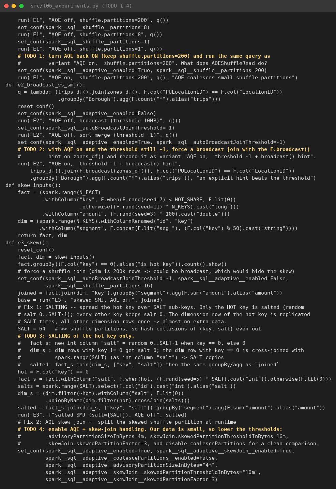

# L06 — Spark performance: shuffle, join, skew, AQE, partitioning, cache

Môi trường: Spark 4.1.3 `local[4]`, driver 2 GB. Dữ liệu: taxi 2024-01 (2.96 triệu dòng) và một fact tổng hợp 10 triệu dòng, trong đó 60 % có key = 0.
Script được chạy **2 lần**; báo cáo dùng lần 2.

## File nộp

| File | Nội dung |
|---|---|
| `l06_experiments.py` | TODO 1–4: E1 AQE on, E2 hint `broadcast()`, E3 salting và AQE skew join |
| `results.csv` | 34 dòng (2 lần chạy × 17 variant) |
| `RESULTS.md` | bảng lần 2, nhận xét E1–E5, khuyến nghị cho cluster 20 node |
| `01_run1.txt`, `02_run2.txt` | log console |
| `03_e3_task_quantiles.txt` | phân vị thời gian task và số bản ghi shuffle/task (REST API) |

## Bảng kết quả (lần 2)

Bảng đầy đủ, nhận xét từng thí nghiệm và khuyến nghị nằm trong [`RESULTS.md`](RESULTS.md).

## Bằng chứng trên Spark UI

| | |
|---|---|
| **E1**: AQE off, 200 partition → `Exchange` 200 partition |  |
| **E1**: AQE on → `AQEShuffleRead` *coalesced* |  |
| **E2**: `BroadcastExchange` + `BroadcastHashJoin` |  |
| **E2**: threshold -1 → `Exchange` + `Sort` hai phía + `SortMergeJoin` |  |
| **E3**: baseline SMJ |  |
| **E3**: AQE → `AQEShuffleRead` (*skewed partitions: 1, splits: 4, partitions: 19*) + `SortMergeJoin(skew=true)` |  |
| **E5**: Storage tab, `cleaned` cache 8/8 partition, 100 %, 59.4 MiB |  |
| Danh sách SQL query |  |

### Skew: Summary Metrics của stage join

| Stage | Task time min / median / max | Shuffle records median / max |
|---|---|---|
| 42: baseline, AQE off | 140 / 165 / **2,366 ms** | 262,619 / **6,264,438** (61.9 MiB, so với 3.4 MiB) |
| 46: salting 64 | 308 / 590 / 1,197 ms | 638,133 / 917,267 |
| 52: AQE skew join | 129 / 186 / 682 ms | 262,677 / 1,576,365 (≈ 6.26 M / 4) |

## Trả lời checkpoint

**Q1.** Kết quả `groupBy(PU, DO)` chỉ có vài MB, khoảng 20 nghìn nhóm. 200 partition nghĩa là 204 task, mỗi task chạy 6 ms; chi phí lập lịch, serialize và khởi tạo task áp đảo, nên mất 2.2 s so với 0.33 s khi dùng 8 partition.
`shuffle.partitions=1` nhanh ở đây chỉ vì dữ liệu shuffle tí hon.
Trên dữ liệu thật, một reducer phải xử lý **toàn bộ** shuffle: không có song song, spill ra đĩa, dễ OOM.
Quy tắc: khoảng 100–200 MB mỗi partition shuffle, hoặc để AQE tự quyết.

**Q2.** Sau khi stage map của shuffle chạy xong, AQE có **thống kê thật** về kích thước từng partition shuffle (map output statistics).
`AQEShuffleRead coalesced` cho một reducer đọc gộp nhiều partition nhỏ liền kề cho tới khi đạt `advisoryPartitionSizeInBytes`. Nhờ đó 200 partition chỉ còn 1 task reduce (tổng 5 task, thay vì 204).
Planner tĩnh chỉ có **ước lượng** (kích thước file), và ước lượng thường sai sau filter, join hay aggregate.

**Q3.** Con số chứng minh skew là **task max ≫ median** ở stage join: 2,366 ms so với 165 ms (khoảng 14×).
Task đó đọc 6.26 triệu bản ghi trong khi median chỉ 262 nghìn.
Salting giảm straggler (max 1,197 ms) nhưng **wall-clock gần như không đổi** (4.10 → 4.01 s). Lý do:
- Nó thêm việc ở mọi nơi: `rand()` cho mỗi dòng, thêm cột join, 64 bản sao dim.
- 6 triệu dòng hot vẫn phải chia trên 16 partition × 4 core, nên median tăng từ 165 lên 590 ms. Với 4 core, tổng công việc là như nhau, chỉ phân bổ lại.

Salting thắng rõ khi có **nhiều core và partition**: straggler sẽ giữ hàng trăm executor ngồi chờ. Nó cũng thắng khi công việc trên mỗi dòng nặng (dòng rộng, join many-to-many, spill), hoặc khi skew nặng hơn (ví dụ 90 % hot).

**Q4.** Một partition bị coi là skew khi kích thước của nó **lớn hơn `skewedPartitionFactor` × median** **và** lớn hơn `skewedPartitionThresholdInBytes`.
- Mặc định là 5× và 256 MB; lab hạ xuống 3× và 16 MB.
- Ở đây partition hot 61.9 MiB so với median 3.4 MiB.

AQE **tách** partition đó thành nhiều task theo khoảng map output (ở đây 4 split, nên 16 → 19 partition), rồi **nhân bản** partition tương ứng của phía bên kia. Plan khi đó hiện `SortMergeJoin(skew=true)`.

Giới hạn của AQE so với salting:
- chỉ áp dụng cho join có shuffle ở cả hai phía (SMJ hoặc shuffled hash);
- không áp dụng cho mọi kiểu join (không tách được phía cần giữ nguyên của outer join);
- cần ngưỡng hợp với dữ liệu;
- **không xử lý skew trong `groupBy`** hay skew sau join. Salting, hay aggregate hai pha, xử lý được những trường hợp này.

**Q5.** Không nên broadcast dù một bên "nhỏ" khi:
- bảng đó vẫn lớn trong bộ nhớ: driver phải collect trước rồi gửi bản sao tới mọi executor, gây OOM driver hoặc broadcast timeout;
- thống kê **đánh giá thấp** kích thước, ví dụ sau filter hay UDF;
- là **full outer join** (không hỗ trợ), hoặc phía cần broadcast là phía được giữ của outer join;
- join chạy lặp lại nhiều lần trên dữ liệu thay đổi, nên mỗi lần phải dựng lại broadcast.

**Q6.**
- `repartition(n)` **luôn shuffle**: partition cân bằng (4 file đều nhau), và stage trước giữ nguyên song song. Cái giá là thêm một shuffle (4.40 s).
- `coalesce(n)` gộp partition sẵn có **không shuffle**: rẻ (3.12 s), nhưng **có thể tạo file lệch**. Ở đây chỉ ra 3 file vì input chỉ có 3 row group, nên một partition rỗng.
- Vì `coalesce` là narrow dependency, nó **giảm song song của cả stage trước**: `coalesce(1)` chạy scan và ghi trong **1 task** (6,800 ms).

**Q7.** DataFrame được cache là kết quả của một bước **đắt** (`dropDuplicates`, shuffle toàn bộ khoảng 3 triệu dòng) và được dùng lại 3 lần.
- Không cache: dedup chạy 3 lần, 6.40 s.
- Có cache: dedup chạy 1 lần (3.42 s) rồi 3 query chỉ còn 0.99 s.

Một scan Parquet thuần, đã prune cột, thì vốn rẻ: đọc vectorized, có column pruning và predicate pushdown. Cache khi đó chỉ tốn bộ nhớ và thời gian materialize, gần như không lợi.
Quy tắc: cache cái **đắt và được dùng lại**, rồi `unpersist()`.

**Q8.** Checklist trước khi mua thêm phần cứng:
1. **Đọc plan và Spark UI**: tìm stage chậm nhất, spill, GC, và tỉ lệ task max/median để phát hiện skew.
2. **Lọc và chọn cột sớm**: partition pruning, predicate/column pushdown, dùng định dạng cột (Parquet/ORC).
3. **Kích thước partition shuffle hợp lý**: bật AQE (coalesce và skew join), khoảng 100–200 MB mỗi partition.
4. **Chọn đúng chiến lược join**: broadcast bảng nhỏ; với skew thì dùng AQE skew join, salting, hoặc tách hot key.
5. **Tránh UDF Python** (dùng hàm built-in hoặc pandas UDF), **cache có chọn lọc**, và **tránh file nhỏ** khi ghi (repartition hoặc compaction).
